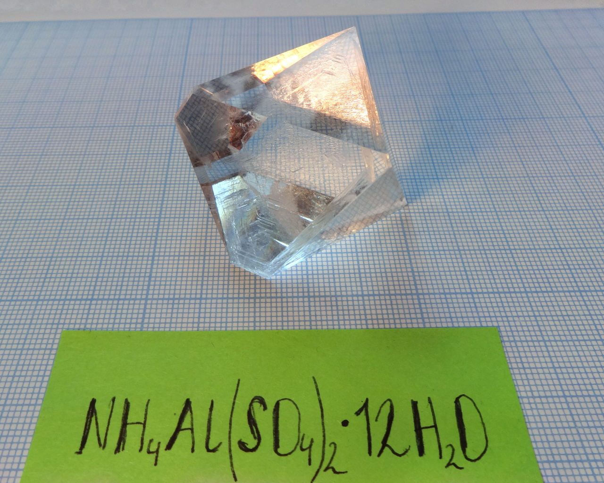
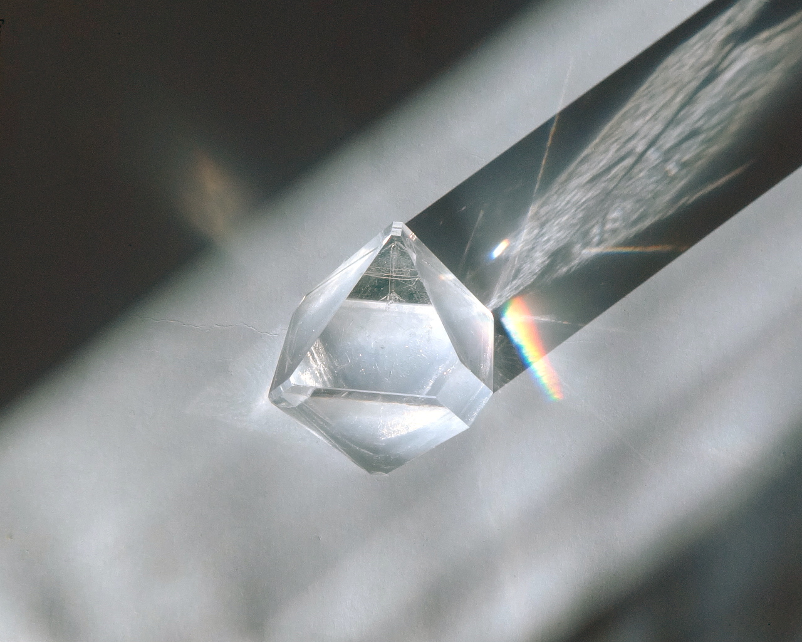
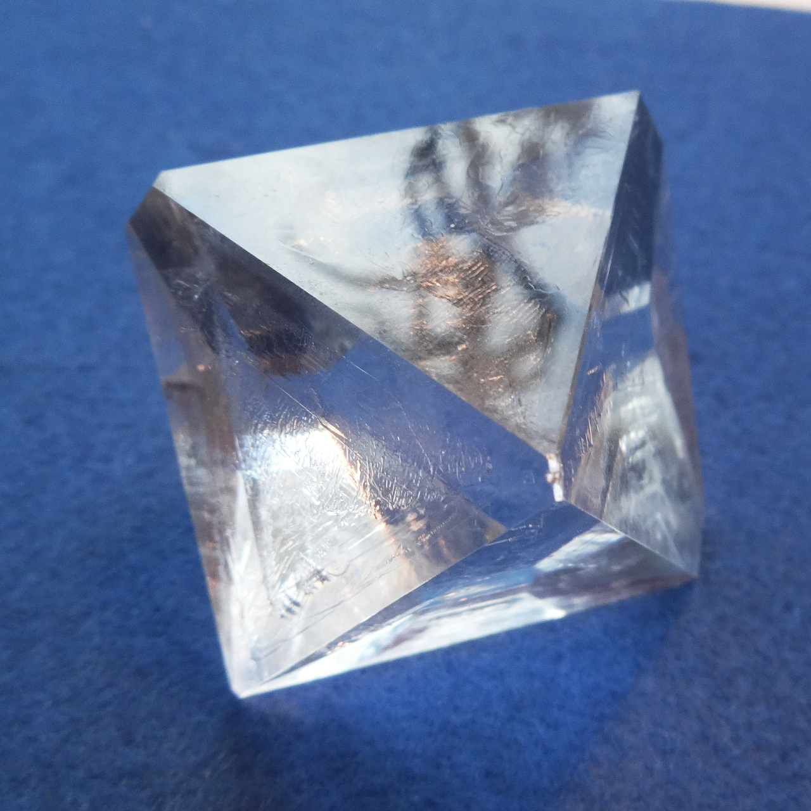
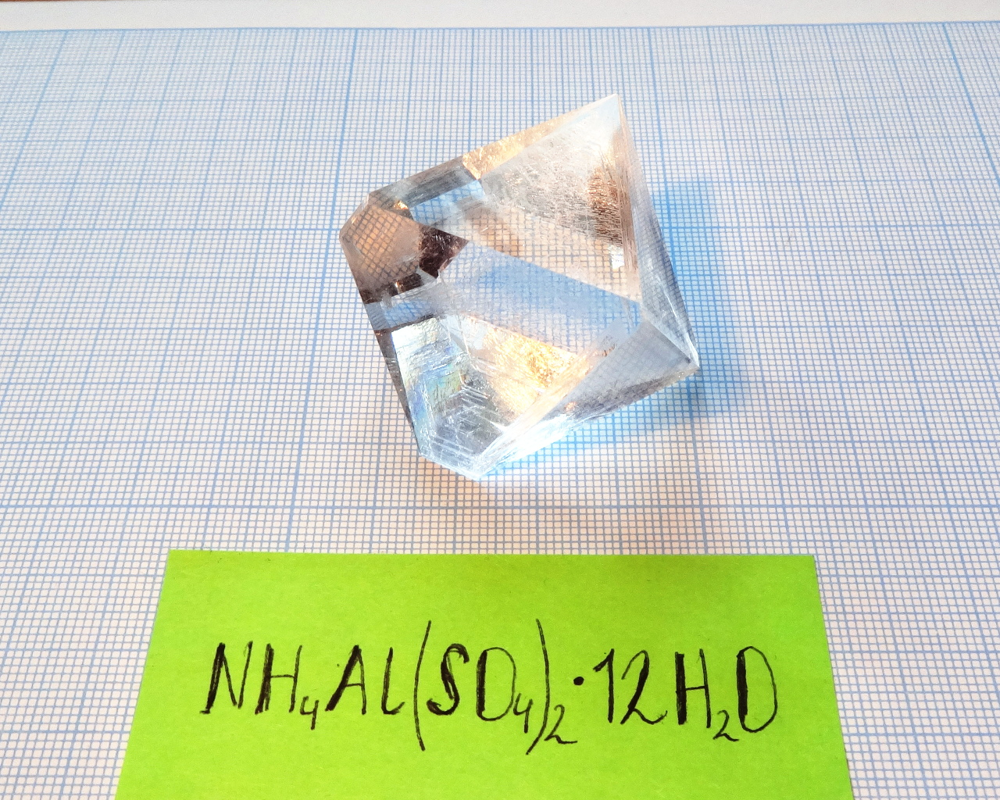
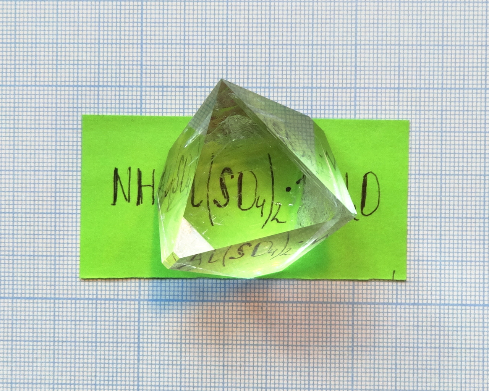
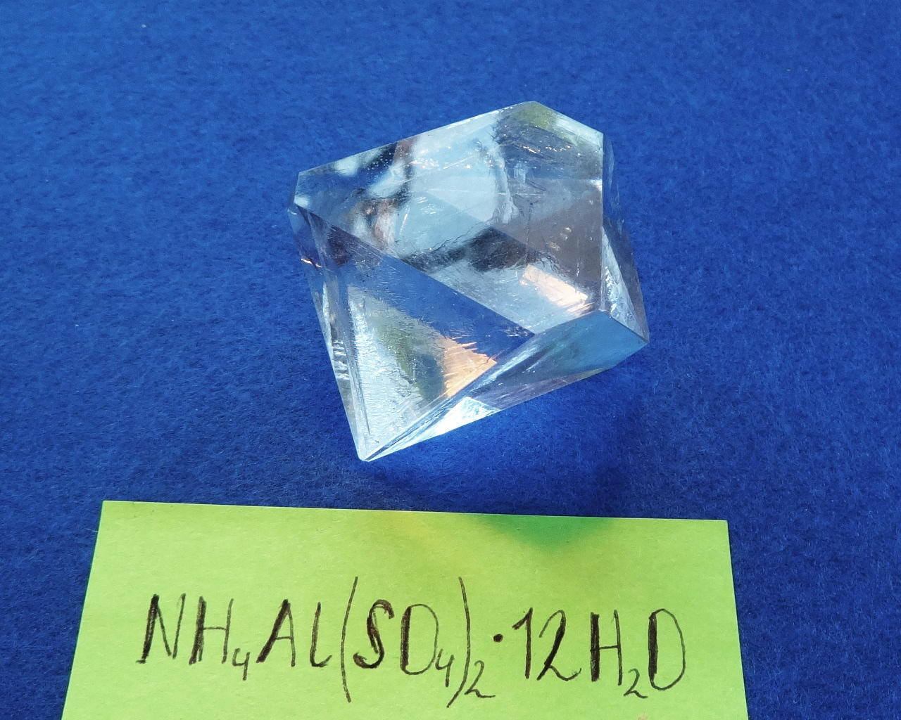

Formula: \ce{NH4Al(SO4)2*12H2O}

The biggest specimen in my collection. Mass is 45g, growth time is 4 months.

<!--more-->

## Properties
* **Crystal system**: isometric (cubic)
* **Crystal shape**: octahedron
* **Color**: transparent
* **Stability on air**: stable
## Preparation
I prepared the compound by mixing hot concentrated solutions of aluminum sulfate and ammonium nitrate and then cooling the solution:

\ce{2Al2(SO4)3 + 3NH4NO3 -> 3NH4Al(SO4)2*12H2O(s) + Al(NO3)3(aq)}

Alum is much less soluble than aluminum nitrate and crystallizes, leaving \ce{Al(NO3)3} in the solution.

More direct way would be using ammonium sulfate \ce{(NH4)2SO4} instead of nitrate, but I had no supply of it at the moment.

## Growing
One of the easiest compounds for growing. Solubility is relatively low (15g/100ml at room temperature), but increases significantly with heating. This makes this compound suitable for quick growing using cooling method.

However, I prefer to use slow evaporation method, as it produces clearer crystals.
## Safety
The compound is safe.
## More photos

## References
* [Wikipedia](https://en.wikipedia.org/wiki/Ammonium_aluminium_sulfate)
* Natural variety: [tschermigite](http://www.mindat.org/min-4036.html)
