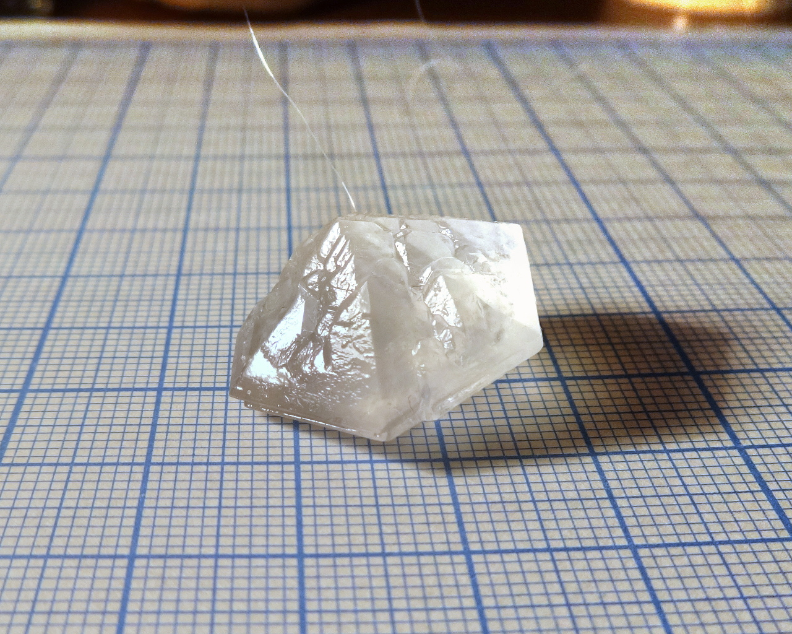
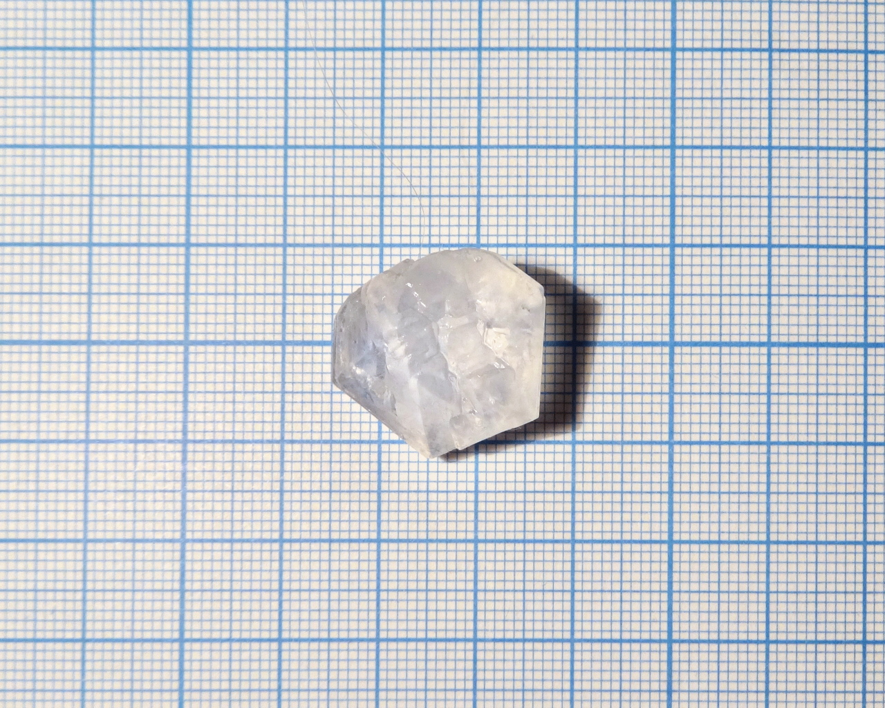
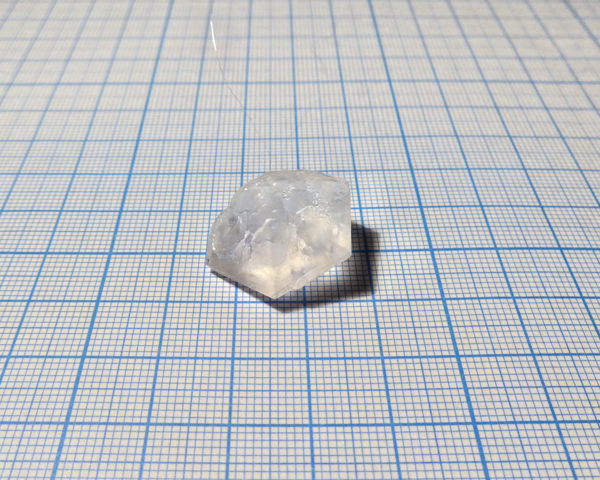

Formula: \ce{5Ca(NO3)2*NH4NO3*10H2O}

<!--more-->

## Properties
* **Crystal system**: No information. Shape suggests hexagonal, but it can be caused by twining.
* **Crystal shape**: Apparently, flattened hexagonal bipyramid.
* **Stability on air**: Not stable, deliquescent. Quickly absorbs moisture from air, becoming liquid.
## Preparation
Dissolve calcium nitrate (sometimes salt as fertilizer, in the form of hydrate \ce{Ca(NO3)*4H2O}), and ammonium nitrate \ce{NH4NO3} (also fertilizer) in 5:1 molar ratio in minimal amount of hot water, then crystallize.
## Growing
Left on open air, solution of this compound will not evaporate.

I used home-made dessicator for growing: big capped plastic container with 50g of anhydrous \ce{CuSO4} on the bottom.

## Safety
Moderately toxic, as all nitrates.

## More photos

## References
* [Imgur gallery](http://imgur.com/a/BfiNb)

