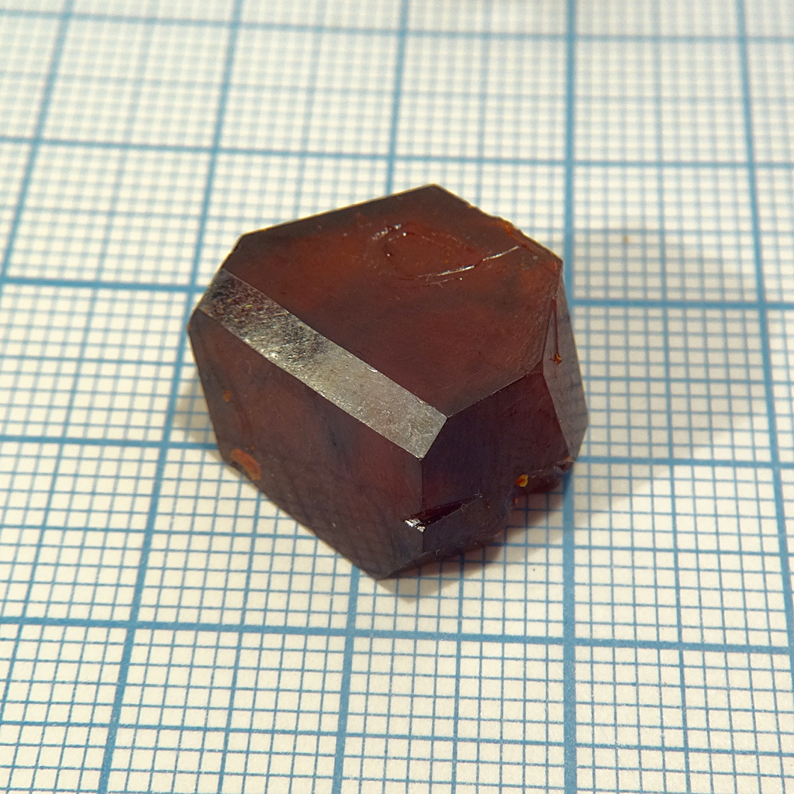
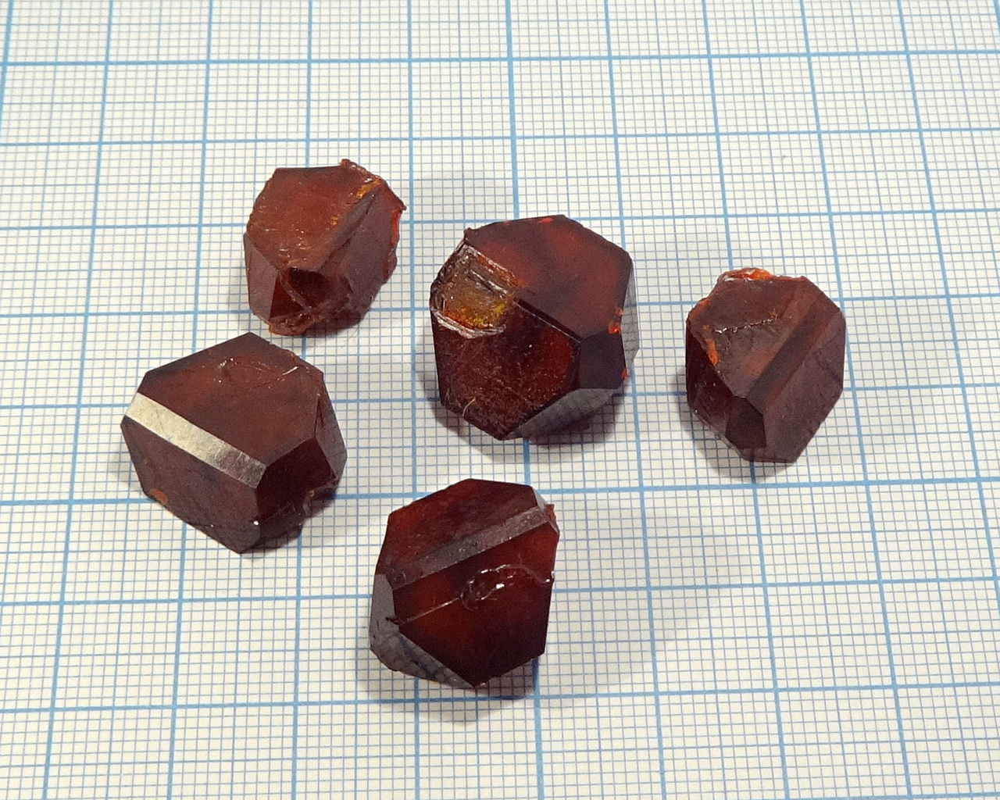
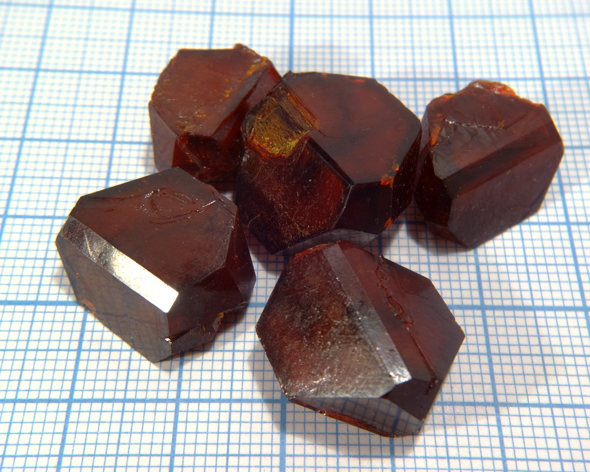
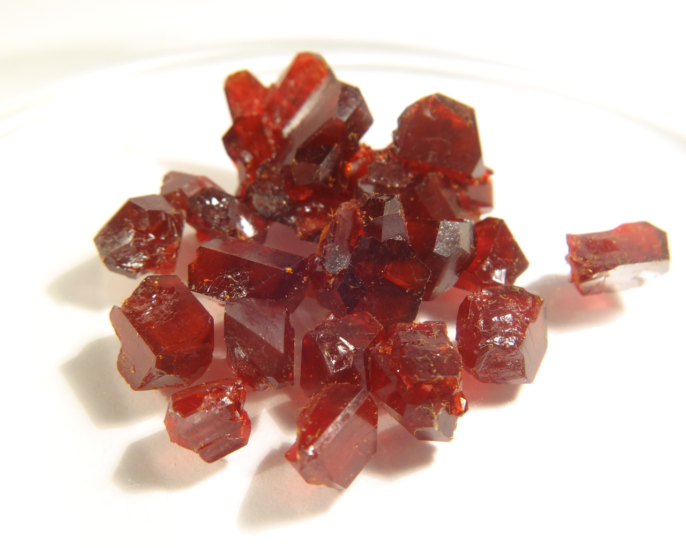

Formula: \ce{(NH4)2[FeCl5(H2O)]}

<!--more-->

## Properties
* **Crystal system**: don't know, either monoclynic or triclynic.
* **Crystal shape**: prismatic
* **Color**: dark red-brown
* **Stability on air**: hygroscopic, in humid environment becomes deliquescent. Store in dry, closed container.
## Preparation
Dissolve ammonium chloride \ce{NH4Cl} and iron (III) chloride \ce{FeCl3} in water in stoichiometric proportions and crystallize.
## Growing
I used slow evaporation method. Solubility of the compound is quite high 
## Safety
Not toxic, but irritant and leaves rusty stains on everything (use oxalic or citric acid to remove stains). Don't use metaiic containers: \ce{FeCl3} easily etches steel, copper and many other metals.

## More photos

## References
* [atomistry.com](http://iron.atomistry.com/pentachlorferrates.html)
