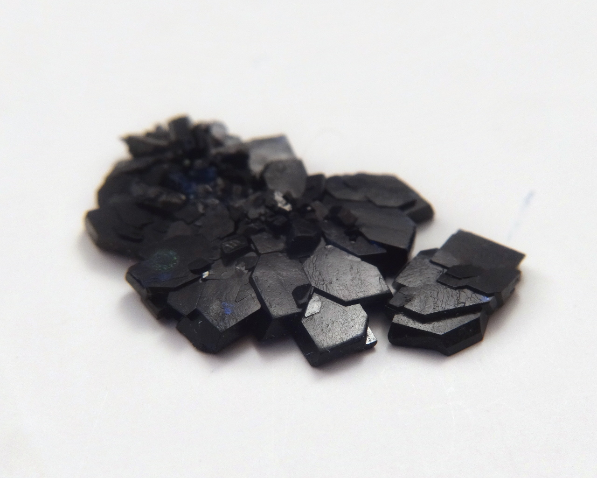
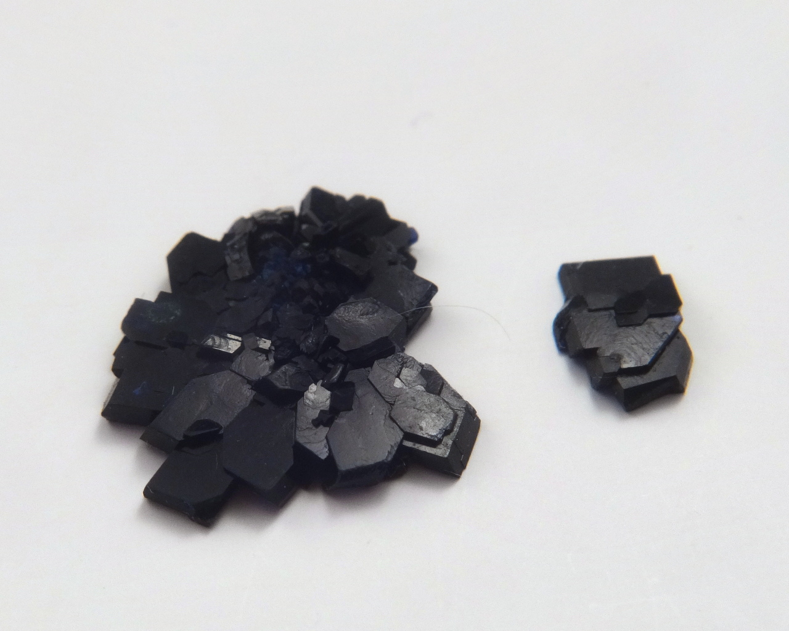
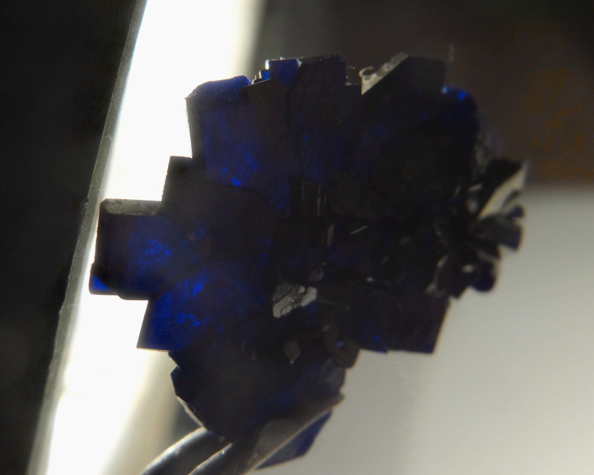

Formula: \ce{(NH4)2[Cu(SO3NH2)2Cl2]}

An unusual coordination complex of copper, producing dark blue crystals.

Similar compounds:
+ [Potassium bis(sulfamato) chlorocuprate](potassium-sulfamato-chloro-cuprate.md), \ce{K2[Cu(SO3NH2)2Cl2]}.
+ [Potassium bis(sulfamato) bromocuprate](potassium-sulfamato-bromo-cuprate.md), \ce{K2[Cu(SO3NH2)2Br2]}.

<!--more-->

## Properties
* **Color**: dark blue, almost black
* **Crystal shape**: tabular, flat
* **Stability on air**: stable
## Preparation

Preparation is essentially the same as of the [potassium analog](potassium-sulfamato-chloro-cuprate.md), with potassium replaced by ammonium. However, there is a complication: a solution containing stoichiometric mixture of \ce{[NH4]^(+)}, \ce{Cu^(2+)}, \ce{Cl^(-)}, \ce{NH2SO3^(-)} ions does not produce the desired compound upon crystallization. Instead, light blue crystals of [ammonium tetrachlorocuprate](ammonium-tetrachlorocuprate.md) appear. This can be solved by adding excess of copper sulfamate.

## Safety

All copper compounds are moderately toxic.

## More photos

## References

* [Préparation et étude par spectrométrie infrarouge de bis(sulfamato) halogénocuprate (II): \ce{M2[Cu(NH2SO3)X2}](X = Cl ou Br et M = K ou NH4)](https://www.sciencedirect.com/science/article/abs/pii/0584853976801730)
