Formula: \ce{(NH4)2[CuCl4]}

[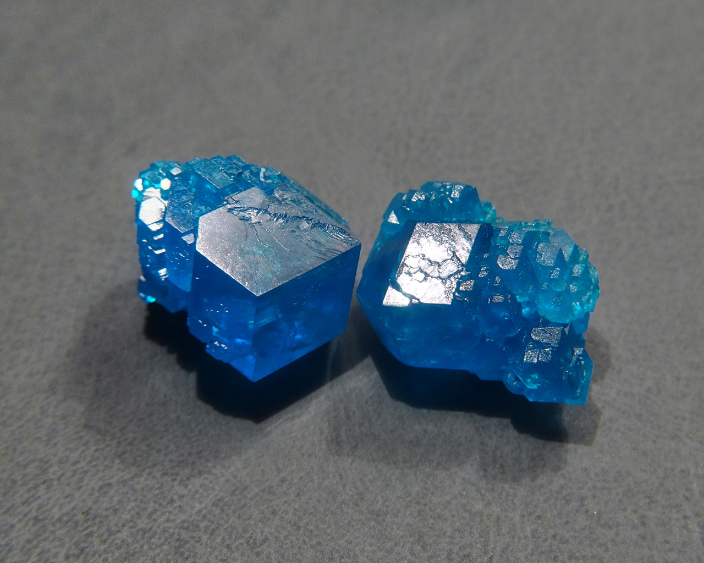](/crystals/images/ammonium-tetrachlorocuprate/dsc04050.jpg)

Blue crystals, obtained when ammonium chloride \ce{NH4Cl} is crystallized together with copper(II) chloride \ce{CuCl2}.

<!--more-->

## Properties
* **Crystal shape**: distorted rhombododecahedrons, octahedrons
* **Color**: greenish-blue, teal. Less blue than [copper sulfate](copper-sulfate.md)
* **Stability on air**: stable
## Preparation
To prepare ammonium tetrachlorocuprate, dissolve ammonium and copper chlorides in water, in 2:1 molar ration, then crystallize the solution. Reaction equation is:

\ce{2NH4Cl + CuCl2 = (NH4)2[CuCl4]}

## Safety
All copper compounds are moderately toxic.

## More photos
[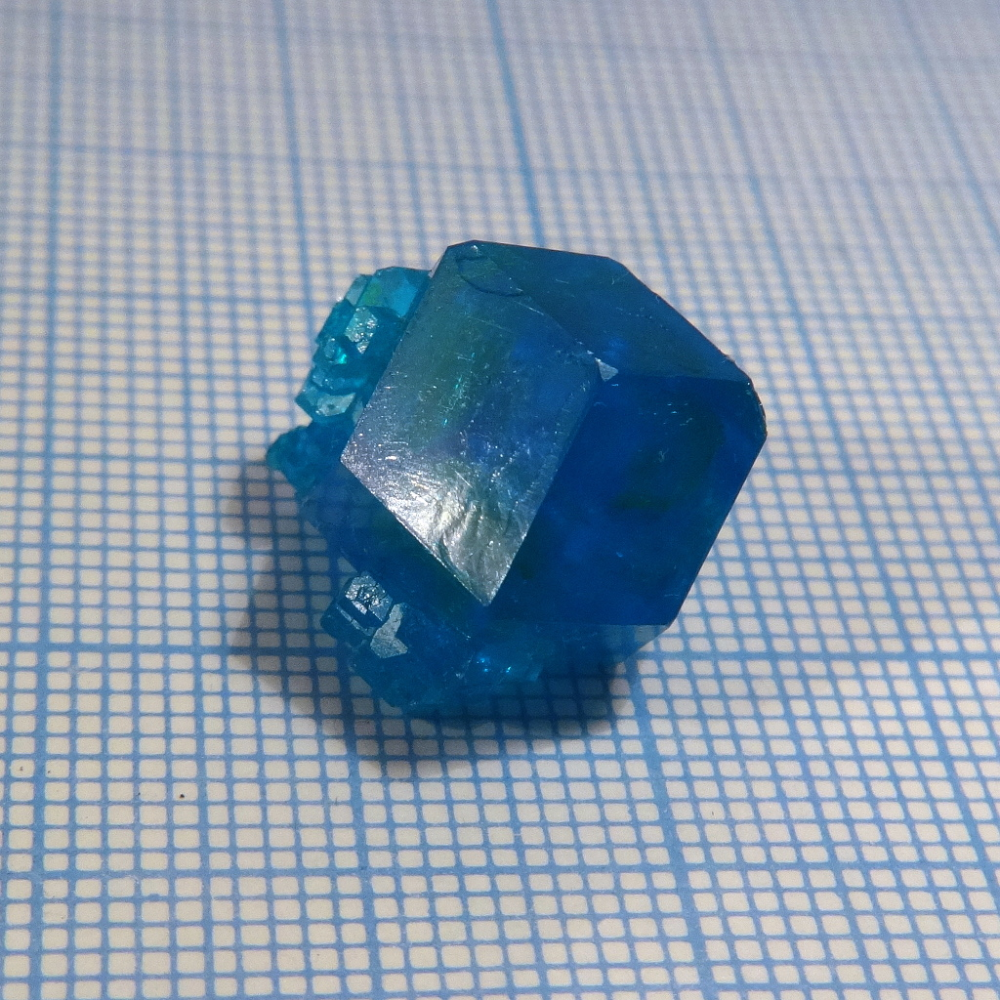](/crystals/images/ammonium-tetrachlorocuprate/dsc03958.jpg)

[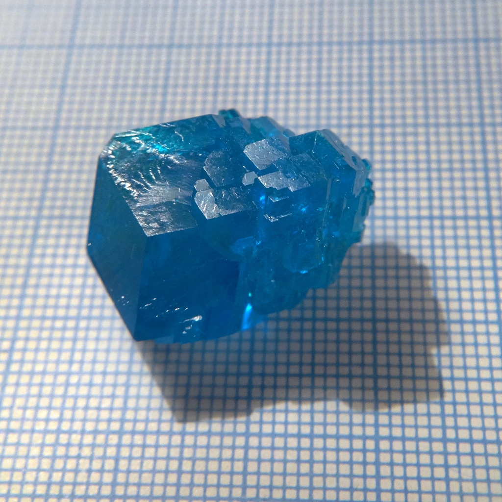](/crystals/images/ammonium-tetrachlorocuprate/dsc03980.jpg)

[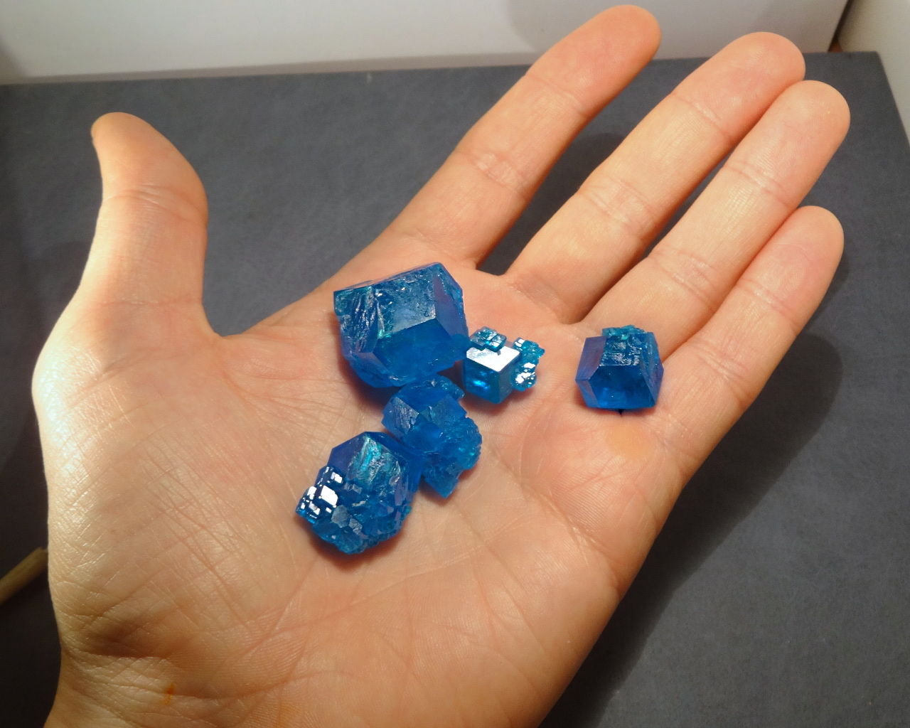](/crystals/images/ammonium-tetrachlorocuprate/dsc04058.jpg)

[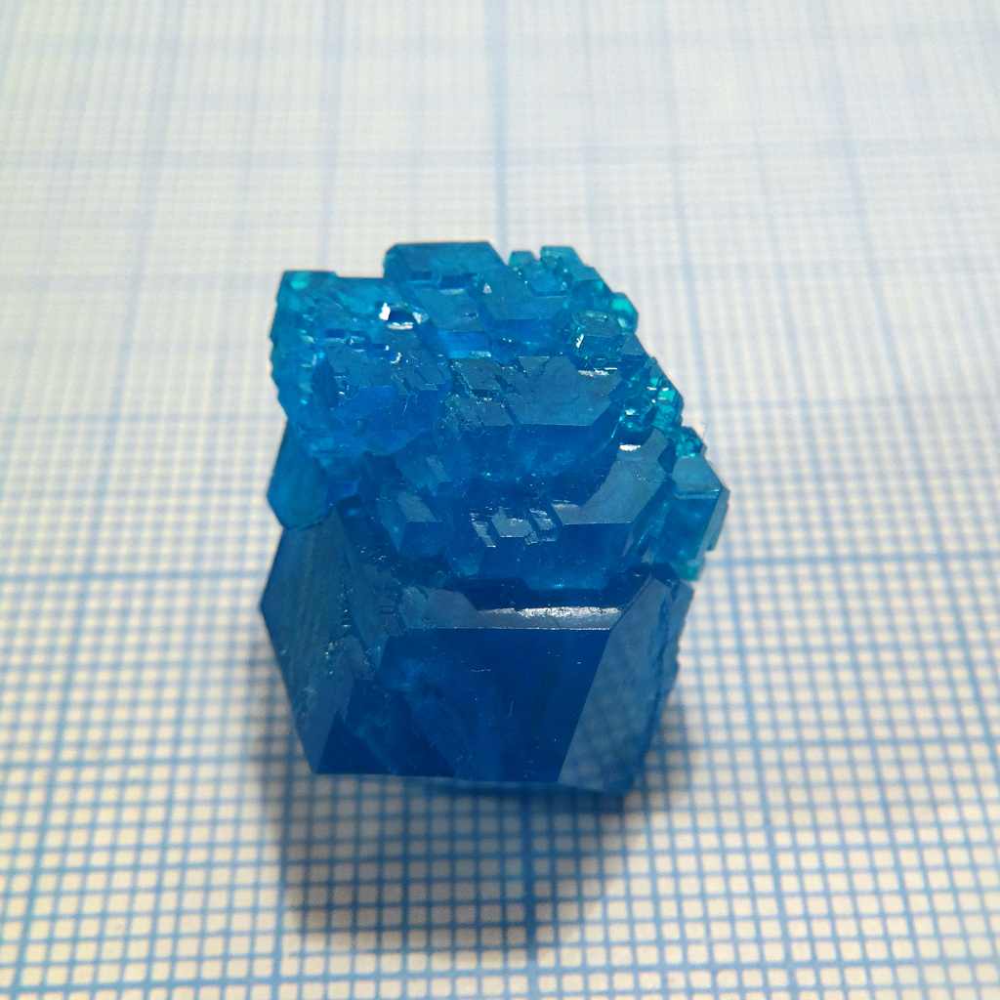](/crystals/images/ammonium-tetrachlorocuprate/dsc03994.jpg)

[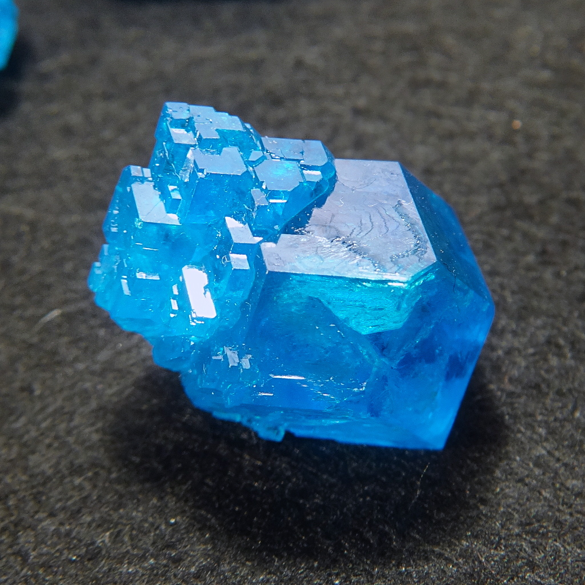](/crystals/images/ammonium-tetrachlorocuprate/dsc04008.jpg)

[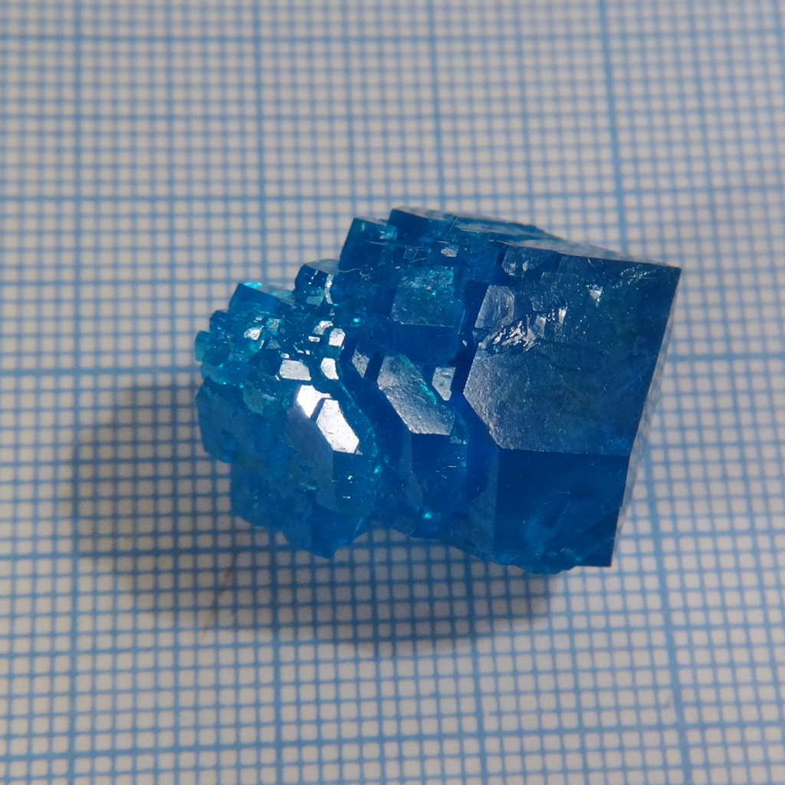](/crystals/images/ammonium-tetrachlorocuprate/dsc03961.jpg)

[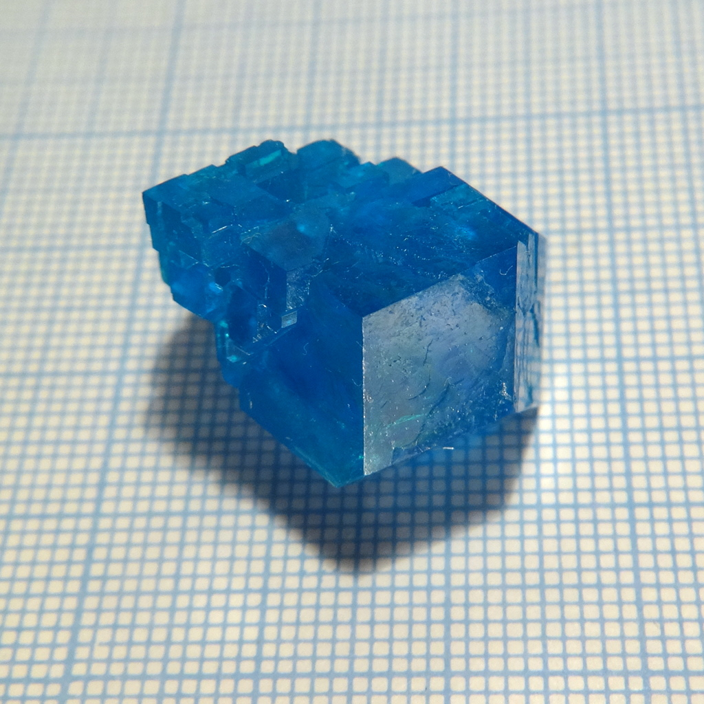](/crystals/images/ammonium-tetrachlorocuprate/dsc03992.jpg)

[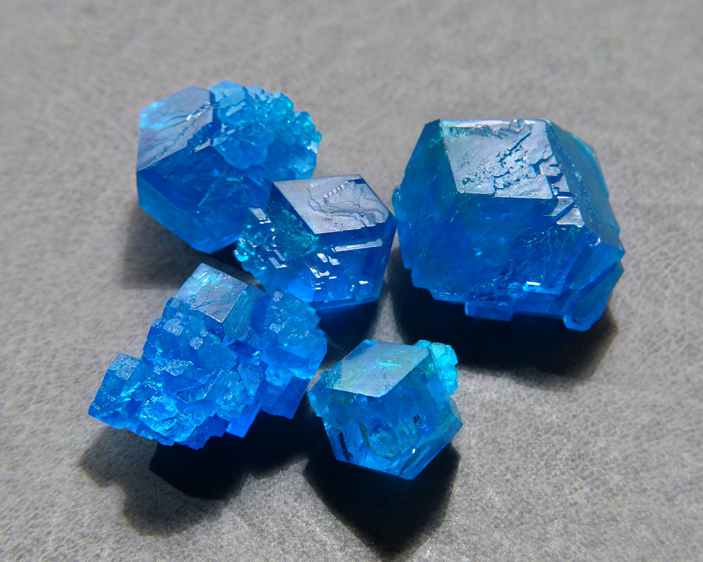](/crystals/images/ammonium-tetrachlorocuprate/dsc04052.jpg)

[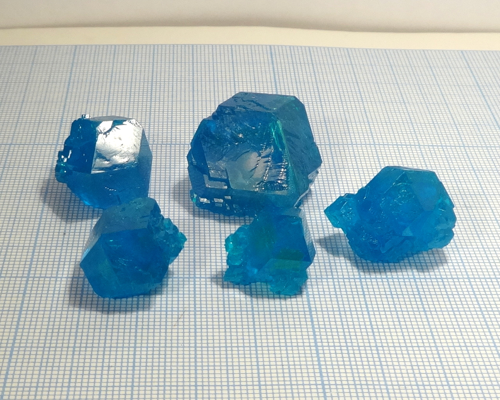](/crystals/images/ammonium-tetrachlorocuprate/dsc03942.jpg)

[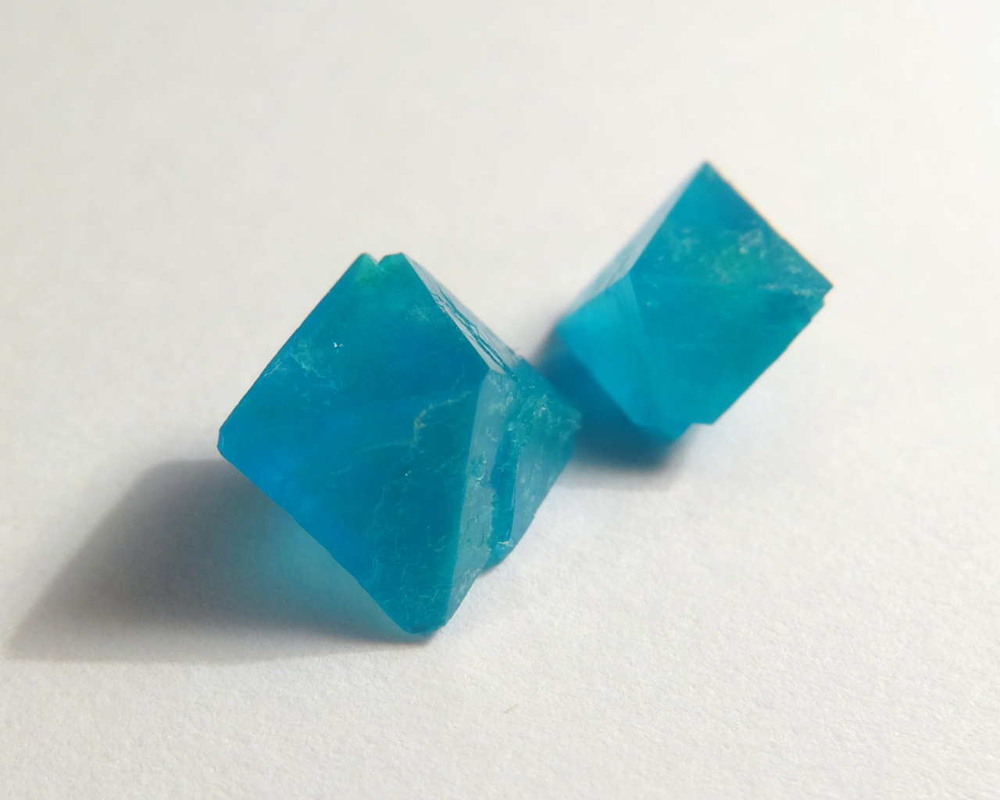](/crystals/images/ammonium-tetrachlorocuprate/dsc03496.jpg)

## References
