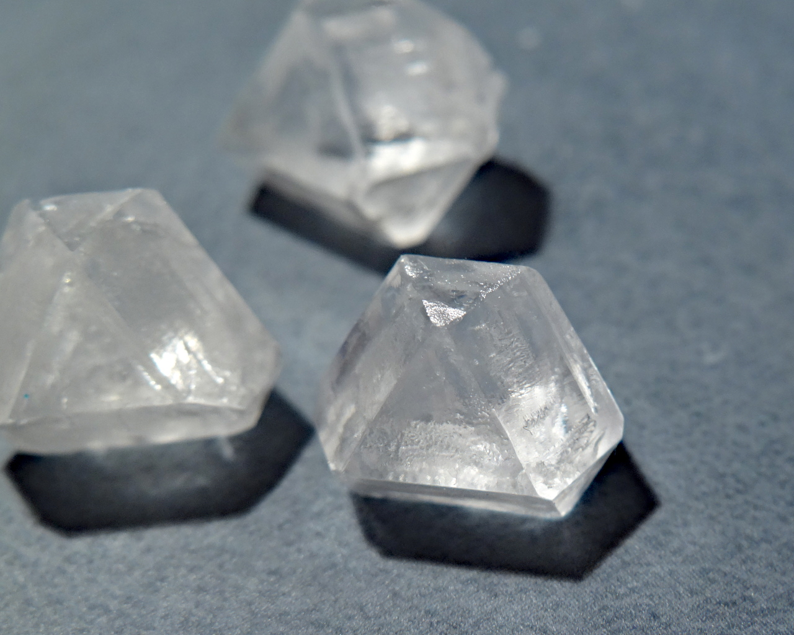
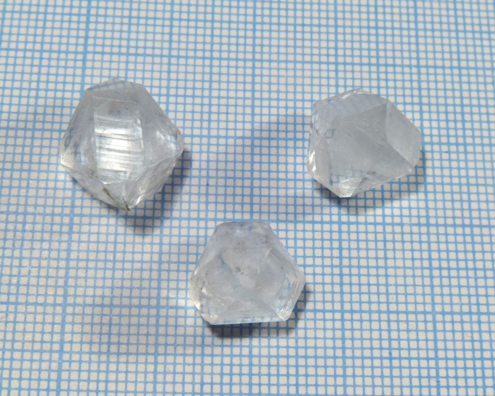
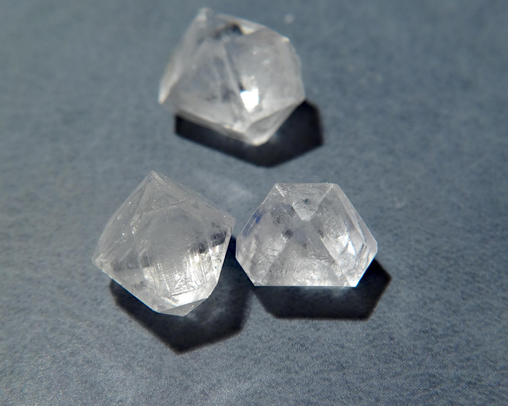
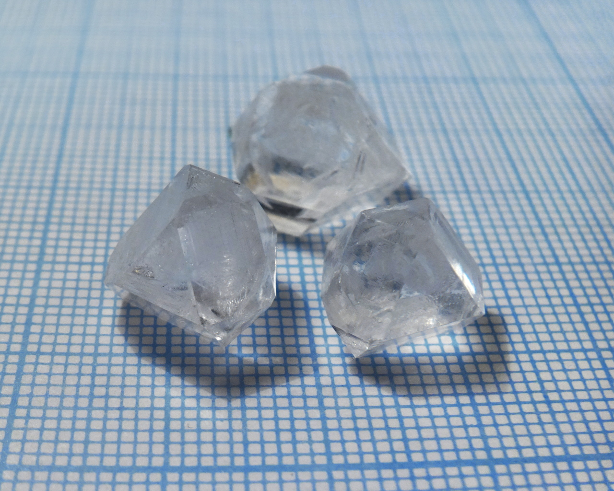

Formula: \ce{Ba(NO3)2}

<!--more-->

## Properties

* **Crystal system**: isometric
* **Crystal shape**: truncated tetrahedorns, cubes, octahedrons
* **Color**: colorless
* **Stability on air**: very stable, crystals are anhydrous

## Growing

As always, I used slow evaporation method to grow these crystals. Solubility of barium nitrate is merely 10.5g/100ml, quite low value for a nitrate.

## Safety

All soluble barium salts are highly toxic.

## More photos

## References

* [Barium nitrate in Wikipedia](https://en.wikipedia.org/wiki/Barium_nitrate)
