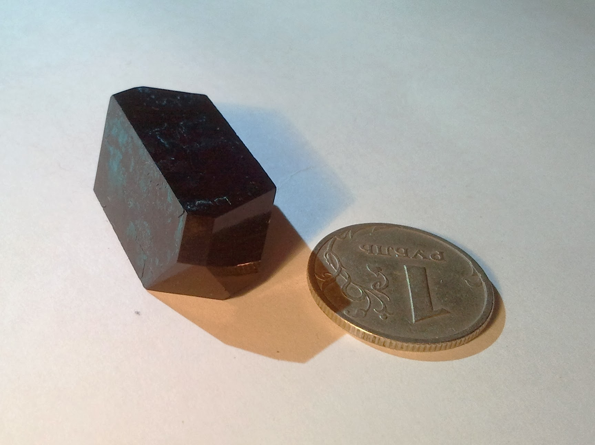
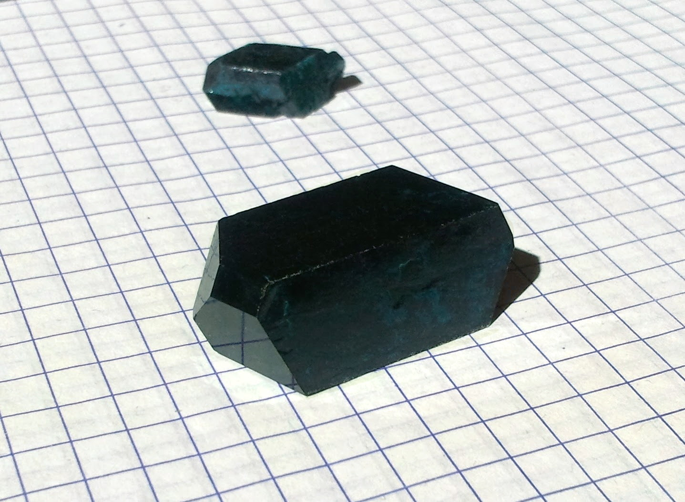
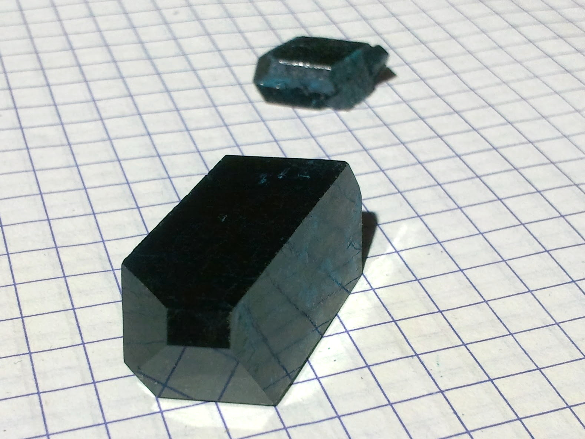
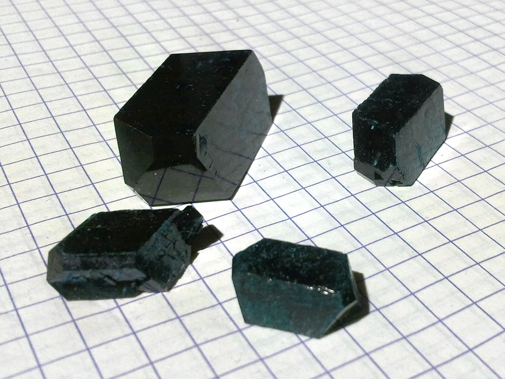

Formula: \ce{Cu(CH3COO)2*H2O}

Copper salt of acetic acid.

<!--more-->

## Properties
* **Crystal system**: monoclinic
* **Crystal shape**: slant prism
* **Color**: dark blue, almost black
* **Stability on air**: stable, though some people report slow weathering.
## Preparation
I've made it electrochemically, by dissolving copper anode in acetic acid. An easier way would be the following 2-step reaction, starting from copper (II) sulphate \ce{CuSO4}.

First, dissolve some \ce{CuSO4} in water and add baking soda \ce{NaHCO3}. Sodium carbonate (\ce{Na2CO3}) or hydroxide (\ce{NaOH}) are fine too. Immediately, \ce{CO2} gas will release (beware of exceffive foaming), and green-blue sediment of the basic copper (II) carbonate will precipitate:

\ce{2CuSO4 + 2NaHCO3 -> CuCO3*Cu(OH)2(s) + Na2SO4 + CO2(g)}

Let the sediment to settle down, wash it 2-3 times, then dissolve it it in the acetic acid:

\ce{CuCO3*Cu(OH)2 + 4CH3COOH -> 2Cu(CH3COO)2 + 2H2O + CO2(g)}

You will obtain blue solution of the copper (II) acetate. Again, carbon dioxide gas would form, so don't add a lot of acid at once. In case you are getting dark-blue precipitate, add more water: copper acetate has relatively low solubility in water.
## Growing
Solubility of this compound is quite low: 7.2g per 100ml.

Avoid strong heating, because it causes hydrolysis. Some additional acetic acid improves quality.
## Safety
Like all copper compound, it is moderately toxic, so avoid eating it.
## More photos

## References
* [Wikipedia](https://en.wikipedia.org/wiki/Copper%28II%29_acetate)
* [Crystal growing site in Russian](https://sites.google.com/site/crystallsgrowing/crystal_compounds/acetates/copper_acetate)
