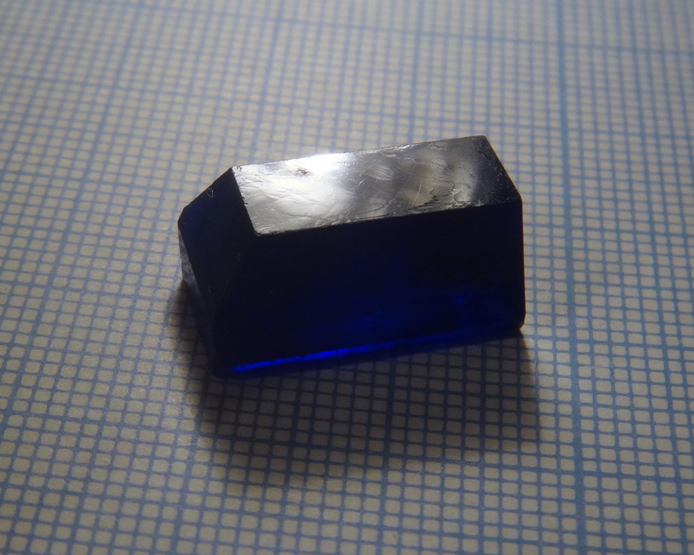
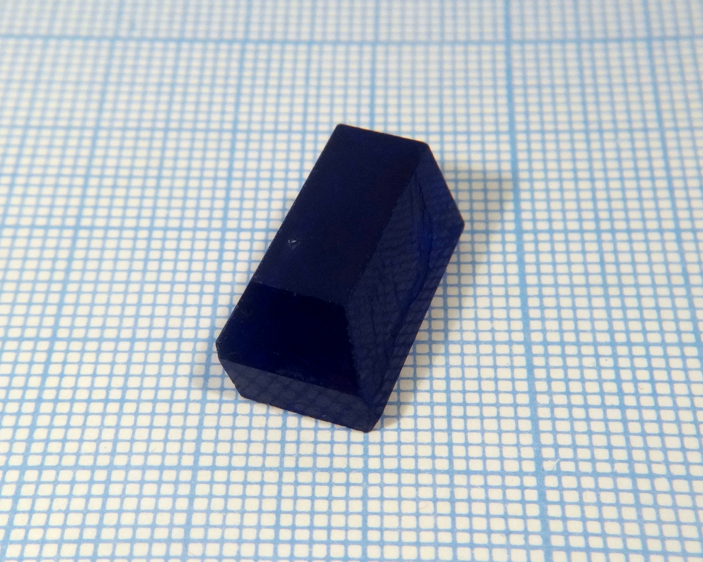
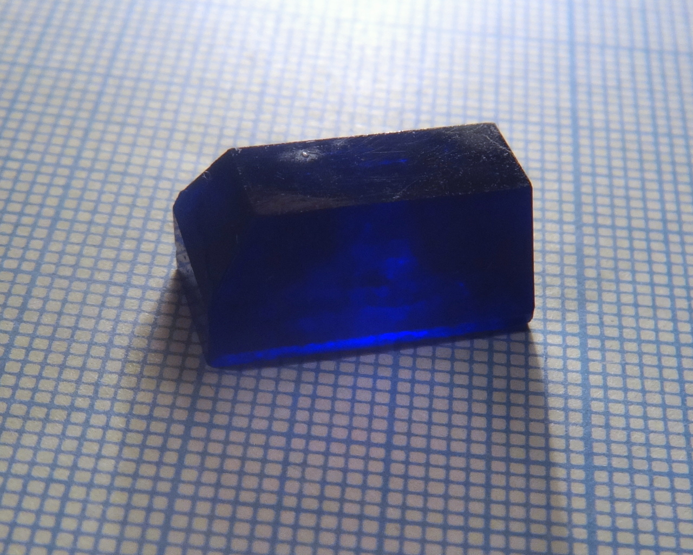

Formula: \ce{Cu(C3H6NO2)2}

Systematic name is copper(II) 3-aminopropanoate.

Salt of copper and amino acid [β-alanine](https://en.wikipedia.org/wiki/%CE%92-Alanine)

<!--more-->

## Properties

* **Crystal shape**: prismatic
* **Color**: bark blue
* **Stability on air**: not stable, dehydrate in a matter of days

## Preparation

Reaction of β-alanine acid with copper hydroxocarbonate or copper hydroxide in water. Copper hydroxocarbonate can be prepared by reacting any soluble copper salt, such as \ce{CuSO4} with sodium carbonate or hydrocarbonate.

\ce{Cu2CO3(OH)2 + 4 C3H7NO2 = 2 Cu(C3H6NO2)2 + 3 H2O + CO2}

## Growing

Copper β-alaninate is higly soluble in water.

## Safety

All copper compounds are moderately toxic. Avoid ingestion.

## More photos

