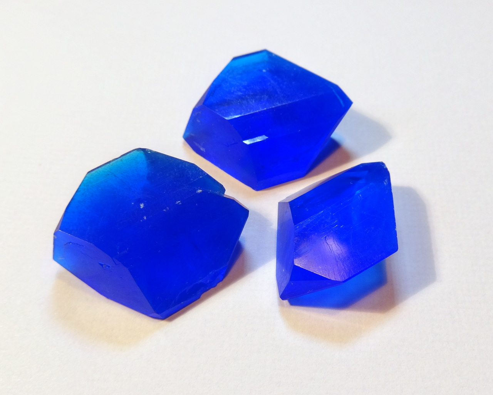
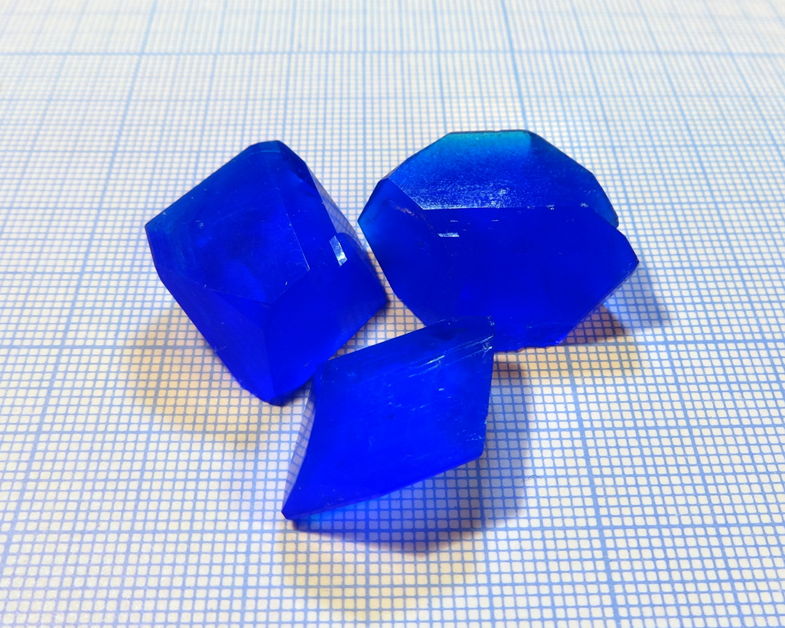

Hydrated cupric salt of sulfuric acid, with formula: \ce{CuSO4*5H2O}. Its traditional name is blue vitriol.

<!--more-->

One of the classic compounds for crystal growing. Everybody has tried it, so no much information here.
## Properties
* **Crystal system**: triclinic
* **Crystal shape**: complex prism with multiple facets
* **Color**: blue
* **Stability on air**: in my comditions it is stable, but some people report that it can dehydrate.
## Growing
Usual evaporation method used. Some also note that addition of glycerol to the mother solution improves crystal clarity and makes them flattened, but I failed to grow crystals of acceptable quality this way.

## Safety
Copper salts are toxic.

## More photos

