Formula: \ce{C4H10O4}
[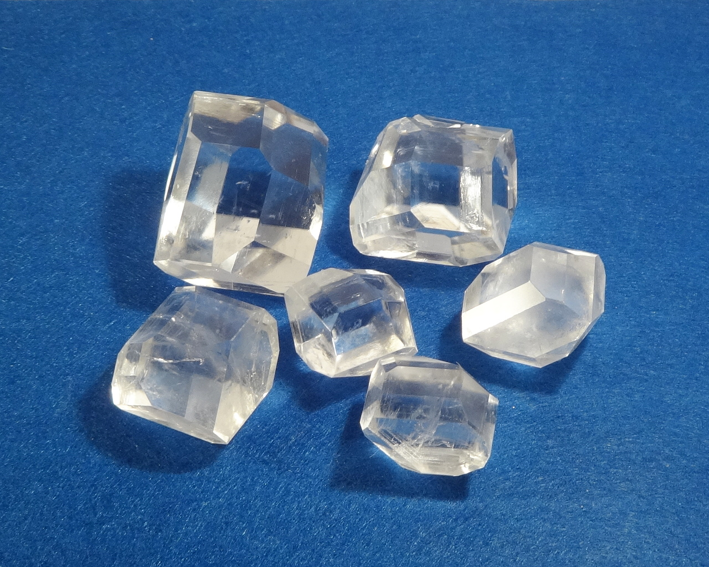](/crystals/images/erythritol/dsc02734.jpg)
One of the common sugar substitutes.

<!--more-->

## Properties
* **Crystal system**: tetragonal
* **Crystal shape**: flat rectangular prism with multiple facets on ends
* **Color**: transparent
* **Stability on air**: stable
[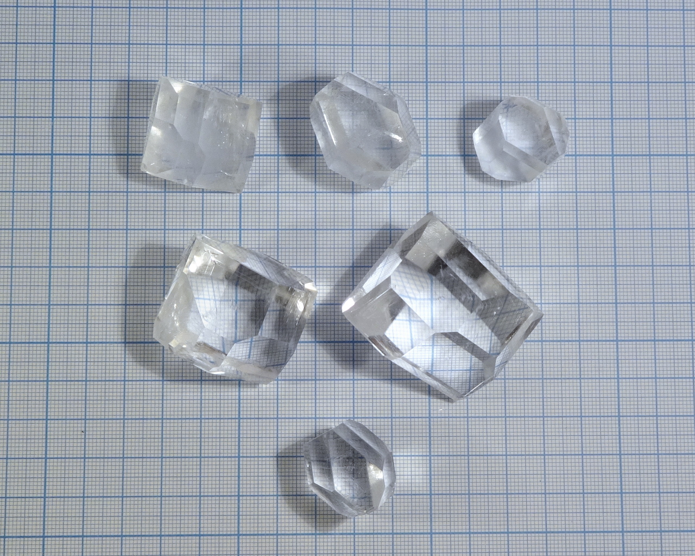](/crystals/images/erythritol/all-sizedsc02707.jpg)

### Birefringence
In some direciotns, erythritol crystals display well visible [birefringence](https://en.wikipedia.org/wiki/Birefringence).
[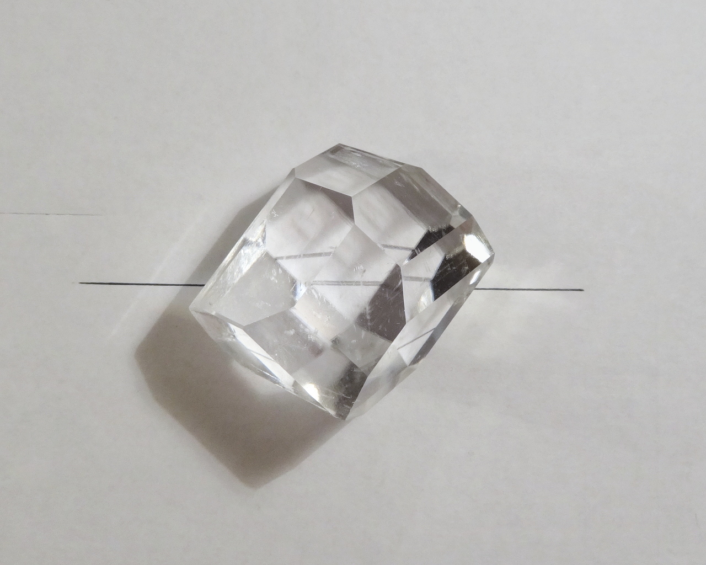](/crystals/images/erythritol/biref-2-dsc02748.jpg)
[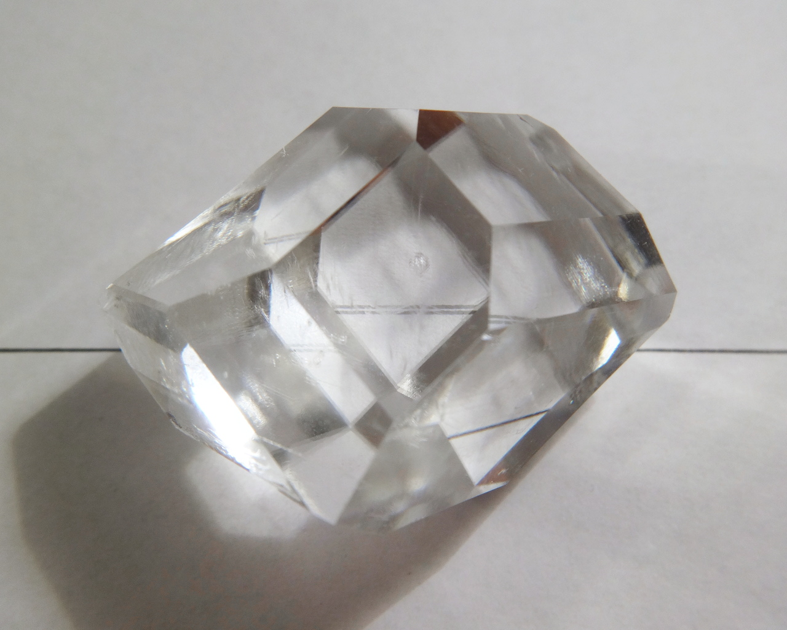](/crystals/images/erythritol/biref-1-dsc02751.jpg)

## Obtaining
Erythritol can be found as main component in many sugar substitute compositions. Because it is less sweet than sucrose, it is often mixed with more potent sweeteners, such as sucralose.
## Growing
This compound grows really well. I used slow evaporation method to grow my specimens, growth time is around one month. Solubility at room temperature is around 60..65 g / 100ml.

## Safety
The compounds is safe to consume in reasonable amounts
[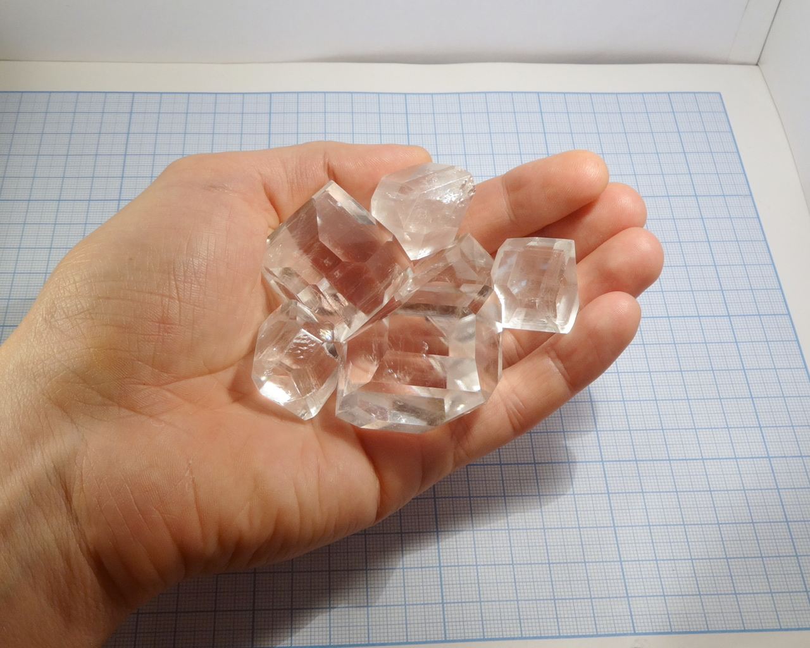](/crystals/images/erythritol/hand-dsc02725.jpg)

## More photos
[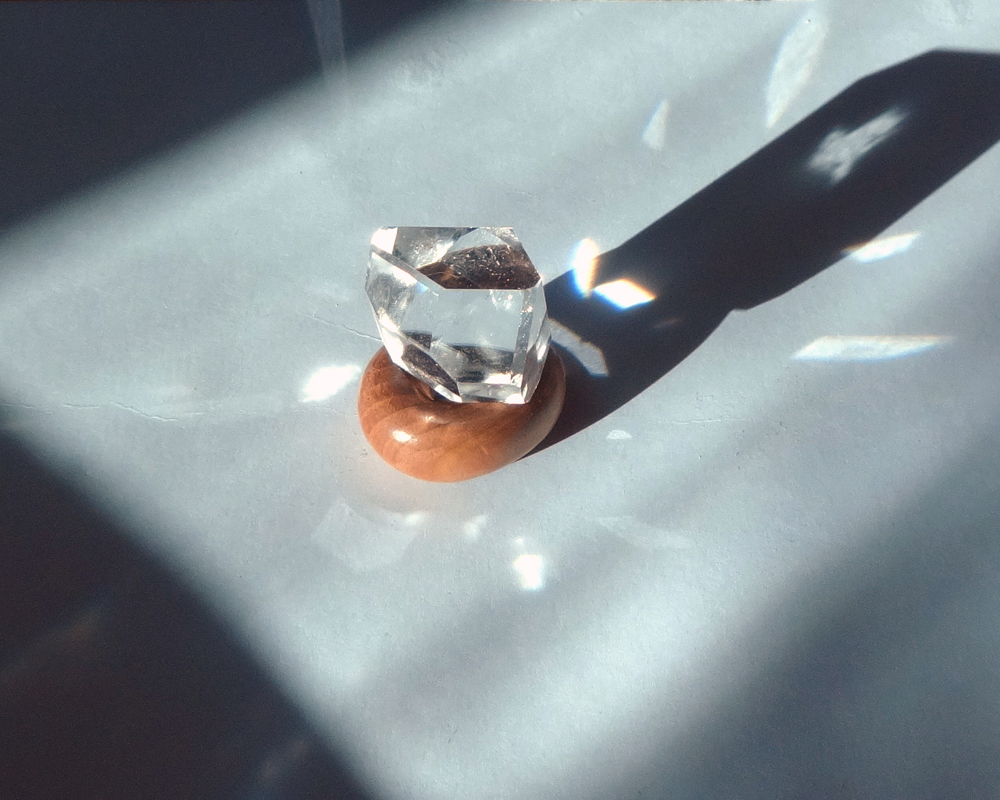](/crystals/images/erythritol/erythritol-shiny.jpg)

[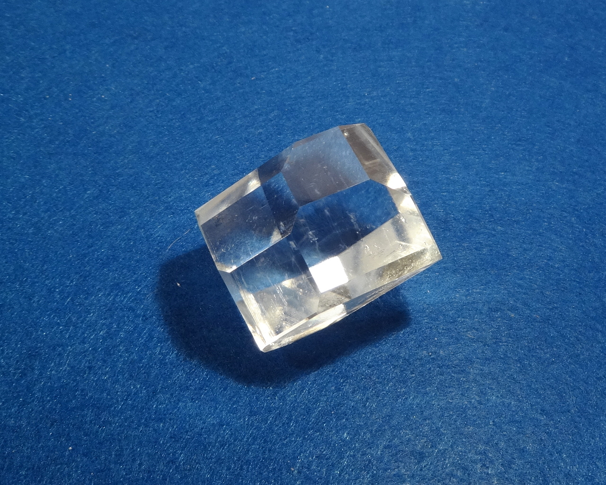](/crystals/images/erythritol/dsc02745.jpg)

[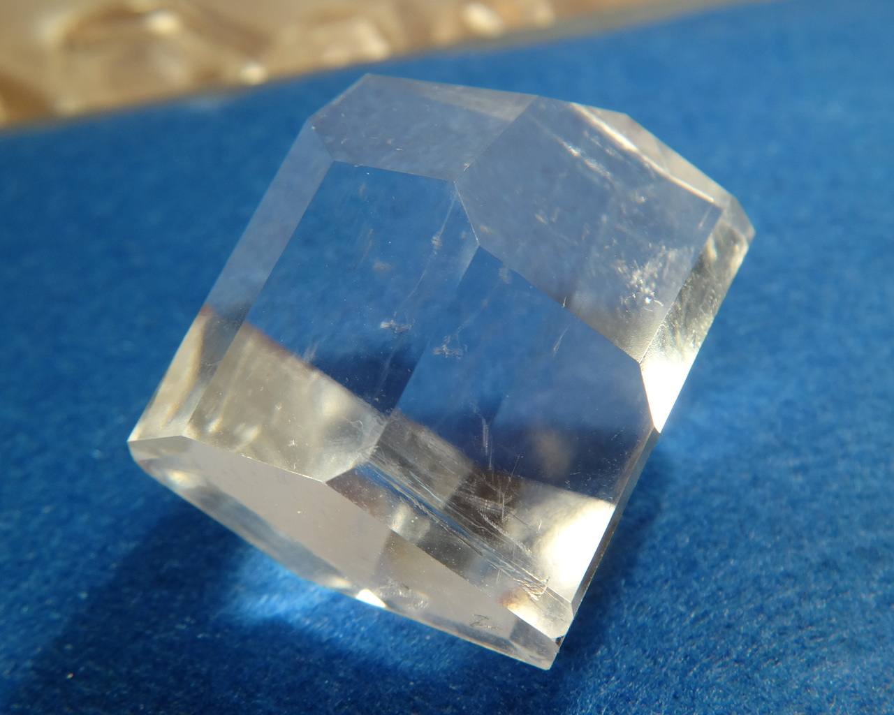](/crystals/images/erythritol/dsc02760.jpg)

[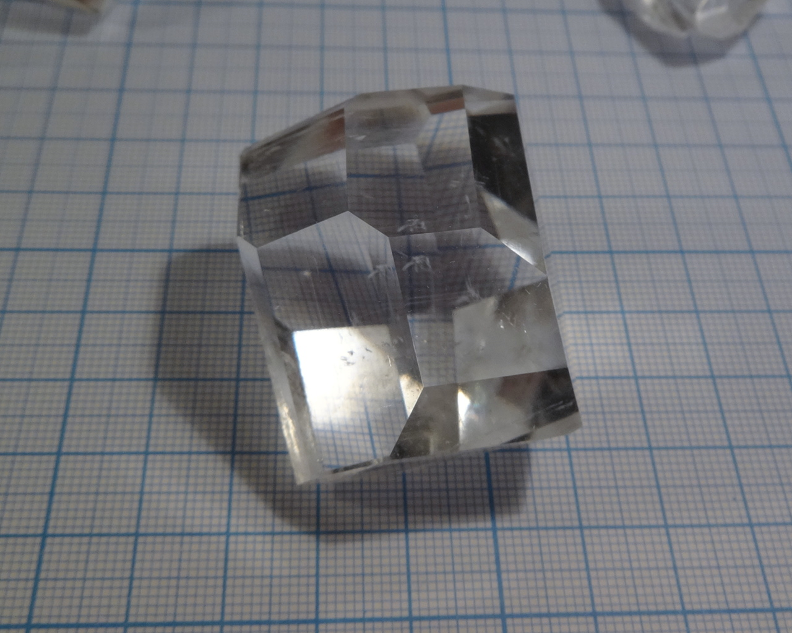](/crystals/images/erythritol/big-mmpaper-dsc02713.jpg)

[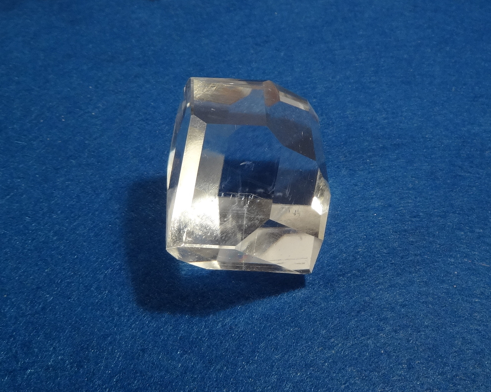](/crystals/images/erythritol/dsc02738.jpg)

[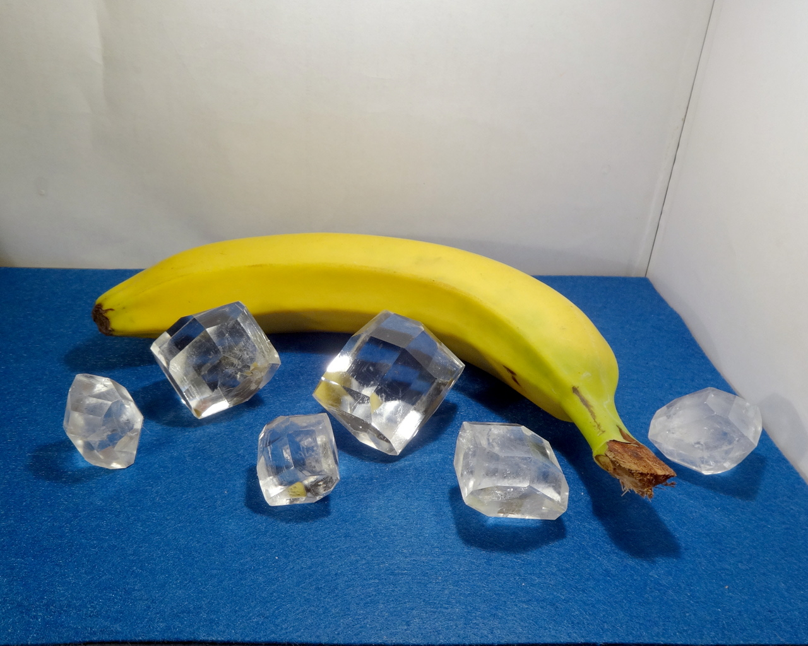](/crystals/images/erythritol/banana-dsc02776.jpg)
