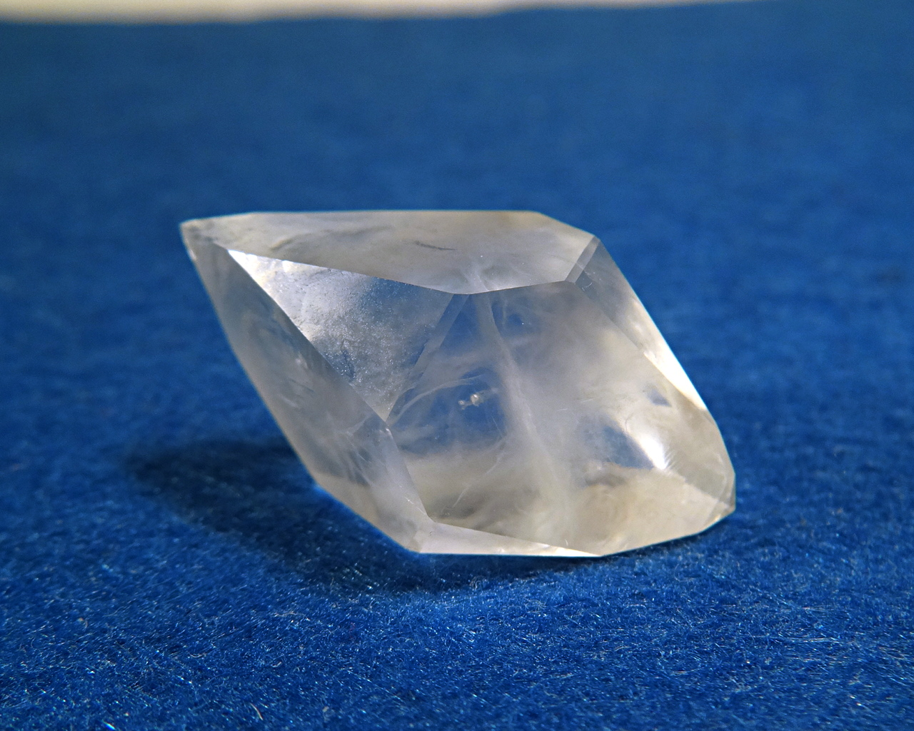
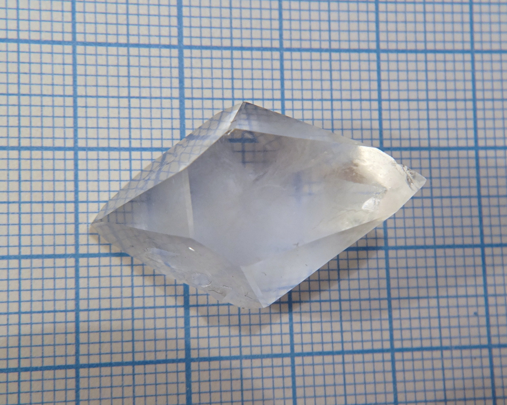
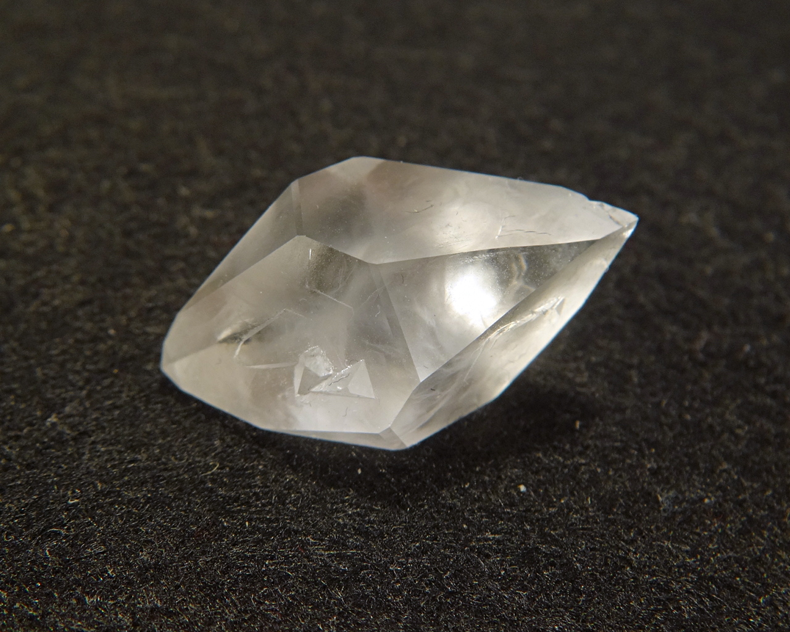
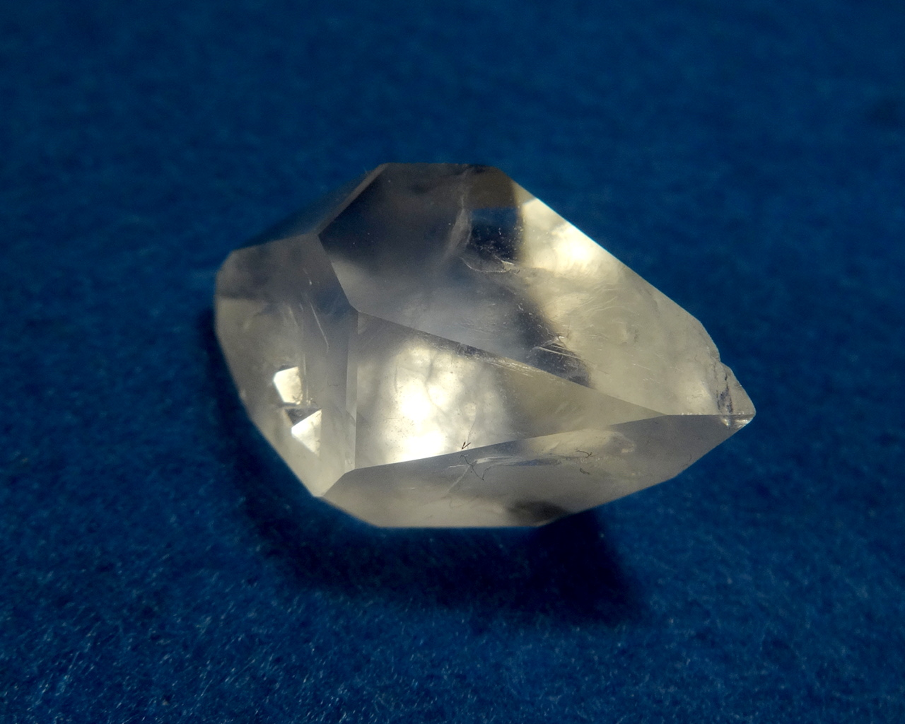
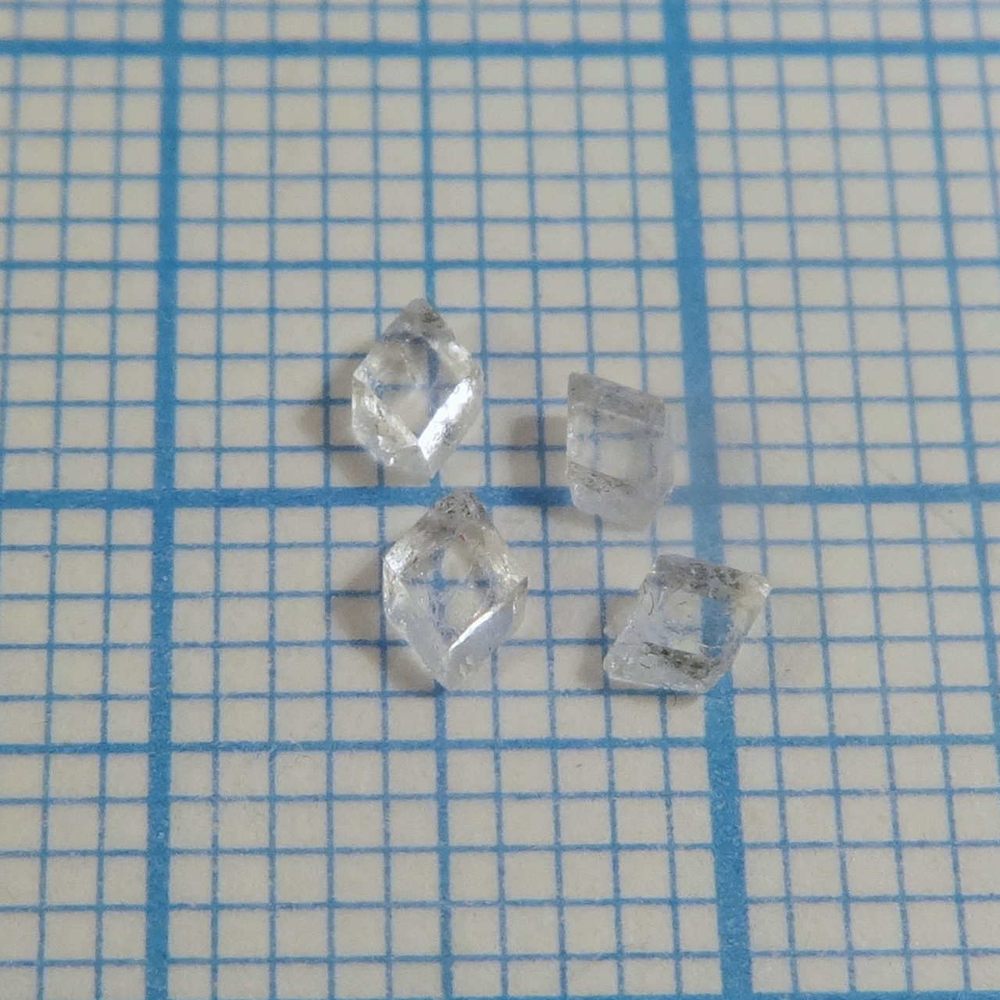

Formula: \ce{2C6H12O6*NaBr*H2O}

Crystalline adduct (cocrystal) of carbohydrate [glucose](https://en.wikipedia.org/wiki/Glucose) with sodium bromide.

<!--more-->

## Properties

* **Crystal system**:trigonal
* **Crystal shape**:cube, stretched along main diagonal
* **Color**: colorless
* **Stability on air**: stable

## Preparation

Dissolve glucose and sodium bromide in warm water in 2:1 molar ratio, then crystallize. Avoid strong heating that causes darkening of glucose.

## Growing

The compound grows much worse than its [chloride analog](glucose-sodium-chloride.md), it is much more prone to formation of small parasitic crystals. Solubility, according to my measurements, is around 130g/100ml.

To grow it, I used slow evaporation method, limiting evaporation speed with cover. Growth time is 1 month.

## Safety

Bromide is slightly toxic, avoid consumption of it.

## More photos

Seed crystals:

