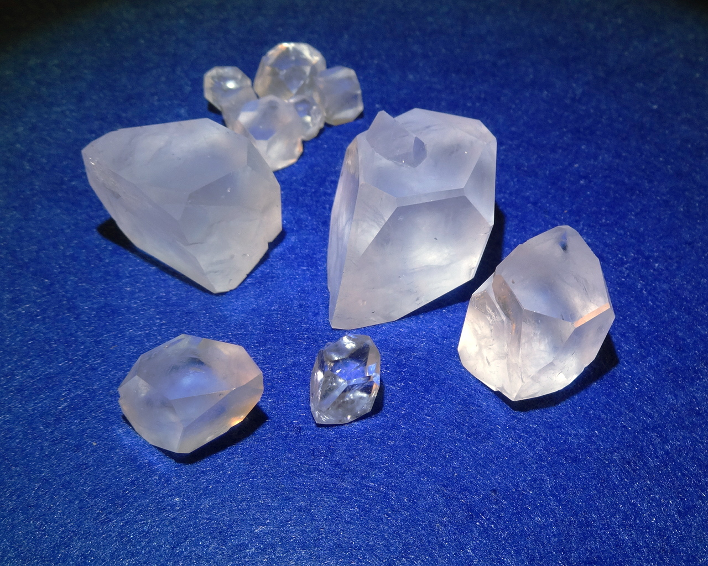
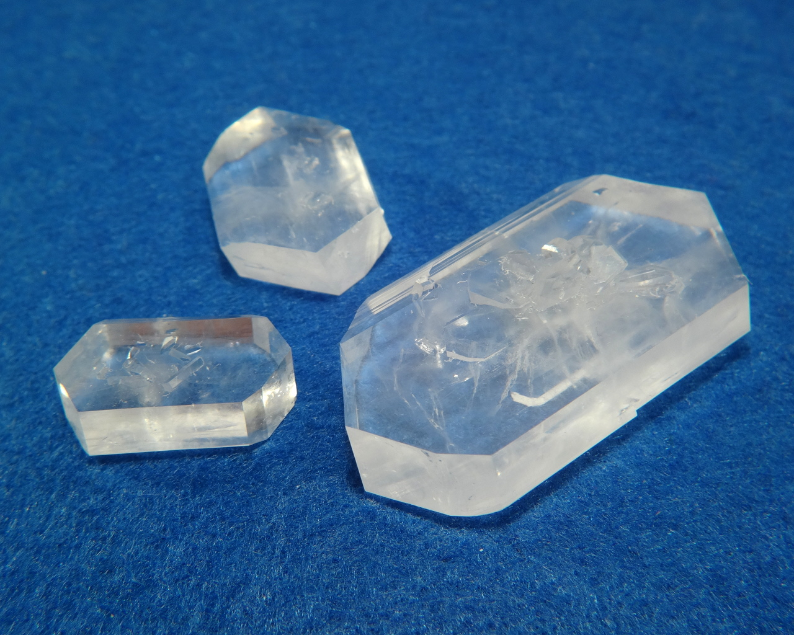
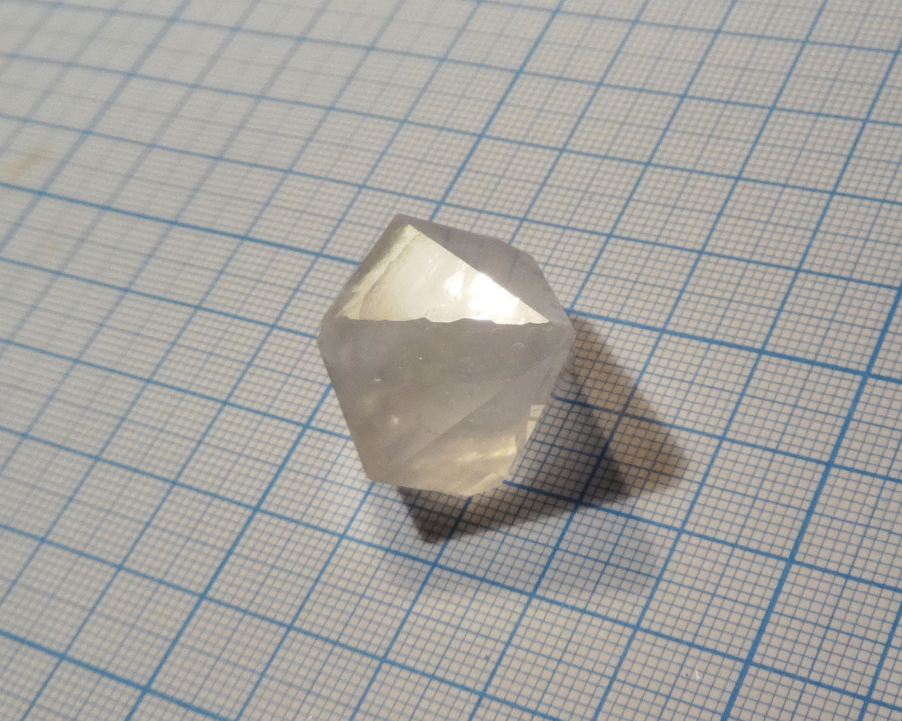
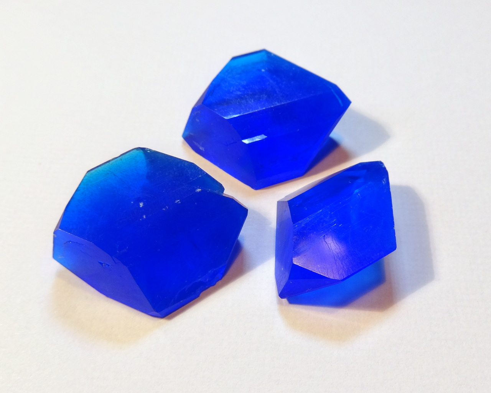
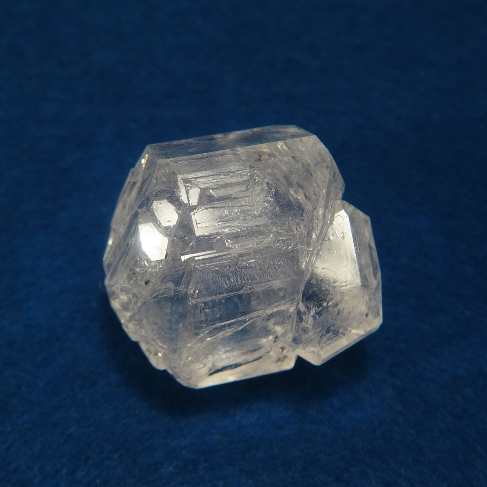
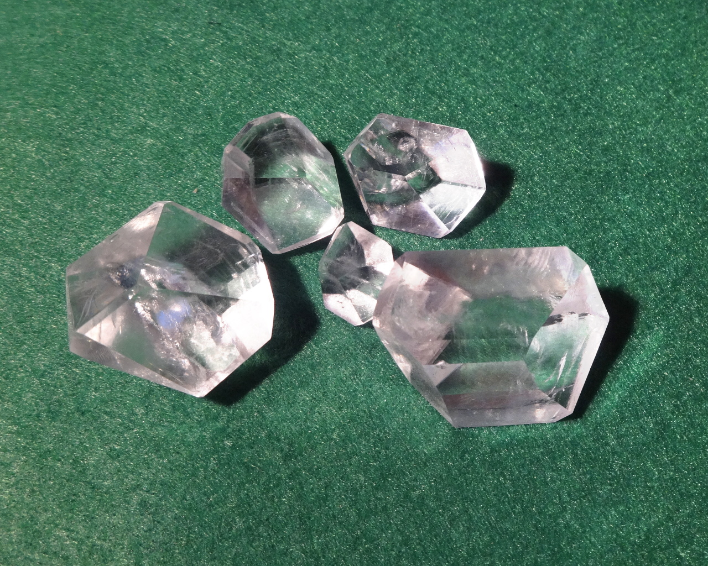
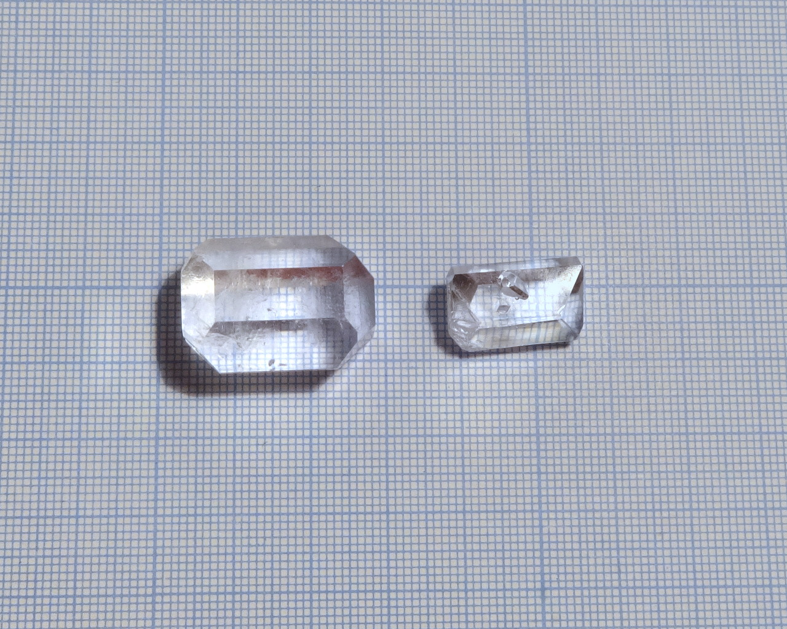

[TOC]

## Sulfates

Sulfates are salts of the sulfuric acid \ce{H2SO4}. Many of them are a good material for growing crystals, because of their stability and solubility.

* [Lithium sulfate](lithium-sulfate.md), \ce{Li2SO4}
* [Potassium sulfate](potassium-sulfate.md), \ce{K2SO4}
* [Lithium potassium sulfate](lithium-potassium-sulfate.md), \ce{KLiSO4}
* [Copper(II) sulfate](copper-sulfate.md), \ce{CuSO4*5H2O}
* [Sodium ammonium sulfate](sodium-ammonium-sulfate.md), \ce{NH4NaSO4*2H2O}

Sulfuric acid also forms salts or adducts with some organic compounds and complex ions.

* [Triglycine sulfate](triglycine-sulfate.md) \ce{3NH2CH2COOH*H2SO4}
* [Hexakis(urea) zinc sulfate](urea-zinc-sulfate.md) \ce{[Zn(CON2H4)6]SO4*?H2O}

### Double sulfates: Tutton's salts
There are many sulfates that have 2 different metals in it, in stoichiometric proportion. They form several families of similar compounds. Tutton's salts are compounds of general formula: \ce{M^I2M^(II)(SO4)2*6H2O}, where \ce{M^I} and \ce{M^(II)} stand for univalent and bivalent anions. In mineralogy, they are called schoenites.

* [Ammonium zinc sulfate](ammonium-zinc-sulfate.md) \ce{(NH4)2Zn(SO4)2*6H2O}
* [Potassium zinc sulfate](potassium-zinc-sulfate.md) \ce{K2Zn(SO4)2*6H2O}
* [Ammonium iron(II) sulfate](mohr-salt.md) \ce{(NH4)2Fe(SO4)2*6H2O}, also known as Mohr's salt.
* [Potassium magnesium sulfate](potassium-magnesium-sulfate.md) \ce{KMg(SO4)2*6H2O}, mineral schoenite.
* [Mixed K-Mg and K-Cu schoenite](magnesium-copper-potassium-sulfate.md), \ce{K2(Mg0.5Cu0.5)(SO4)2*6H2O}

### Double sulfates: bloedite family
Bloedites are similar to Tutton's salts (schoenites), but have 4 molecules of water instead of 6. They also can include \ce{Na} ions.

* [Sodium zinc sulfate](zinc-sodium-sulfate.md) \ce{Na2Zn(SO4)2*4H2O}, mineral Changoite.

### Double sulfates: alums
Alums are the family of similar double sulfates of general formula: \ce{M^IM^(III)(SO4)2*12H2O}, where \ce{M^I} and \ce{M^(III)} stand for univalent and trivalent anions. \ce{M^I} is usually one of \ce{K, NH4} but can be other: \ce{Na, Rb, Tl}. Trivalent metal \ce{M^(III)} is usually one of \ce{Al^(3+), Fe^(3+), Cr^(3+)}.

* [Potassium aluminum sulfate](potassium-alum.md) \ce{KAl(SO4)2*12H2O}, usually called just "alum" or potassium alum. The most representative member of this family.
* [Sodium aluminum sulfate](sodium-alum.md) \ce{NaAl(SO4)2*12H2O} is a sodium analog of the above compound. Sodium ion radius is very different from potassium, which makes this alum way less stable.
* [Ammonium aluminum sulfate](ammonium-alum.md) \ce{NH4Al(SO4)2*12H2O}, less common compound that is visually indistinguishable from the potassium salt.
* [Ammonium iron(III) sulfate](ferric-alum.md) \ce{NH4Fe(SO4)2*12H2O}, or ferric alum.

## Phosphates
Salts of phosphoric acid \ce{H3PO4}.

* [Ammonium dihydrogen phosphate](ammonium-dihydrogen-phosphate.md) \ce{NH4H2PO4}. A common fertilizer, giving nice columnar crystals.

## Acetates
Salts of acetic acid. Most acetates are soluble, but few of them are suitable for growing nice crystals.

* [Calcium copper acetate](calcium-copper-acetate.md) \ce{CuCa(CH3COO)4*6H2O}
* [Copper acetate](copper-acetate.md) \ce{Cu(CH3COO)2*H2O}

## Nitrates
Salts of nitric acids \ce{HNO3}. Most of nitrates are extremely soluble in water and deliquescent, which makes them badly suited for growing.

* [Ammonium calcium nitrate](ammonium-calcium-nitrate.md) \ce{5Ca(NO3)2*NH4NO3*10H2O}
* [Barium nitrate](barium-nitrate.md) \ce{Ba(NO3)2}

## Chlorides
* [Sodium chloride](sodium-chloride.md) \ce{NaCl}, table salt (very hard to grow)
* [Potassium chloride](potassium-chloride.md) \ce{KCl}, much better growing potassium sibling of table salt.
* [Ammonium chloroferrate](ammonium-chloroferrate.md) \ce{(NH4)2[FeCl5(H2O)]}, mixed chloride or ammonium and iron (III).
* [Ammonium tetrachlorocuprate](ammonium-tetrachlorocuprate.md) \ce{(NH4)2[CuCl4]}.

## Oxalate complexes
### Alumooxalates
Alumooxalates are salts of the complex anion \ce{[Al(C2O4)3]^(3+)}. They are colorless crystalline solids.

* [Potassium tris(oxalato) aluminate](potassium-trioxalato-aluminate.md) \ce{K3[Al(C2O4)3]}
* [Sodium tris(oxalato) aluminate](sodium-trioxalato-aluminate.md) \ce{Na3[Al(C2O4)3]}
### Ferrioxalates

Ferrioxalates are salts of the complex anion \ce{[Fe(C2O4)3]^(3+)}, they have beautiful green color, unusual for iron (III) compounds. They are slightly light sensitive and must be stored in dark place.

* [Lithium tris(oxalato) ferrate(III)](lithium-ferrioxalate.md)\ce{Li3[Fe(C2O4)3]} - lithium salt of the same green complex, flat crystals.
* [Lithium tris(oxalato) ferrate(III) chloride](lithium-ferrioxalate-chloride.md)\ce{Li4[Fe(C2O4)3Cl]} - double salt with two different anions: ferrioxalate and chloride. Crystals are shaoed as triangular prisms.
* [Sodium tris(oxalato) ferrate(III)](sodium-trioxalatoferrate.md) \ce{Na3[Fe(C2O4)3]} - unstable but beautiful green crystals
* [Potassium tris(oxalato) ferrate(III)](potassium-trioxalato-ferrate.md) \ce{K3[Fe(C2O4)3]} - green crystals, more stable to dehydration than sodium salt.
* [Sodium potassium tris(oxalato) ferrate(III)](sodium-potassium-trioxalatoferrate.md) \ce{K5Na[Fe(C2O4)3]2} - anhydrous crystals of deep green color, lesser known relativeof the above two salts. Very recommended for growing!

## Sulfamates (amidosulfonates)
Sulfamic (also known as amidosulfonic) acid is a moderately strong inorganic acid \ce{HSO3NH2}. Its primary household use is a descaler agent. Unlike sulfuric acid, it is solid. Almost all sulfamates have extremely high solubility.

* [Sulfamic acid](sulfamic-acid.md), \ce{H3NSO3} - the acid itself forms shiny rectangular tablets
* [Potassium sulfamate](potassium-sulfamate.md), \ce{KSO3NH2}, potassium salt for the above acid, crystallizing in a similar shape
* [Potassium bis(sulfamato) chlorocuprate](potassium-sulfamato-chloro-cuprate.md), \ce{K2[Cu(SO3NH2)2Cl2]} - a very interesting sulfamate complex, shiny dark violet sticks
* [Potassium bis(sulfamato) bromocuprate](potassium-sulfamato-bromo-cuprate.md), \ce{K2[Cu(SO3NH2)2Br2]} - bromine analog of the above complex, black tablets with green tinge
* [Ammonium bis(sulfamato) chlorocuprate](ammonium-sulfamato-chlorocuprate.md), \ce{(NH4)2[Cu(SO3NH2)2Cl2]} - ammonium analog, dark blue tablets

## Organic
* [Urea citrate](urea-citrate.md) \ce{CO(NH2)2*C3H4(OH)(COOH)3} cocrystal of urea and citric acid.
* [Saccharin](saccharin.md) Free acid of saccharin, insoluble in water.
* [Sodium saccharin](sodium-saccharin.md) Sodium salt of saccharin, once popular sugar substitute.
### Carbohydrates and related compounds
* [Erythritol](erythritol.md) \ce{C4H10O5} another sugar alcohol, lighter cousin of a xylitol.
* [Xylitol](xylitol.md) \ce{C5H12O5} sugar alcohol, used as sugar substitute.
* [Mannitol](mannitol.md)\ce{C6H14O6} another sugar alcohol.
* [Glucose sodium chloride](glucose-sodium-chloride.md) \ce{2C6H12O6*NaCl*H2O} cocrystal of glucose and table salt \ce{NaCl}
* [Glucose sodium bromide](glucose-sodium-bromide.md) \ce{2C6H12O6*NaBr*H2O} heavier sibling of the above compound, cocrystal of glucose and \ce{NaBr}

### Aminoacid salts
* [Glutamic acid hydrochloride](glutamic-acid-hydrochloride.md) \ce{C3H5(NH2)(COOH)2*HCl}
* [Glycyne oxalate 2:1](glycine-oxalate.md) \ce{(NH3CH2COOH)2C2O4} - glycine salt of oxalic acid
* [Copper β-alaninate](copper-beta-alaninate.md) Copper salt of the β-alanine amino acid.
* [Copper β-alaninate urea](copper-beta-alaninate-urea.md) adduct of the above compound with urea. Beautiful dark violet crystals that are stable on air.

## Various inorganic
* [Sodium Potassium tartrate](rochelle-salt.md) \ce{KNaC4H4O6*4H2O}, Rochelle salt
* [Sodium citrate](sodium-citrate.md) \ce{Na3C3H4(OH)(COO)3*?H2O}
* [Sodium tetraborate](borax.md) \ce{Na2B4O7*10H2O}, known as borax
* [Sodium boro-formate](sodium-boroformate.md) \ce{NaH2BO3*2HCOOH*2H2O} - scarcely described compound, formed by sodium borate and formic acid.
