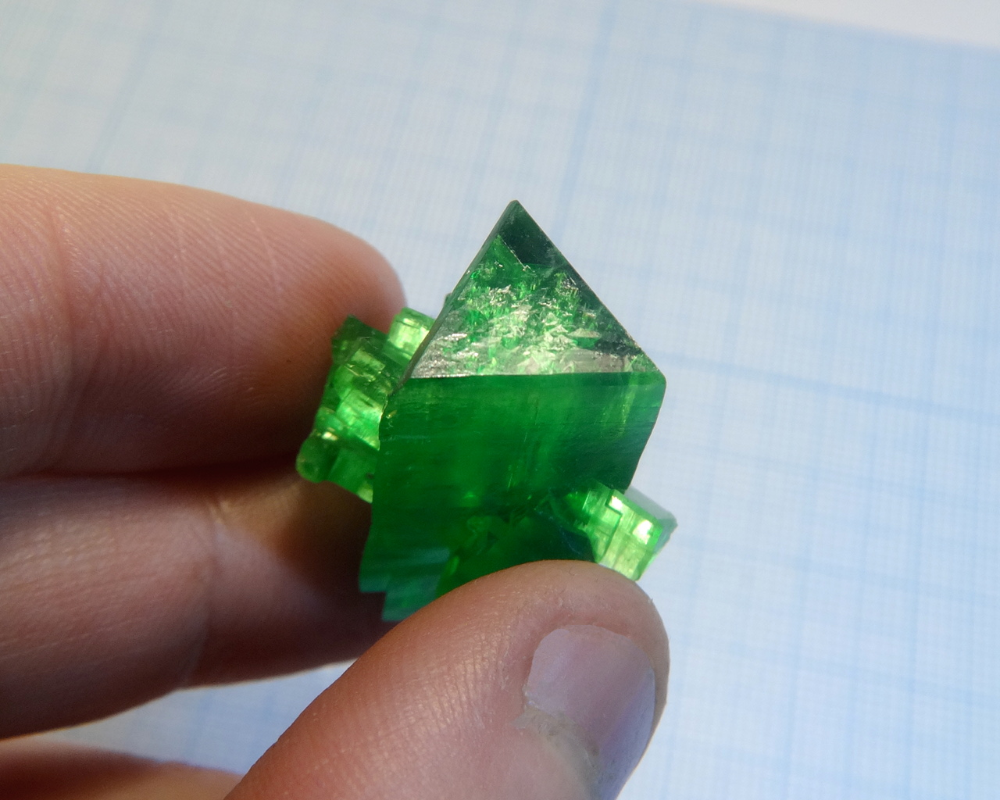
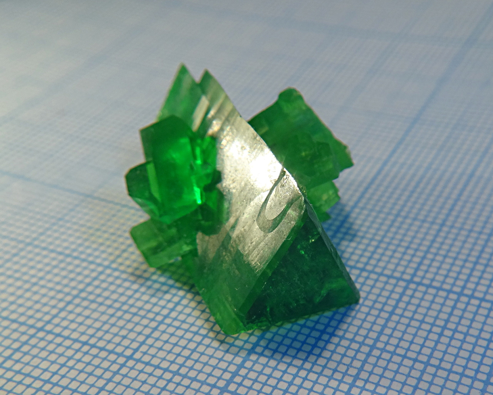
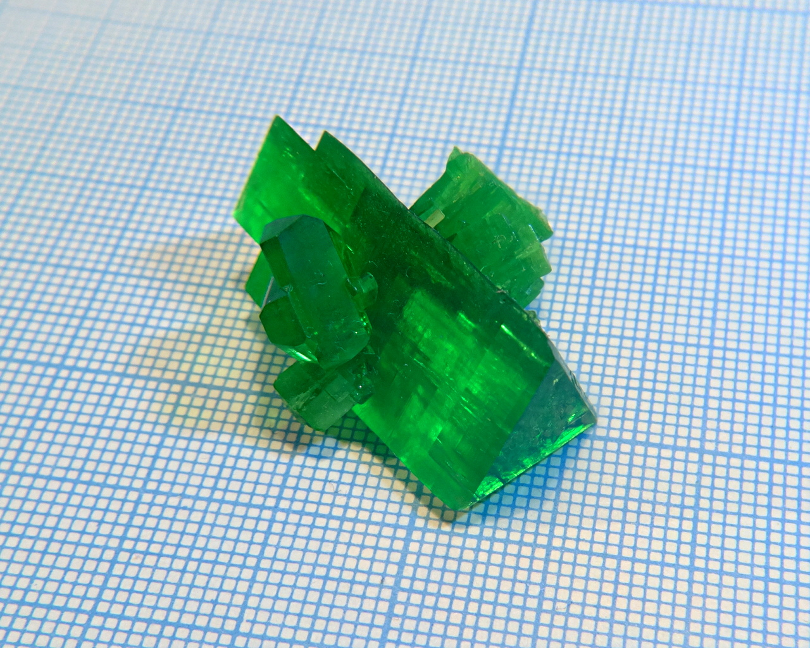
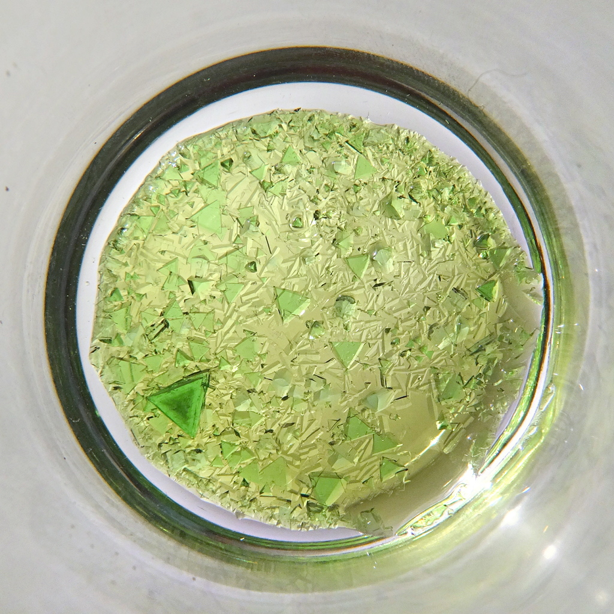
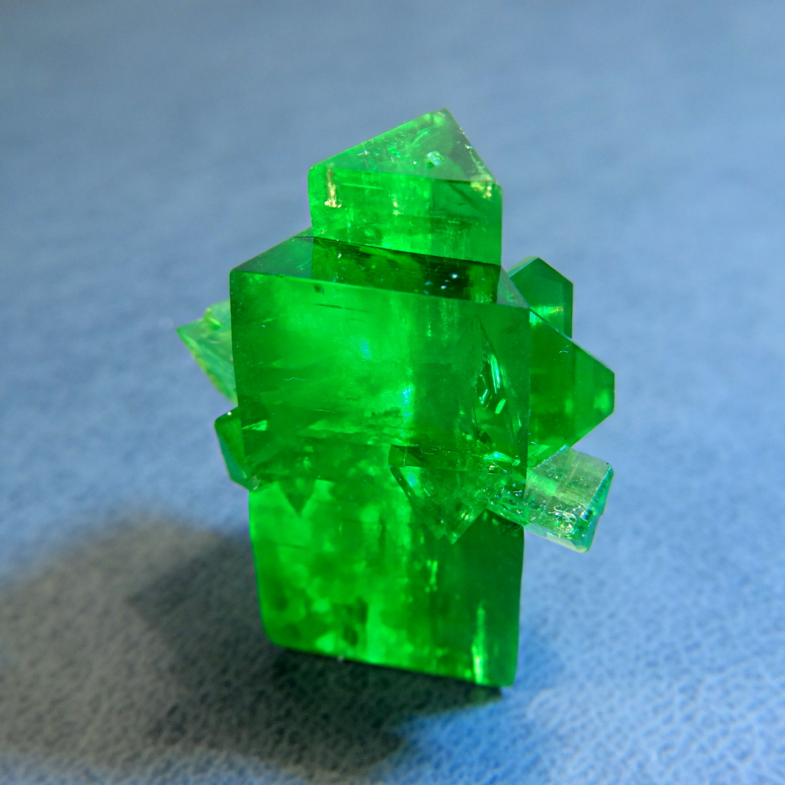
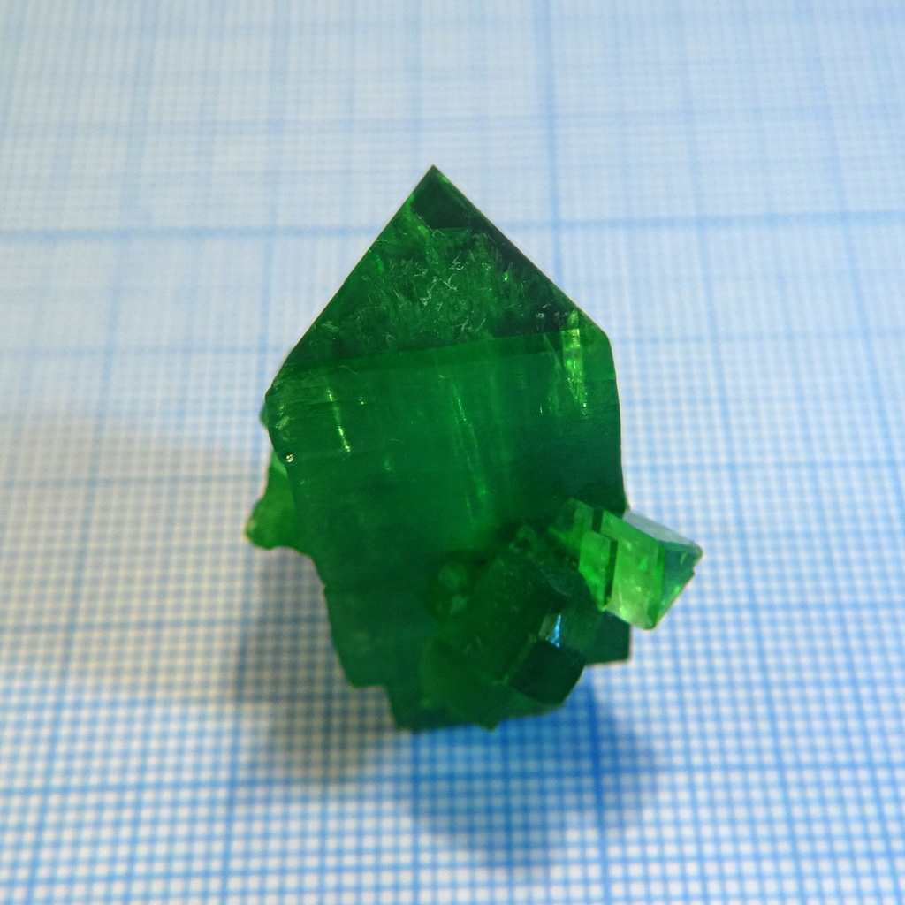
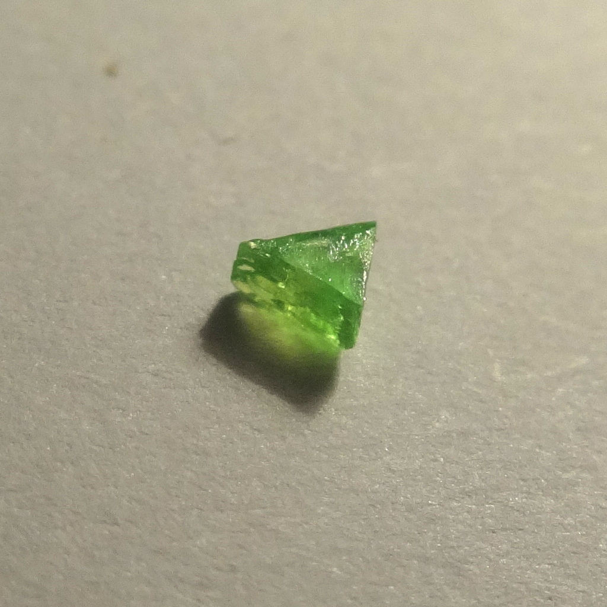
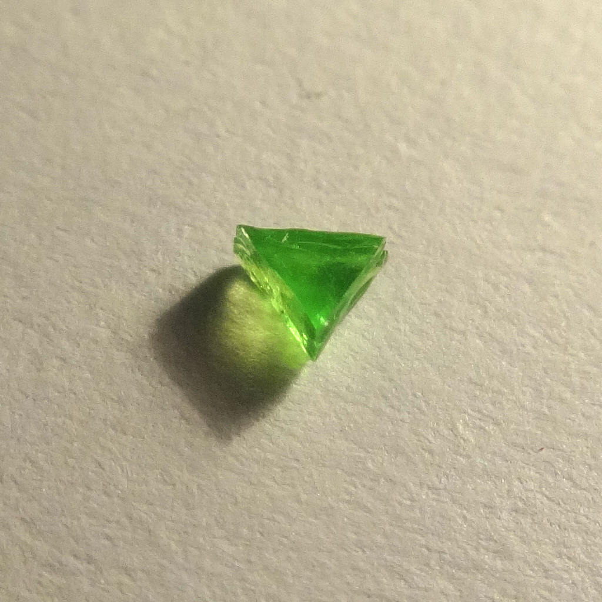
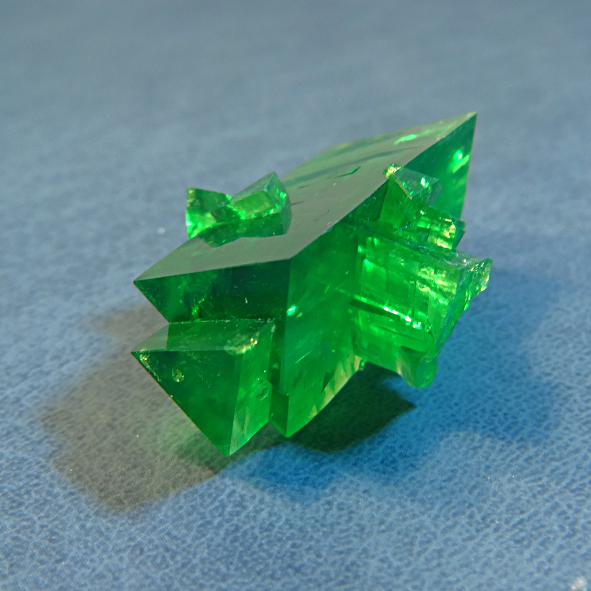

Formula: \ce{Li4[Fe(C2O4)3]Cl*9H2O}

Double salt of lithium with two different anions: ferrioxalate \ce{[Fe(C2O4)3]^(3-)} and chlorice \ce{Cl^-}. Also known as tetralithium iron(III) trioxalate chloride nonahydrate.

Lithium ferrioxalate alone [forms tabular crystals](lithium-ferrioxalate.md), but when lithium chloride is added, they crystallize together, orming new structure.

<!--more-->

## Properties

* **Crystal system**: trigonal
* **Crystal shape**: straight triangular prisms. Very rare shape for a crystal.
* **Color**: bright green, characteristing for ferrioxalates.
* **Stability on air**: not stable, losing water eventually.

## Preparation

To prepare this compound, make aqueous solution, containing stoichiometric amounts of lithium ferrioxalate (see preparation on [its page](lithium-ferrioxalate.md)) and lithium chloride. Equation is:

\ce{Li3[Fe(C2O4)3] + LiCl + 9H2O = Li4[Fe(C2O4)3]Cl*9H2O}

## Growing

As always, I used slow evaporation at room temperature to grow large crystals. Solubility of this material is quite high.

## Safety

All oxalates are mildly toxic.

## More photos

## References

* [Crystal structure and mössbauer study of tetralithium iron(III) trioxalate chloride nonahydrate](https://www.researchgate.net/publication/257113663_Crystal_structure_and_mssbauer_study_of_tetralithium_ironIII_trioxalate_chloride_nonahydrate)
