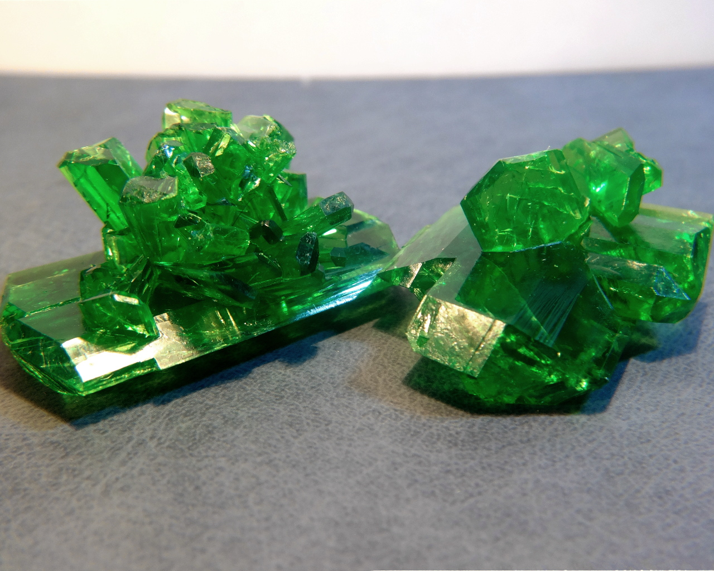
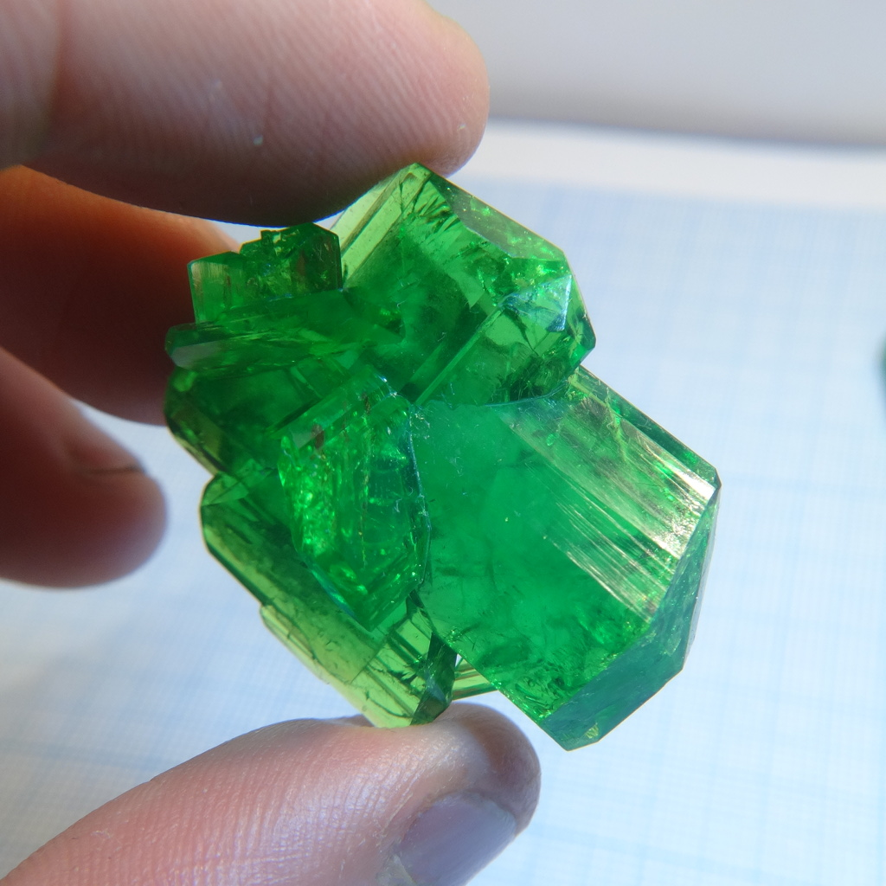
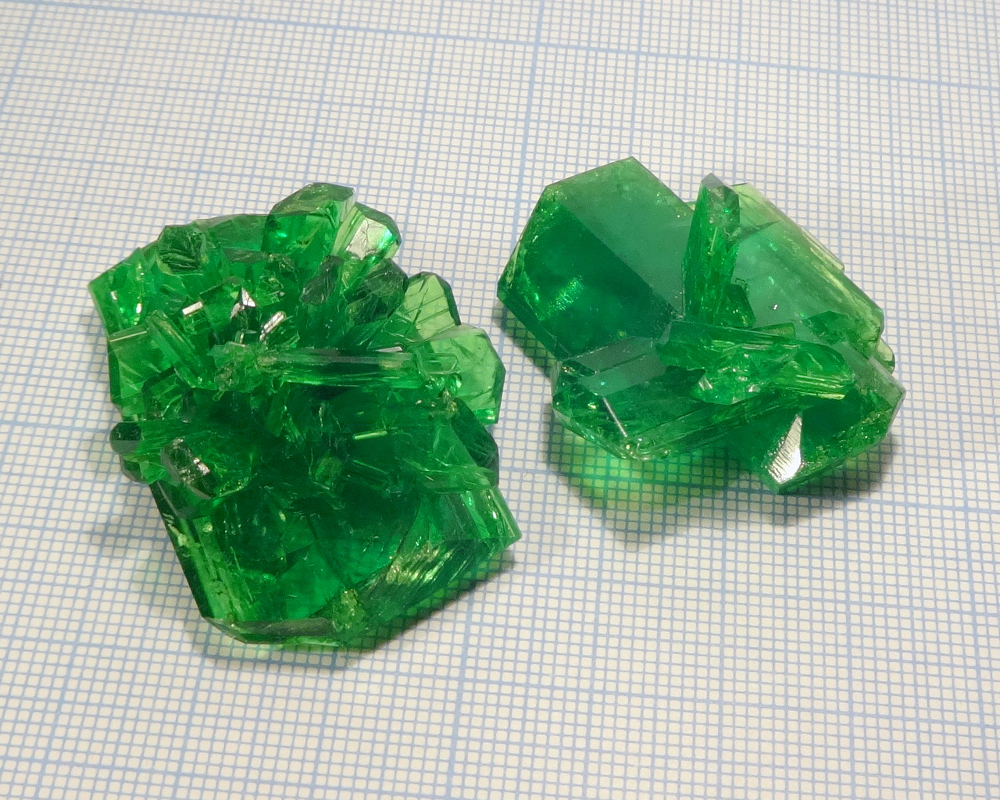
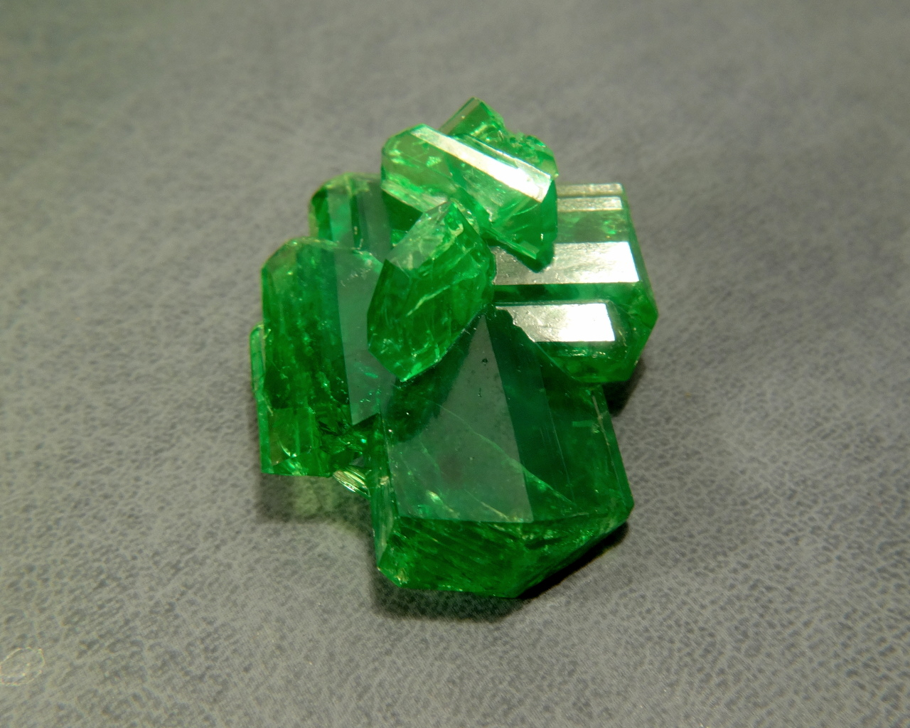
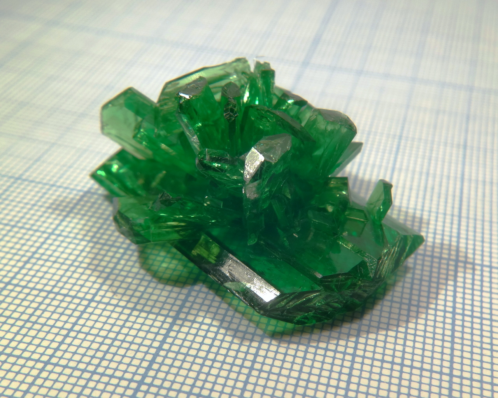
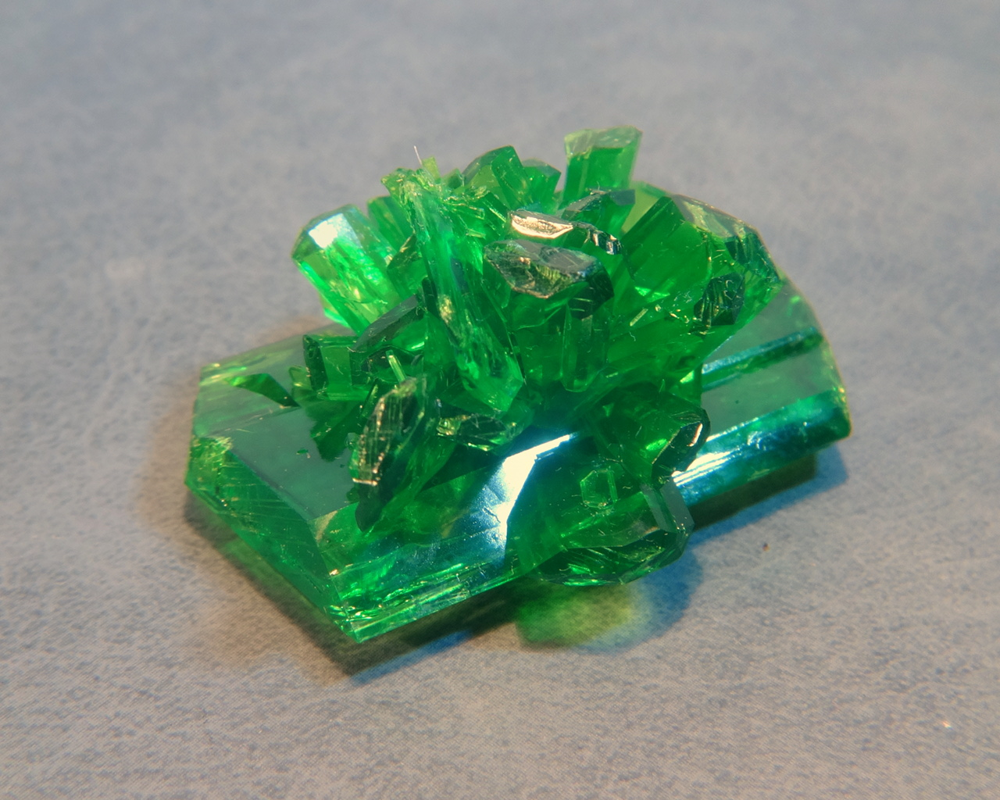
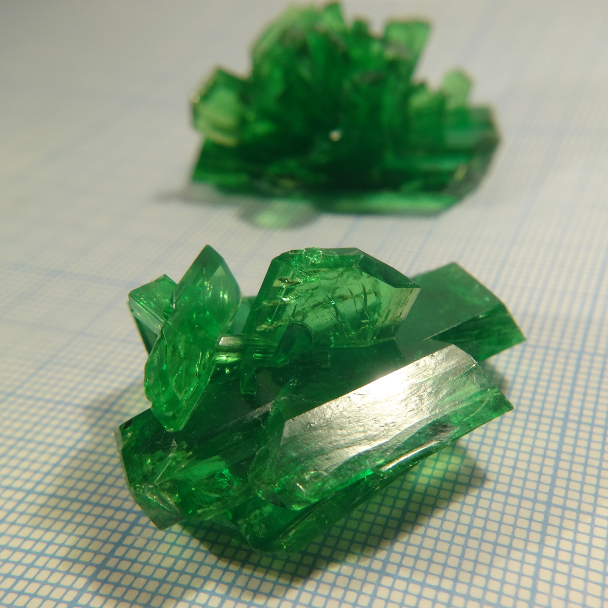
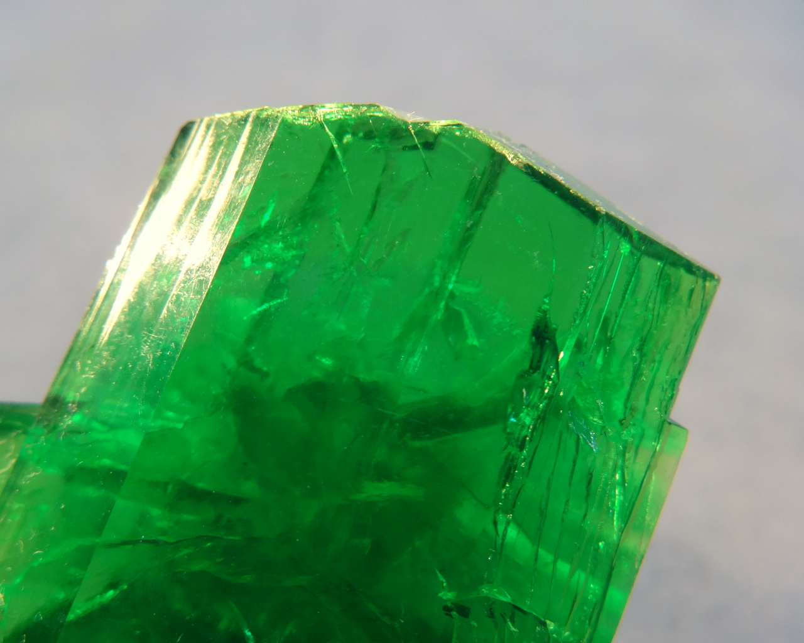

Formula: \ce{Li3[Fe(C2O4)]*5H2O}

Lithium salt of a complex acid, formed by Fe(III) and oxalate ions. As all [ferrioxalates](tag_ferrioxalate.html), has bright green color and is slightly light sensitve.

<!--more-->

## Properties
* **Crystal system**: monoclinic
* **Crystal shape**: flat tabular
* **Color**: deep green
* **Stability on air**: after a week on air, crystals are not showing signs of dehydration, but some cracks appeared.  
## Preparation
Similar to [sodium ferrioxalate](sodium-trioxalatoferrate.md), but replace \ce{NaOH} with \ce{LiOH}.
## Growing
I used slow exaporation method to grow the specimens on the photo; growth time was 3 weeks.
the compound has high solubility: my measurements give 92g/100ml art room temperature.
## Safety
Safe unless consumed.
## More photos

## References
