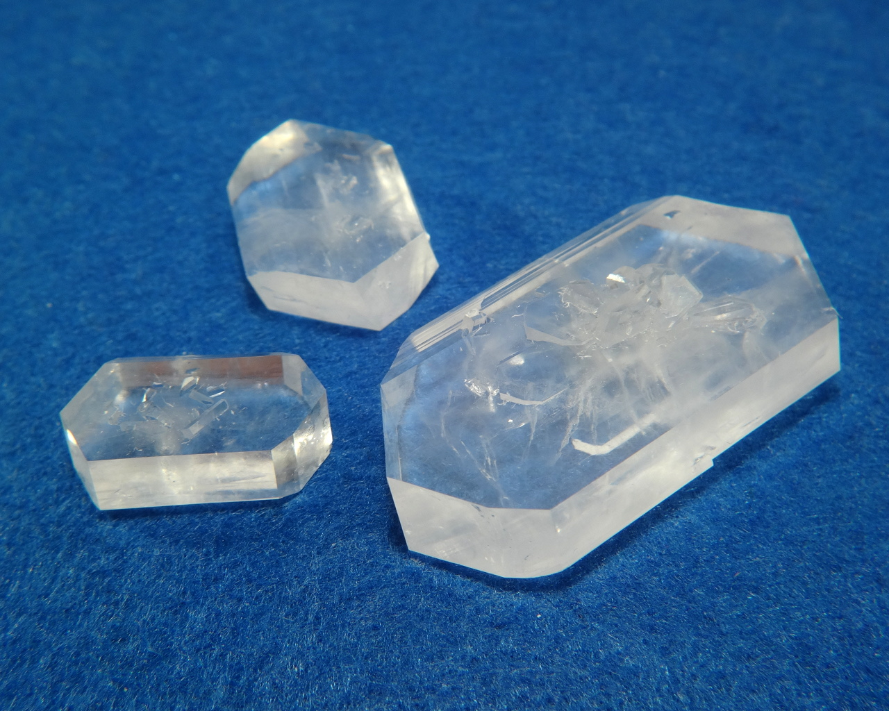
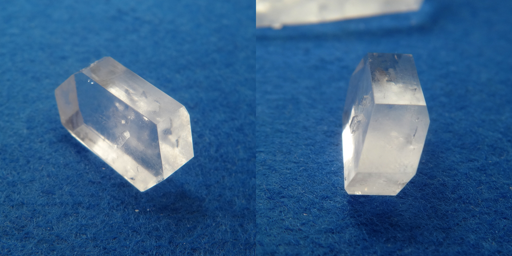
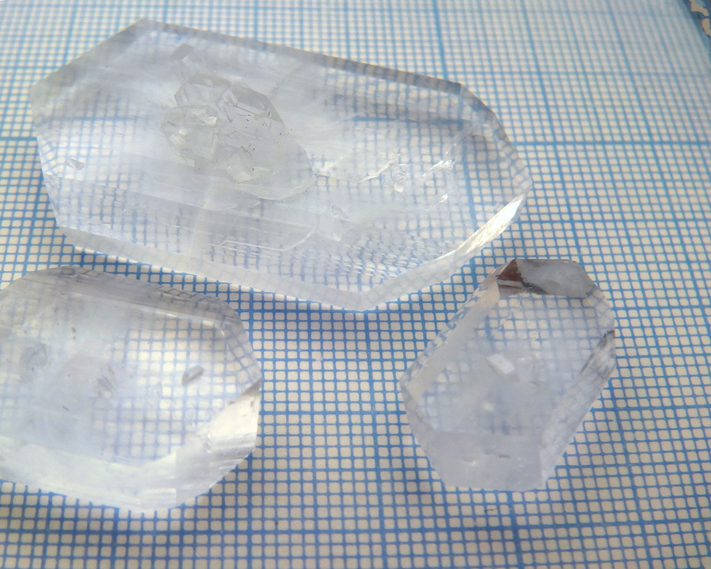
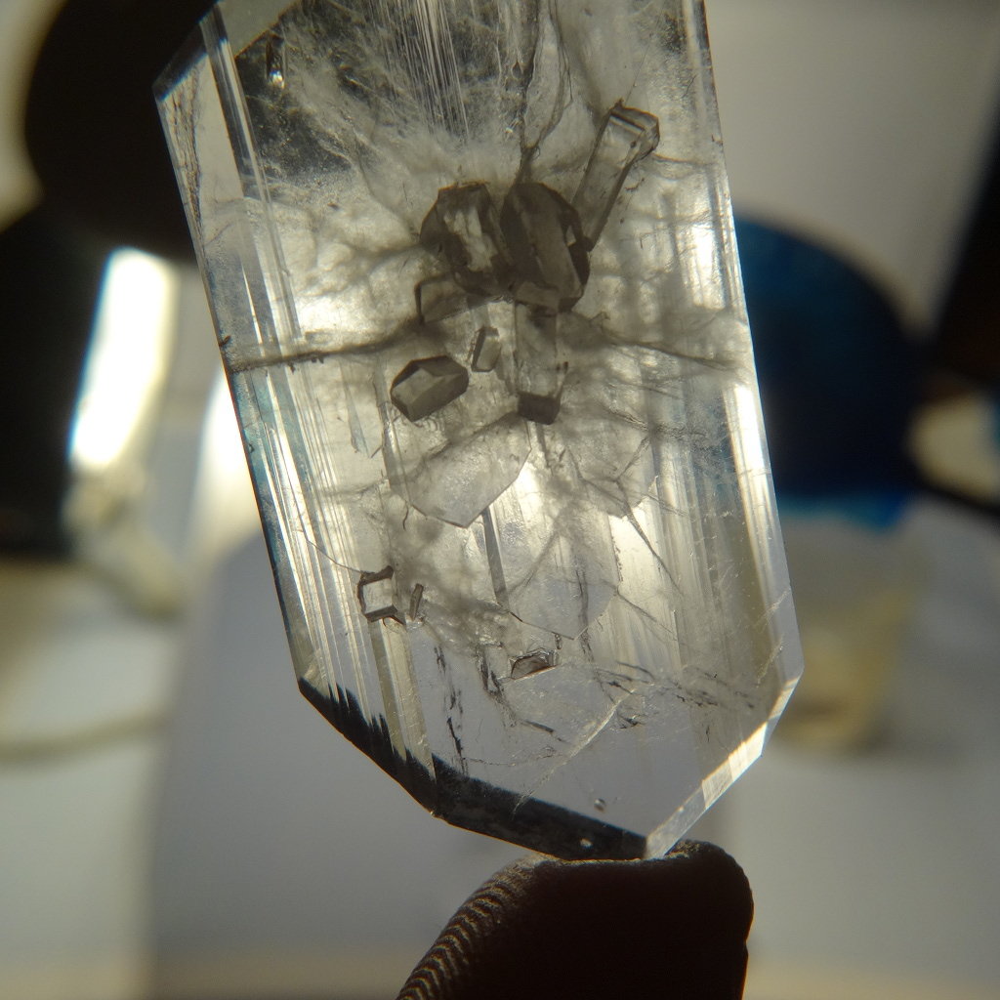
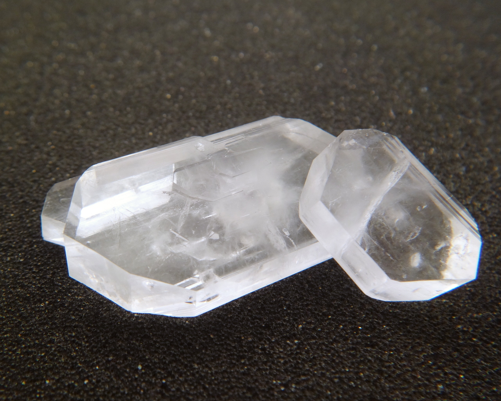
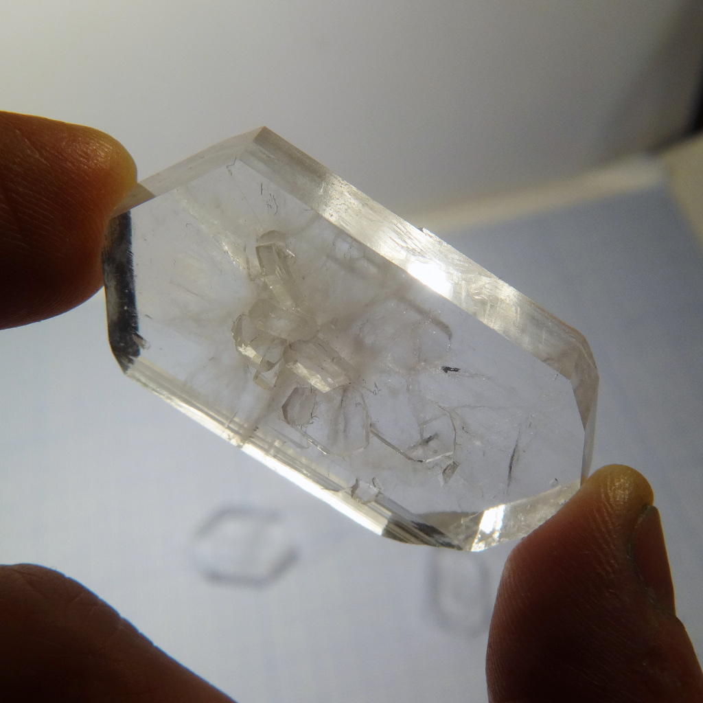
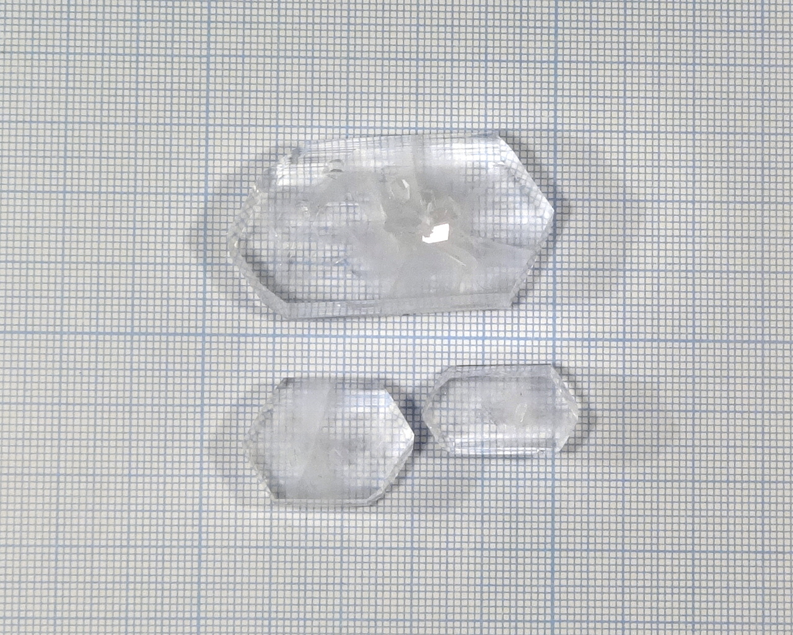

Formula: \ce{Li2SO4*H2O}

<!--more-->

## Properties
* **Crystal system**: monoclinic
* **Crystal shape**: flat, tabular prisms with elongated hexagonal base and slant sides.
* **Color**: colorless
* **Stability on air**: stable

## Preparation
I prepared it by reaction of lithium hydroxide and dilute sulfuric acid:

\ce{2LiOH + H2SO4 = Li2SO4 + H2O}

## Growing

As always, I used slow evaporation method to grow the crystals. Growing was complicated by very strong tendency of lithium sulfate solution to creep.

It seems that pH affects crystal morphology: alcaline pH produces very thin plates, while from acidic solutions thicker plates grow.

## Safety
Lithium has low acute toxicity, but consumption of it must be avoided.

## More photos

