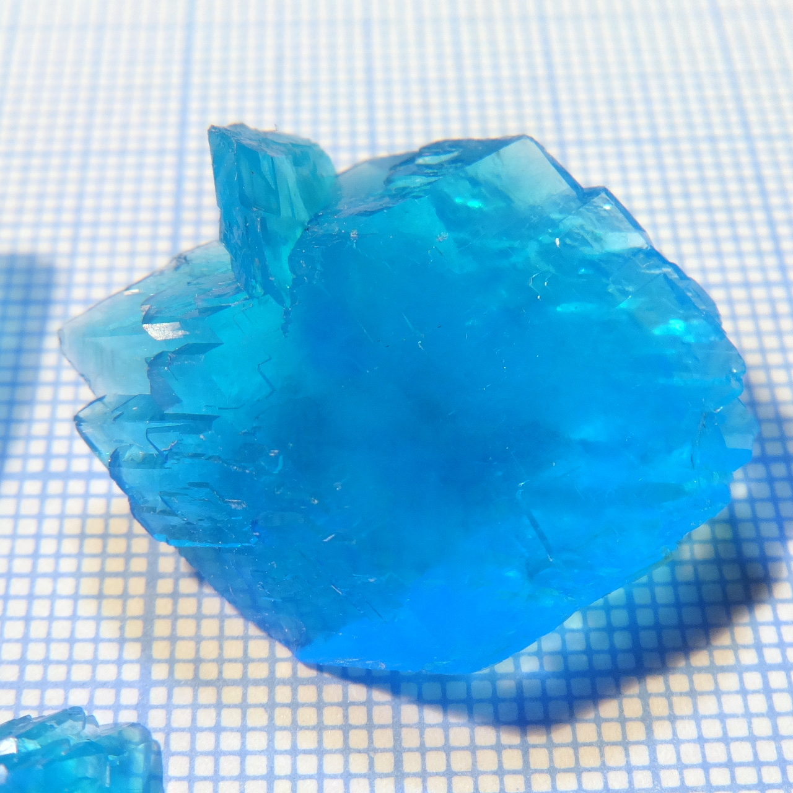
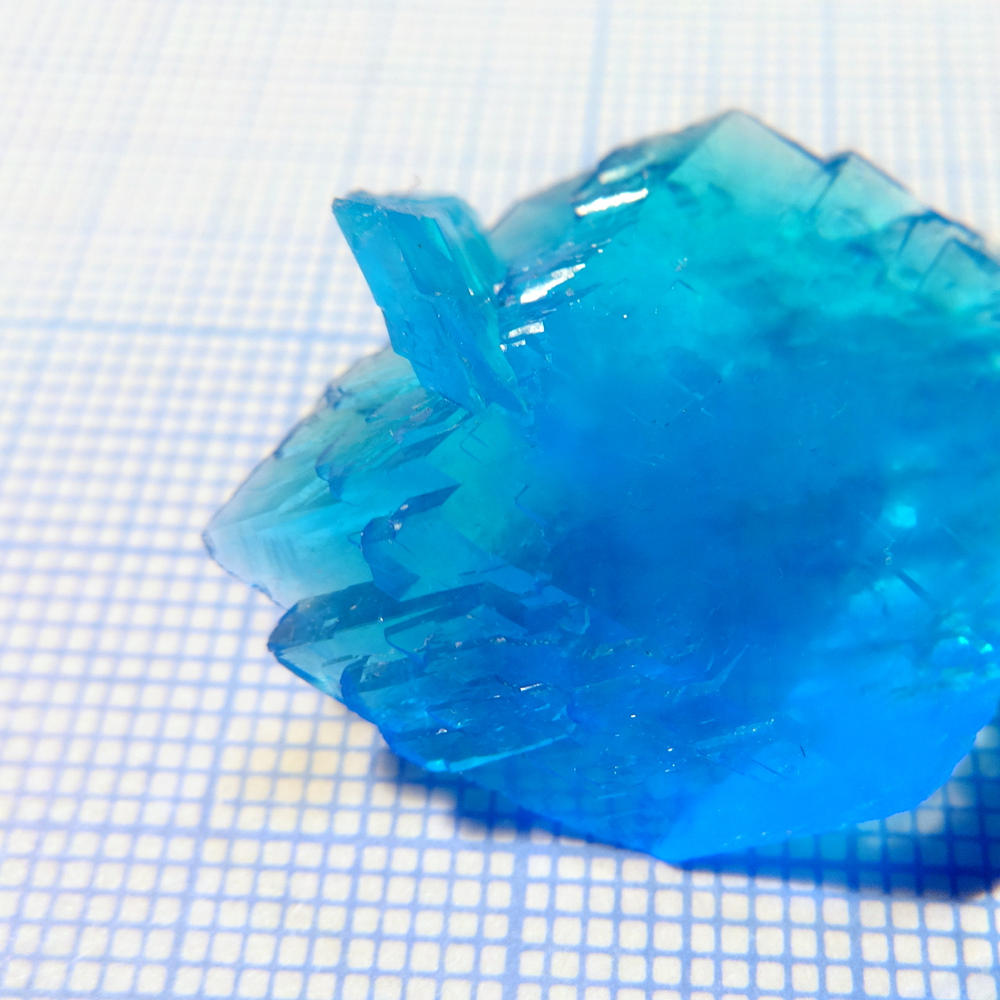
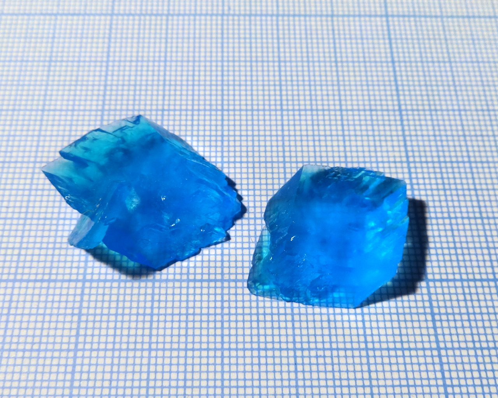

A mixed compound, solid solution of 2 different Tutton's salts: potassium-copper and [potassium-magnesium](potassium-magnesium-sulfate.md).

Approximate formula: \ce{K2(Mg0.5Cu0.5)(SO4)2*6H2O}

<!--more-->

## Properties
* **Crystal system**: monoclinic
* **Crystal shape**: flat slant prisms with rhombic base, very different from the shape of [pure schoenite](potassium-magnesium-sulfate.md).
* **Color**: light blue, much lighter than copper sulfate
* **Stability on air**: stable

## Preparation
Mix \ce{K2Cu(SO4)2*6H2O} and \ce{K2Mg(SO4)2*6H2O} approximately in 1:1 ratio, dissolve in water and crystallize.

## Safety
Mildly toxic as all copper compounds

## More photos

