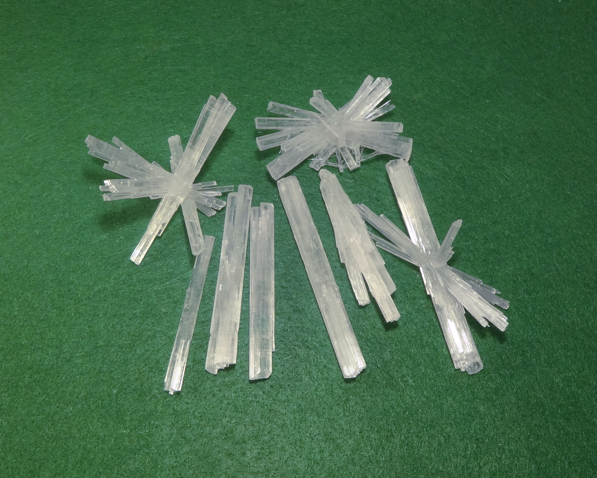
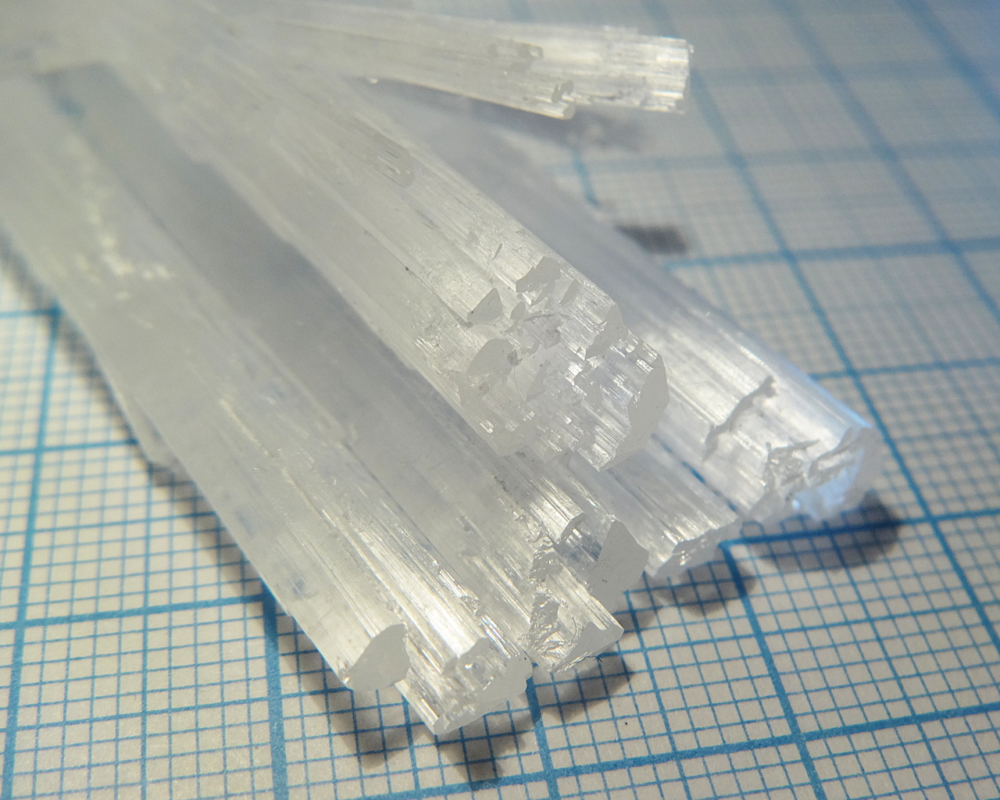
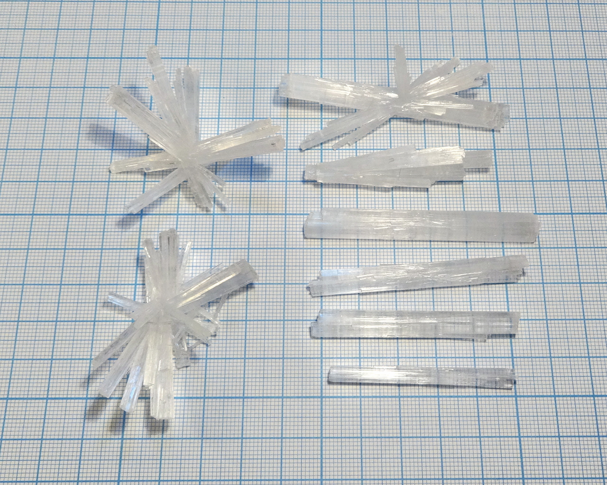
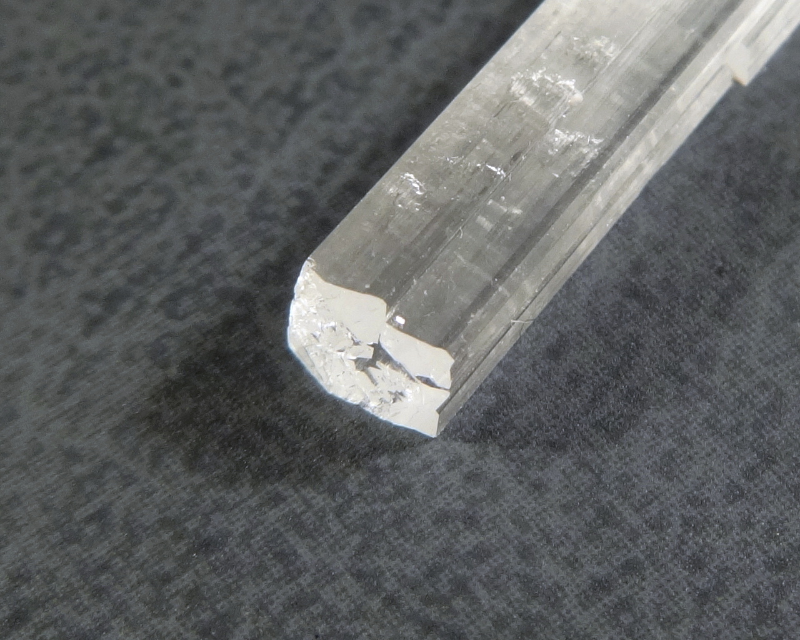
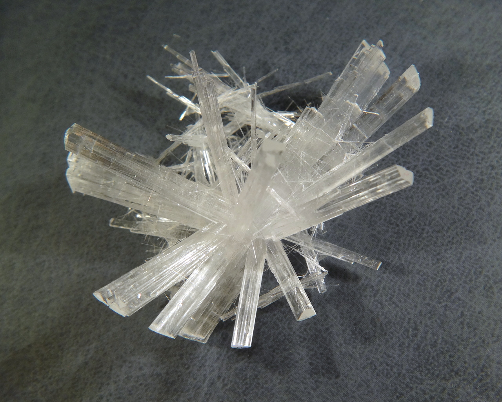
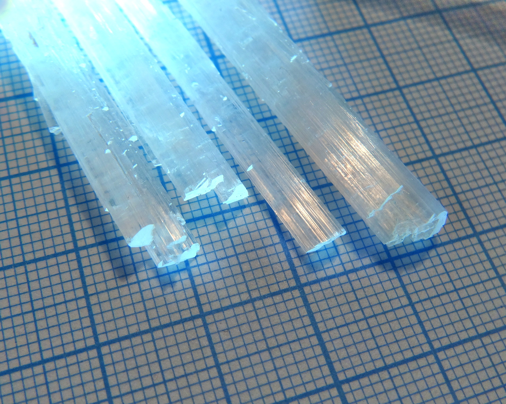

Formula: \ce{C6H14O6}

Mannitol is a sugar alcohol, chemically similar to [xylitol](xylitol.md) and [erythritol](erythritol.md), but having very different crystal morphology. It crystallizes as long transparent sticks.

<!--more-->

## Properties
* **Crystal shape**: elongated sticks, each stick is often a columnar aggregate of multiple crystals
* **Color**: colorless
* **Stability on air**: stable

Sticks of mannitol are hard but brittle; they make glassy sound when hit.

## Obtaining
Solution of mannitol and sodium chloride can be bought in drugstores.

## Growing
The easiest method to grow mannitol sticks is growing from *slightly* supersaturated solution:

* Prepare saturated solution of mannitol at room temperature. Its solubility at room temperature is 21.6g/100ml
* Heat the solution and dissolve few additional grams of mannitol per 100ml of solution.
* Let the solution cool down to the room temperature. Supersaturated solution is ready.
* Now put a seed in it, cover the growing container and let it grow. When growth stopped, repeat previous steps, storing the crystal in a small container with solution.

Such slightly supersaturated solution does not nucleate spontaneously and provides good growing speed, more than 5mm per days. Most my specimens on the photo below were grown in less than 2 weeks.

## Safety
Mannitol is not toxic, but have laxative effect if consumed in large amounts.

## More photos

## References
* [Wikipedia](https://en.wikipedia.org/wiki/Mannitol)
