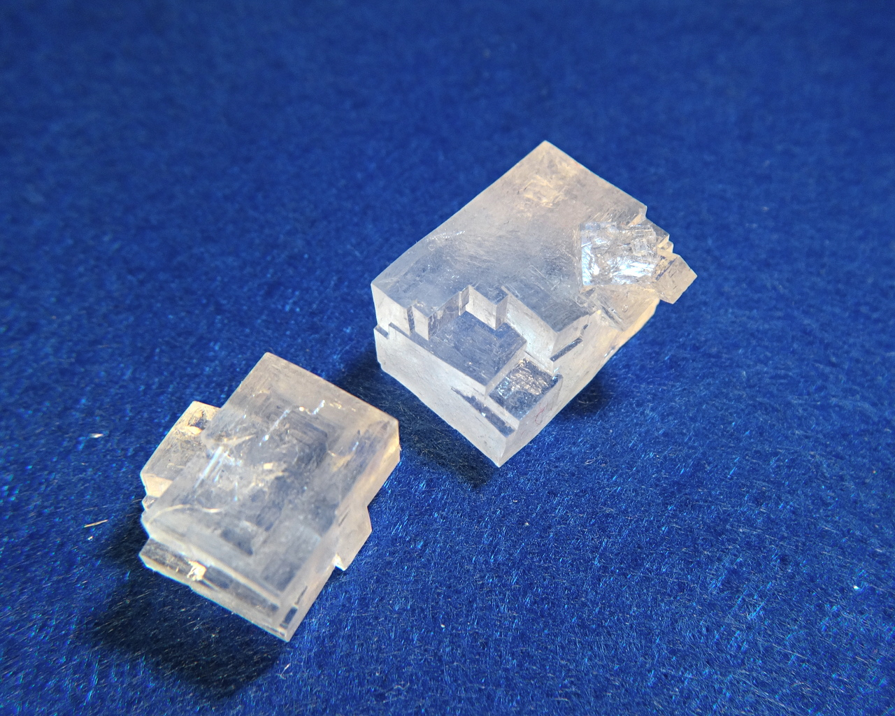
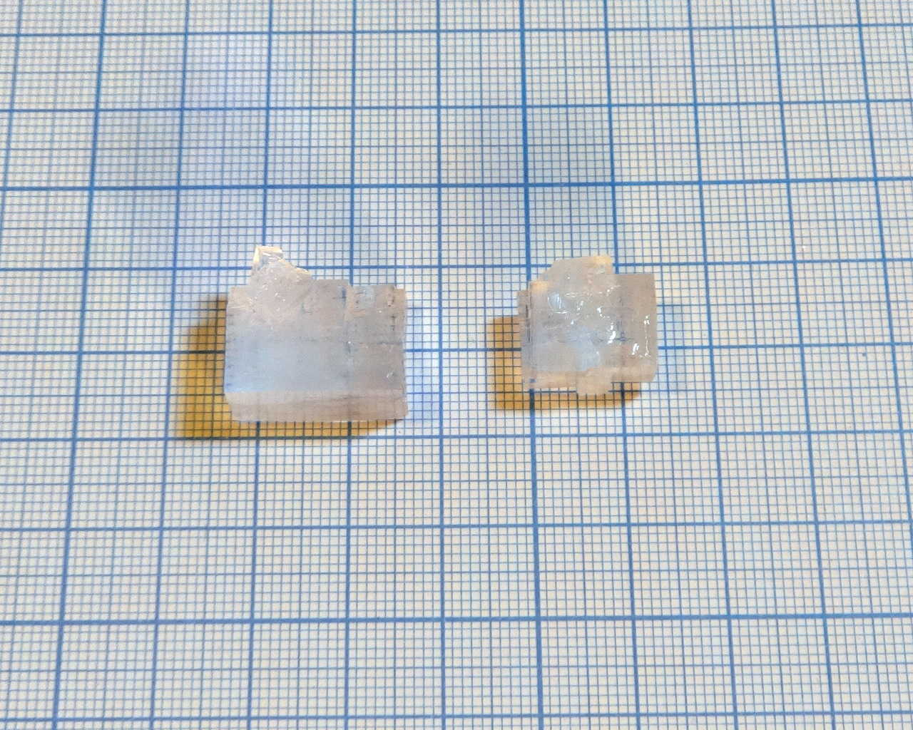

Formula: \ce{KCl}

Potassium chloride is a potassium analog of a [table salt](sodium-chloride.md). It has the same cubic crystalline structure and shape of crystals. Large crystals are easy to grow, but often get cloudy and badly formed.

<!--more-->

## Properties

* **Crystal system**: isometric
* **Crystal shape**: cuboid
* **Color**: colorless
* **Stability on air**: very stable

## Obtaining

Potassium chloride is used as a fertilizer and can be obtained in gardenig stores, but precence of chloride ion makes it less popular choice than other potassium fertilizers.

## Growing

Potassium chloride grows much more easily than [NaCl](sodium-chloride.md). I used slov evapotation to produce the samples on photos.

Its solubility changes a lot with temperature: 34g/100ml at 20°C; and 51.3g/100ml at 80°C. However, in my experiments cooling of saturated solution only produced large number os thin needle-like crystals.

## Safety

This compound is safe.

## More photos

## See also

* [Sodium chloride](sodium-chloride.md), \ce{NaCl}. It has same crystal structure and shape, but is much harder to grow.
* [Glucuse sodium chloride](glucose-sodium-chloride.md), \ce{2C6H12O6*NaCl*H2O}. It is a cocrystal of table salt and glucose sugar. It has completely different crystal shape and structure, and also an easy compound to grow.

## References

* Wikipedia on [potassium chloride](https://en.wikipedia.org/wiki/Potassium_chloride)
* [Crystal growing wiki in Russian](http://ru.crystalls.info/%D0%A5%D0%BB%D0%BE%D1%80%D0%B8%D0%B4_%D0%BA%D0%B0%D0%BB%D0%B8%D1%8F)
