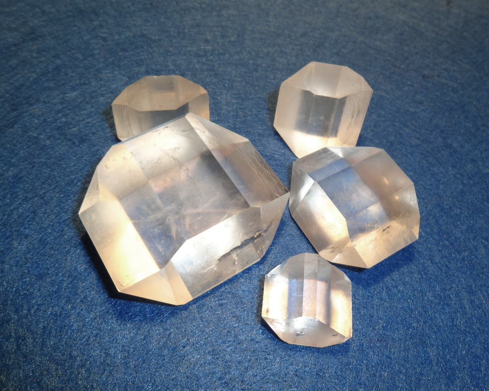
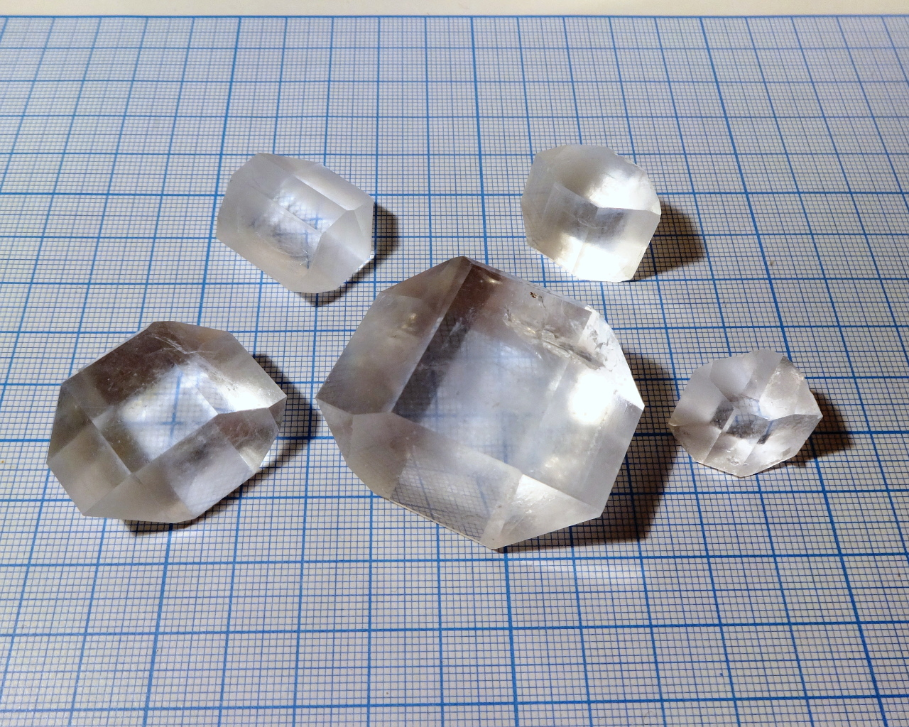
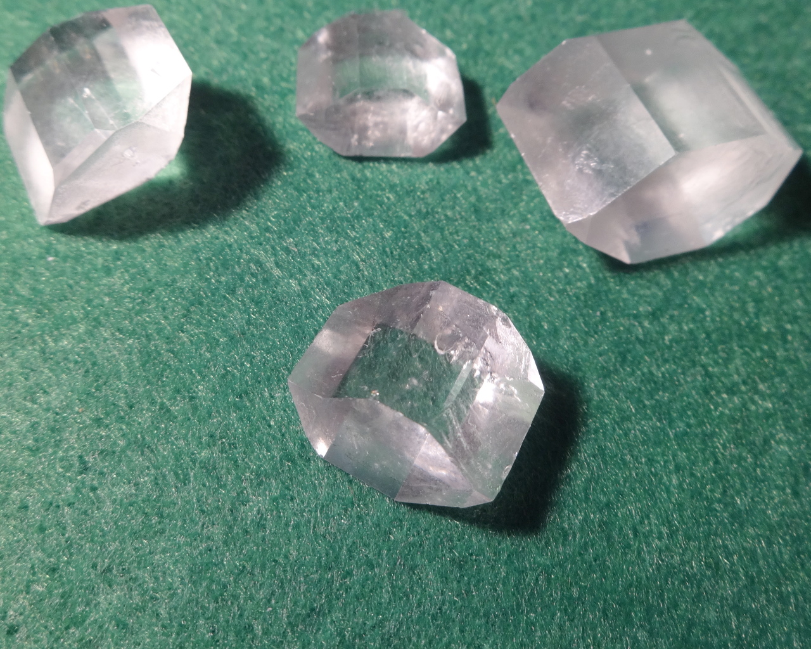
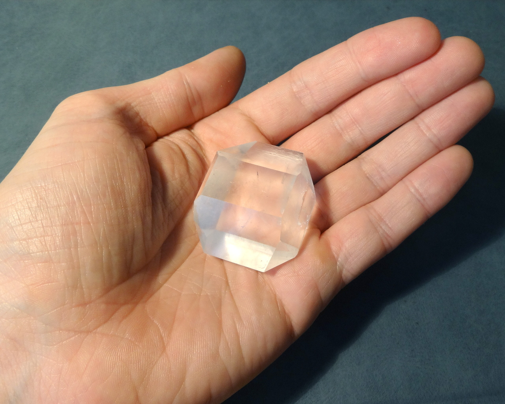
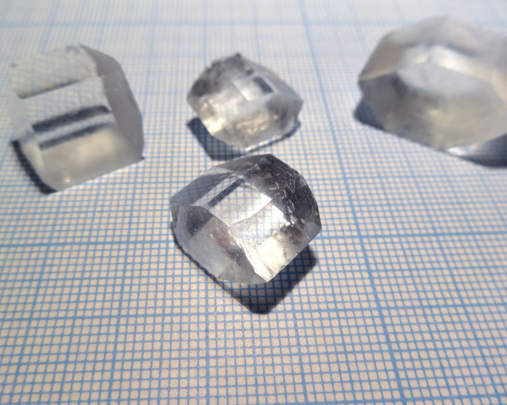
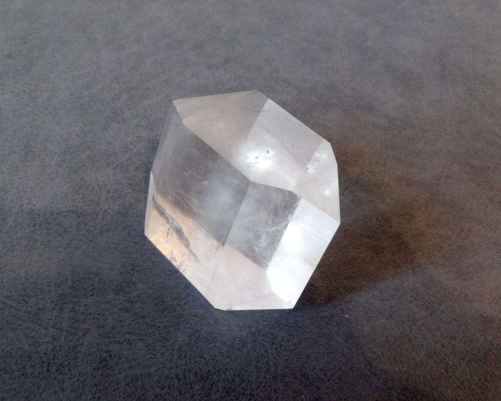
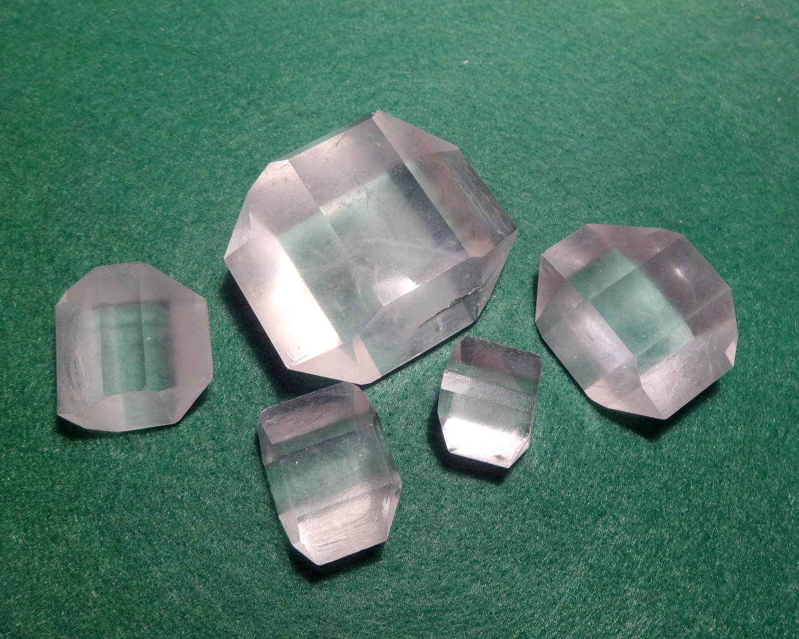
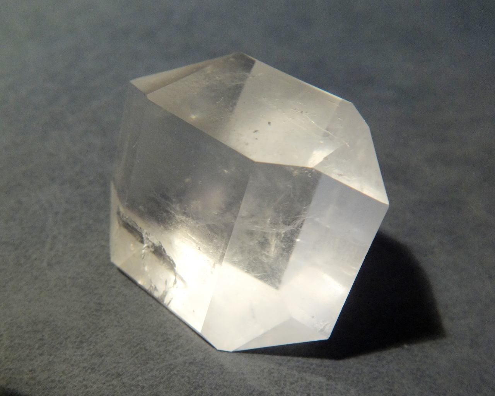

Formula: \ce{K2Mg(SO4)2*6H2O}

<!--more-->

## Properties
**Crystal system**: monoclinic

**Stability on air**: stable. No signs of dehydration after months.

## Preparation
Dissolve equimolar amounts of potassium sulfate \ce{K2SO4} (a common fertilizer) and magnesium sulfate \ce{MnSO4*7H2O} in water, then crystallize.

## Growing

## Safety
The compound is not toxic in reasonable amounts.

## More photos

