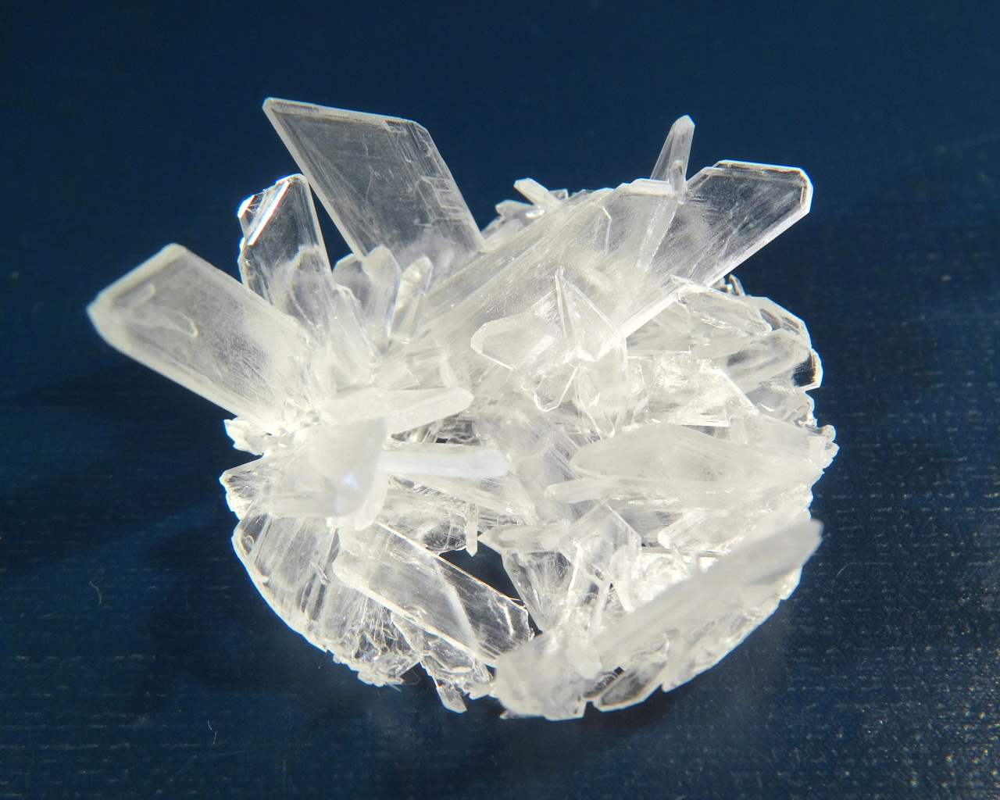
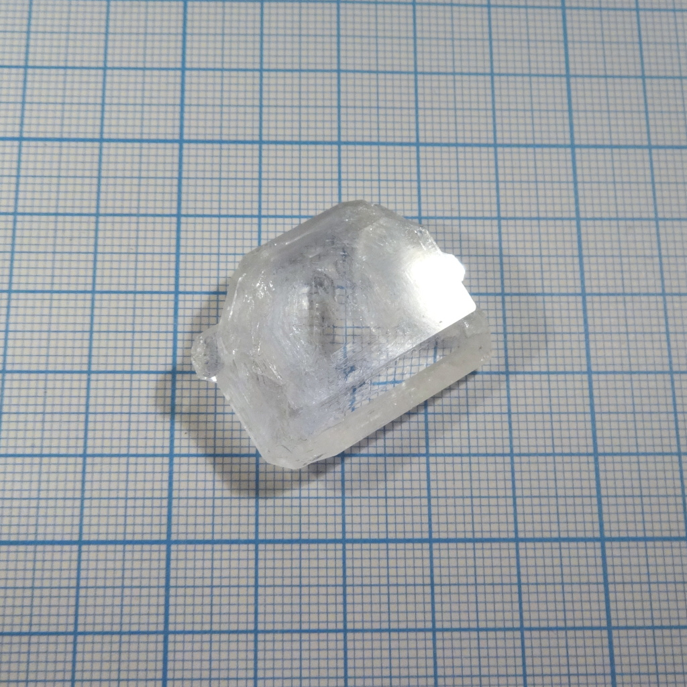

Formula: \ce{KSO3NH2}
Potassium salt of sulfamic (amidosulfonic) acid. One of a few well crystallizing salts of this acid that crystallize well. Other salts often have excessive solubility.

<!--more-->

## Properties
* **Crystal system**: orthorombic
* **Crystal shape**: flat tablets. Fast growing by cooling produces elongated crystals, slow evaporation gives shorter rectangular tables, resembling its aprent compound [sulfamic acid](sulfamic-acid.md).
* **Color**: transparent, colorless.
* **Stability on air**: stable on air
## Preparation

Reaction of sulfamic acid with potassium carbonate \ce{K2CO3} or hydroxide \ce{KOH}:

\ce{K2CO3 + 2H3NSO3 -> 2KSO3NH2 + H2O + CO2},

\ce{KOH + H3NSO3 -> KSO3NH2 + H2O}.

## Growing

Solubility of this compound is big, and increases quickly with temperature. 100 ml of water dissolve 45.86 g of this salt at 9°C, 77.75 g at 25°C and 129.36 g at 45°C.

Crystals on the photo grew in one day from hot saturated solution after it was cooled to room temperature..

Slow growth using evaporation produces tabular crystals resembing those of [sulfamic acid itself](sulfamic-acid.md)

## Safety

The compound is generally safe.

## References

* [DOI: 10.1002/crat.201000135](http://onlinelibrary.wiley.com/doi/10.1002/crat.201000135/abstract): an article with information on crystal structure 
