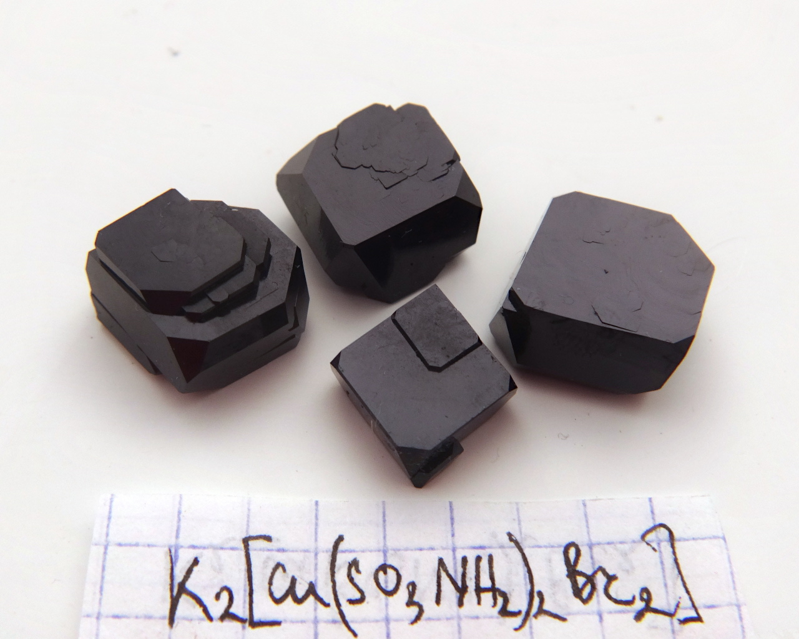
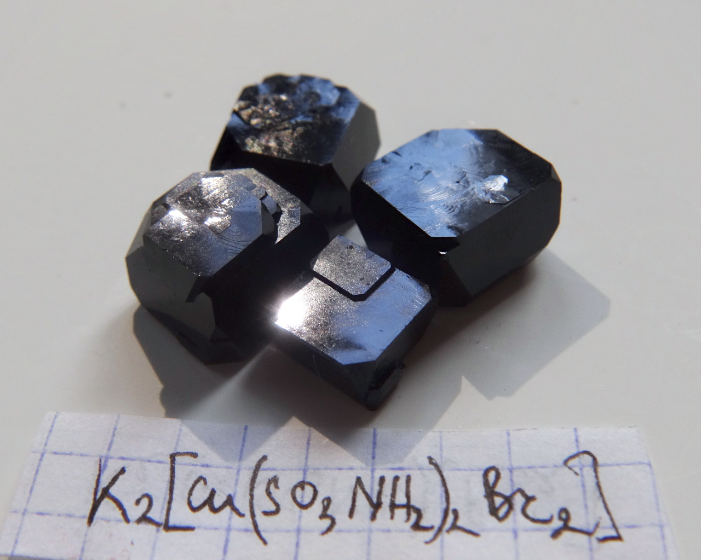
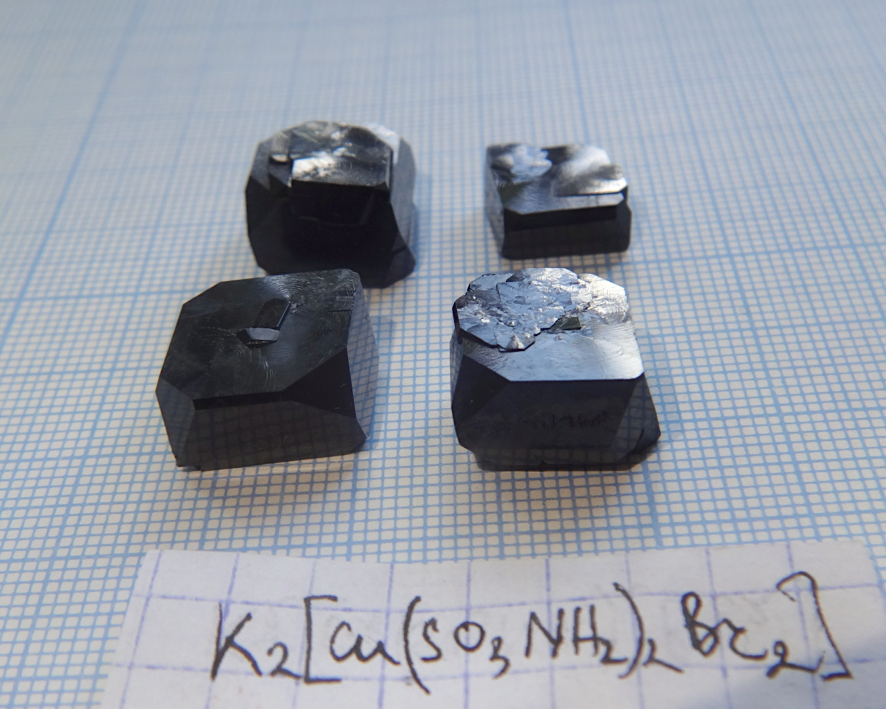
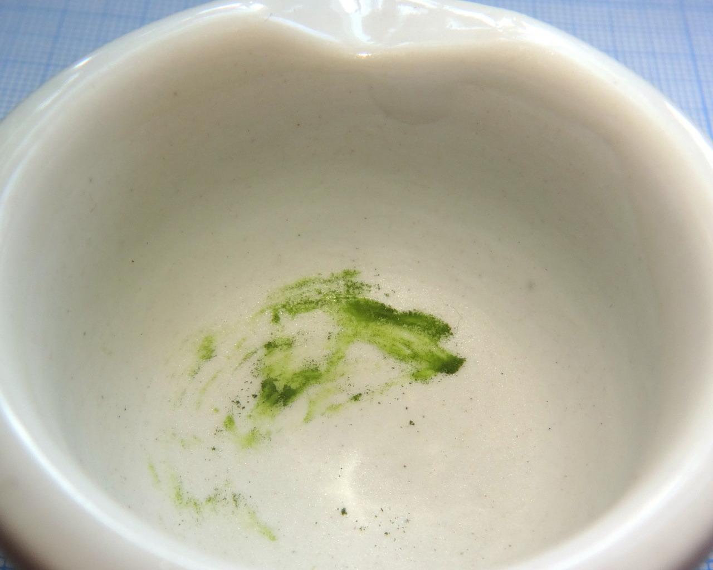

Formula: \ce{K2[Cu(SO3NH2)2Br2]}

Bromine analog of [Potassium bis(sulfamato) chlorocuprate](potassium-sulfamato-chloro-cuprate.md)

<!--more-->

## Properties
* **Crystal shape**: thick rectangular tablets
* **Color**: very dark green, almost indistinguishable from black
* **Stability on air**: stable

## Preparation

Prepare solution, containing potassium bromide \ce{KBr} and copper sulfamate \ce{Cu(SO3NH2)2} in 2:1 molar ratio and crystallize it. 

\ce{2KBr + Cu(NH2SO3)2 = K2[Cu(NH2SO3)2Br2]}.

## Growing

Not the easiest material for growing. Has higher solubility compared to the chloride analog, and is more prone to forming parasite crystals. Moreover, solution has very dark color, making it impossible to control growth visually without extracting the crystal.

## Safety

The main source of danger is copper: all copper compounds are moderately toxic.

## More photos

When powdered, green coloration is observable:

## References

* [Préparation et étude par spectrométrie infrarouge de bis(sulfamato) halogénocuprate (II): \ce{M2[Cu(NH2SO3)X2}](X = Cl ou Br et M = K ou NH4)](https://www.sciencedirect.com/science/article/abs/pii/0584853976801730)
