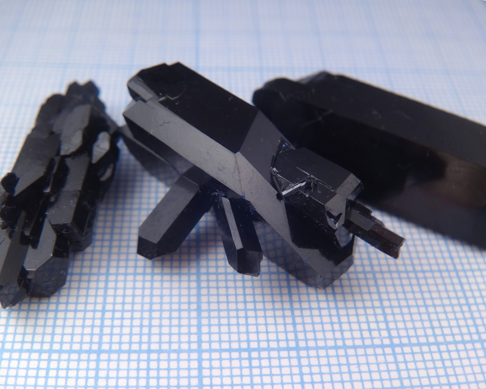
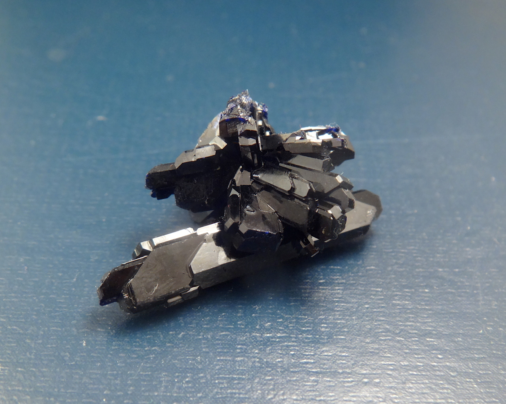
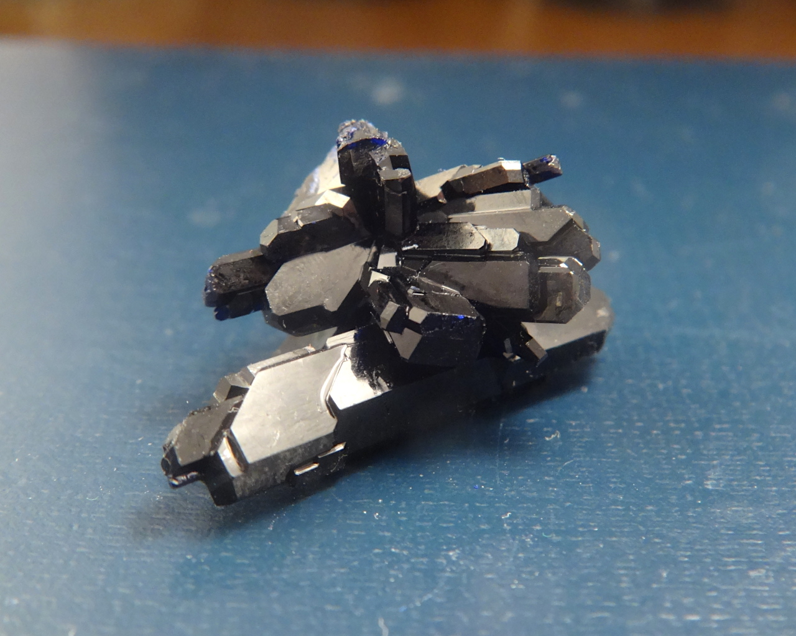
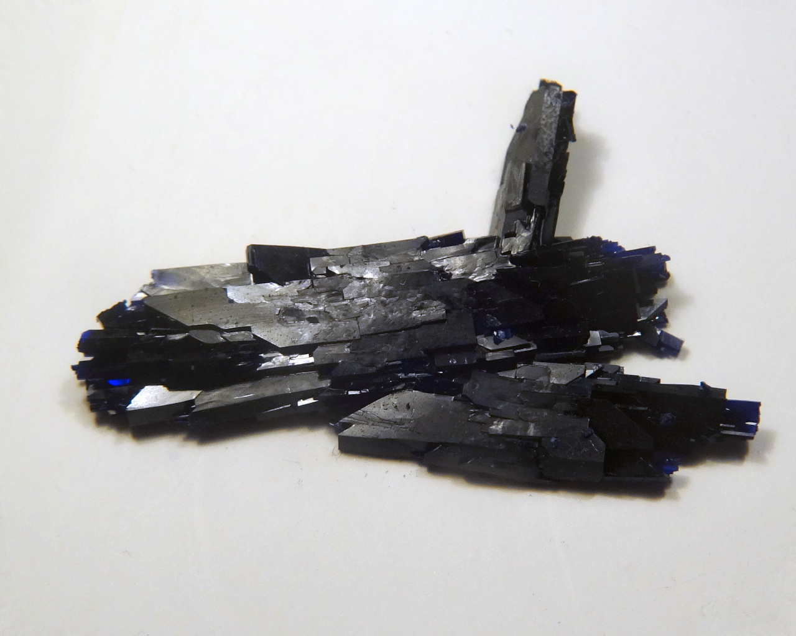
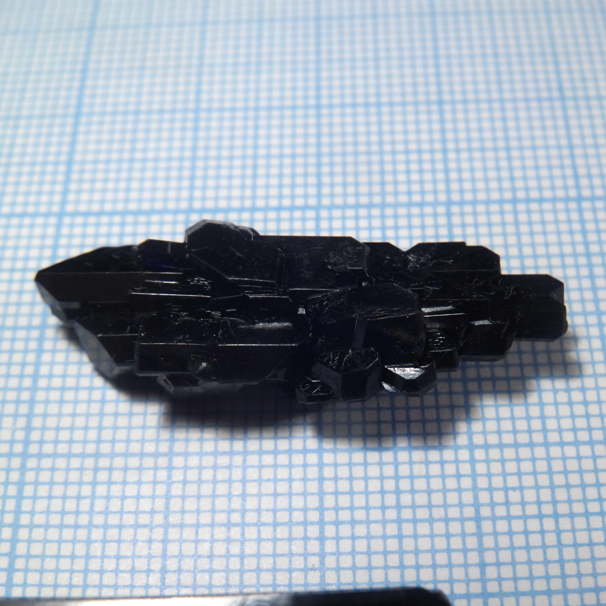
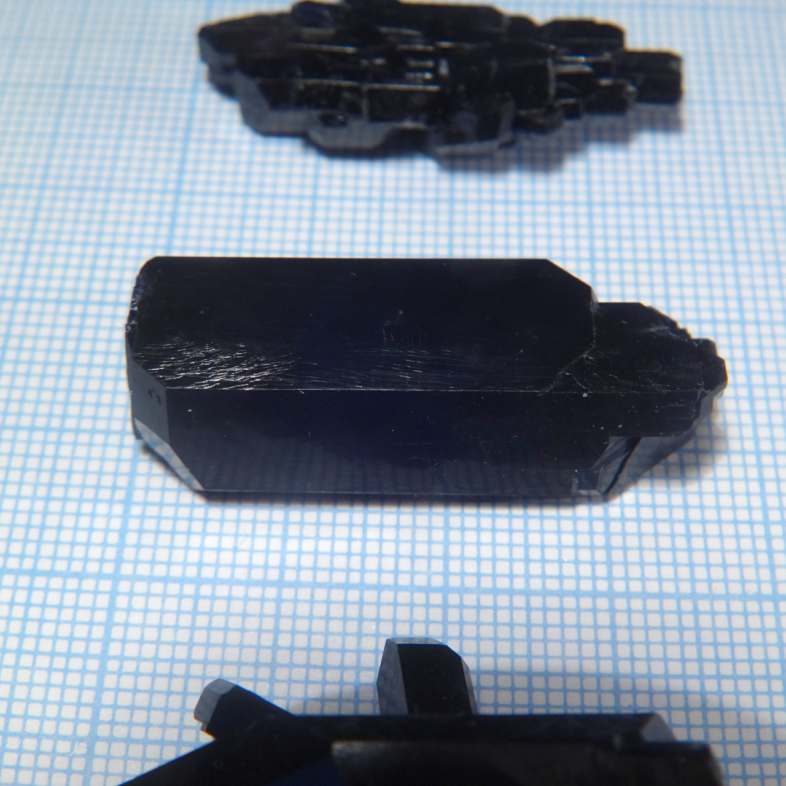
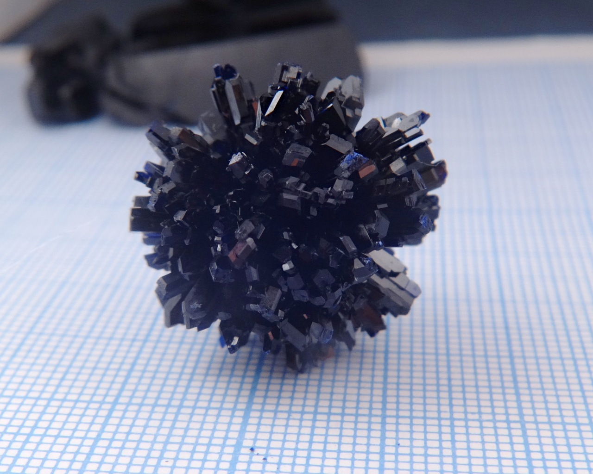
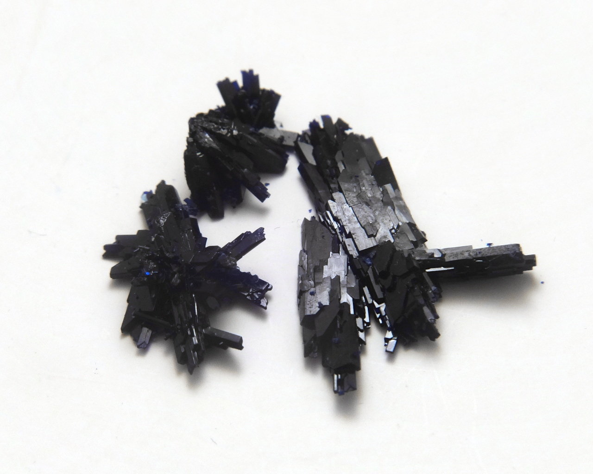
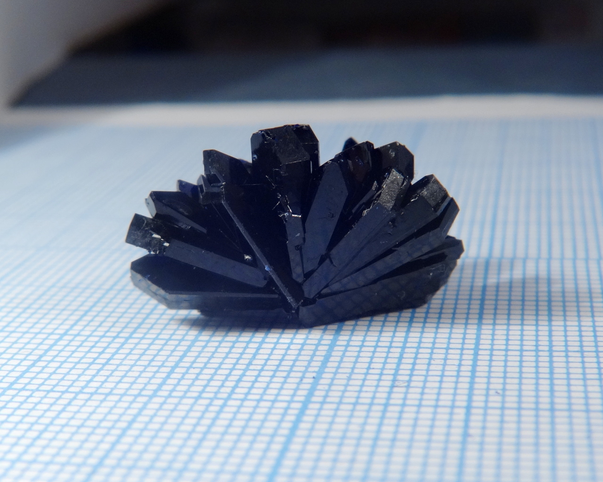
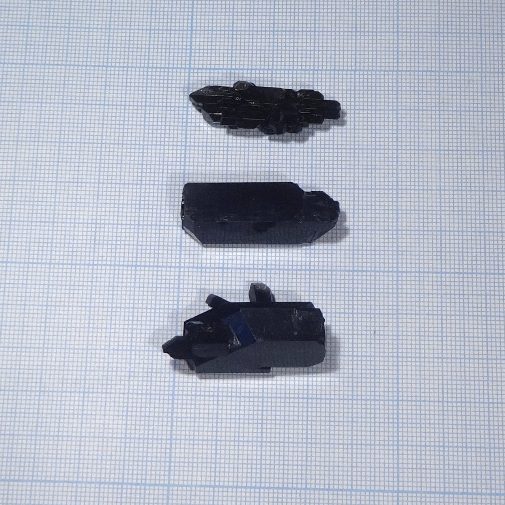

Formula: \ce{K2[Cu(SO3NH2)2Cl2]}

An unusual coordination complex of copper, producing  lustrous dark violet crystals.

It has bromine analog: [potassium bis(sulfamato) bromocuprate](potassium-sulfamato-bromo-cuprate.md). Also, potassium can be replaced with ammonium: [ammonium bis(sulfamato) chlorocuprate](ammonium-sulfamato-chlorocuprate.md)

<!--more-->

## Properties
* **Color**: dark violet, almost black
* **Crystal shape**: rectangular sticks with additional faces at the ends
* **Stability on air**: stable

## Preparation

This compound crystallizes easily from aqueous solution, containing all requried ions in stoichiometric proportion. Such solution can be prepared by dissolving potassium chloride \ce{KCl} together with copper sulfamate \ce{Cu(SO3NH2)2} in 2:1 molar ratio; or, alternatively potassium sulfamate \ce{KSO3NH2} together with coller chloride \ce{CuCl2} again in 2:1 ratio:

\ce{2KCl + Cu(NH2SO3)2 = K2[Cu(NH2SO3)2Cl2]},

\ce{2KNH2SO3 + CuCl2 = K2[Cu(NH2SO3)2Cl2]}.

## Growing

Not the easiest material for growing. Fast crysatllization produces tiny violet needles and dendrites. To achieve large single crystals, crystallization must be slow.

Purity of the soure material seems to affect quality significantly: recrystallized material produced larger crystals with less imperfections.

Solubility, according to my own measurements, is 76..79g / 100ml.

## Safety

The main source of danger is copper: all copper compounds are moderately toxic.

## More photos

## References

* [Préparation et étude par spectrométrie infrarouge de bis(sulfamato) halogénocuprate (II): \ce{M2[Cu(NH2SO3)X2}](X = Cl ou Br et M = K ou NH4)](https://www.sciencedirect.com/science/article/abs/pii/0584853976801730)
