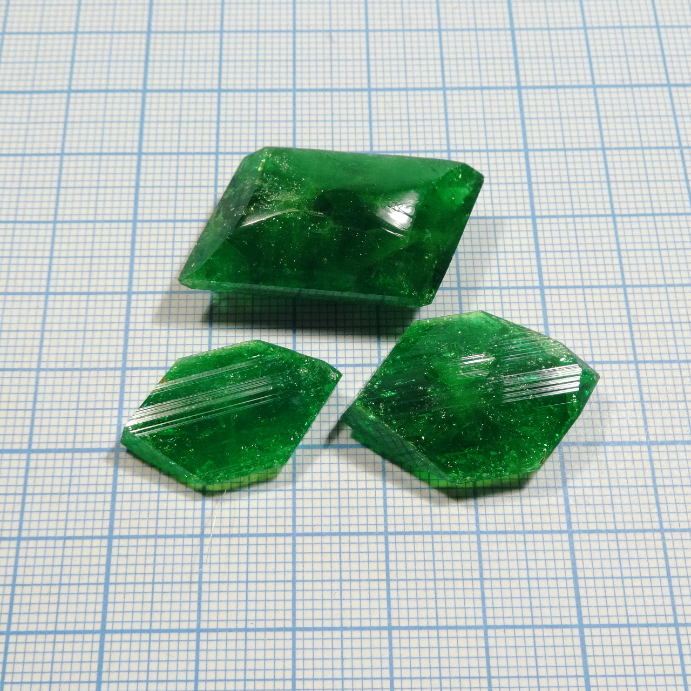

Formula: \ce{K3[Fe(C2O4)3]*3H2O}

Potassium salt of a complex acid, formed by Fe(III) and oxalate ions. As all [ferrioxalates](tags/ferrioxalate.html), has bright green color and is slightly light sensitve.

See also:

* [Sodium tris(oxalato) ferrate (III)](sodium-trioxalatoferrate.md): \ce{Na} analog,
* [Sodium Potassium tris(oxalato) ferrate (III)](sodium-potassium-trioxalatoferrate.md): double salt of \ce{Na} abd \ce{K} with the same anion
* [Sodium tris(oxalato) aluminate](potassium-trioxalato-aluminate.md): \ce{Al} analog

<!--more-->

## Properties
* **Crystal system**:
  Monoclynic.
* **Crystal shape**:
  Flat elongated hexagons, sticks.
* **Color**:
  Deep green.
* **Stability on air**:
  Slowly deterirated by dry air. Also, as all ferrioxalate compounds, they are slightly light sensitive.

## Preparation
This is one of the standard compounds chemistry students prepare in inorganic chemistry course, there are numerous preparation procedures for it inthe internet.

I perpared it by dissolving iron (III) hydroxide in excess of oxalic acid and thenneutralizing excess acid by potassium carbonate. Overal reaction equation was:

1. Prepare iron (III) hydroxide \ce{Fe(OH)3}. Oxide \ce{Fe2O3}, and intermediates between them are good too, though they are less reactive. The easiest way is reaction between \ce{FeCl3} and \ce{NaOH} or soda \ce{NaHCO3}.

2. Dissolve \ce{Fe(OH)3} in hot oxalic acid solution, taking 3 moles of acid per 1 mole of \ce{Fe(OH)3}. This would produce dark greenish-brown solution of iron (III) oxalate

3. Neutralize excess of acid with \ce{KOH} or soda. Brown solution would turn bright green - color of the complex ion \ce{[Fe(C2O4)3]^(3+)}. Filter it and crystallize the compound from it.

Total equation is:

\ce{2Fe(OH)3 + 6H2C2O4 + 3K2CO3 -> 2K3[Fe(C2O4)3] + 6H2O + 3CO2}

## Growing
The compound grows easily, using either evaporation or cooling method; my samples were grown using evaporation approach.
Crystal shape seems to be strongly affected by impurities, present i nthe solution: excess acid, potassium oxalate and others. Depending on impurities compoistion, shape could change from flat hexagons to thin sticks or prismatic crystals.

## Safety
The compound is not especially dangerous, but significant amounts of oxalates could cause poisoning.

## References
* Wikipedia: [sodium ferrioxalate](https://en.wikipedia.org/wiki/Potassium_ferrioxalate)
* K and Na salts and more theory on [chem.pieceofscience.com](http://chem.pieceofscience.com/?p=416)
