Formula: \ce{K2Zn(SO4)2*6H2O}
[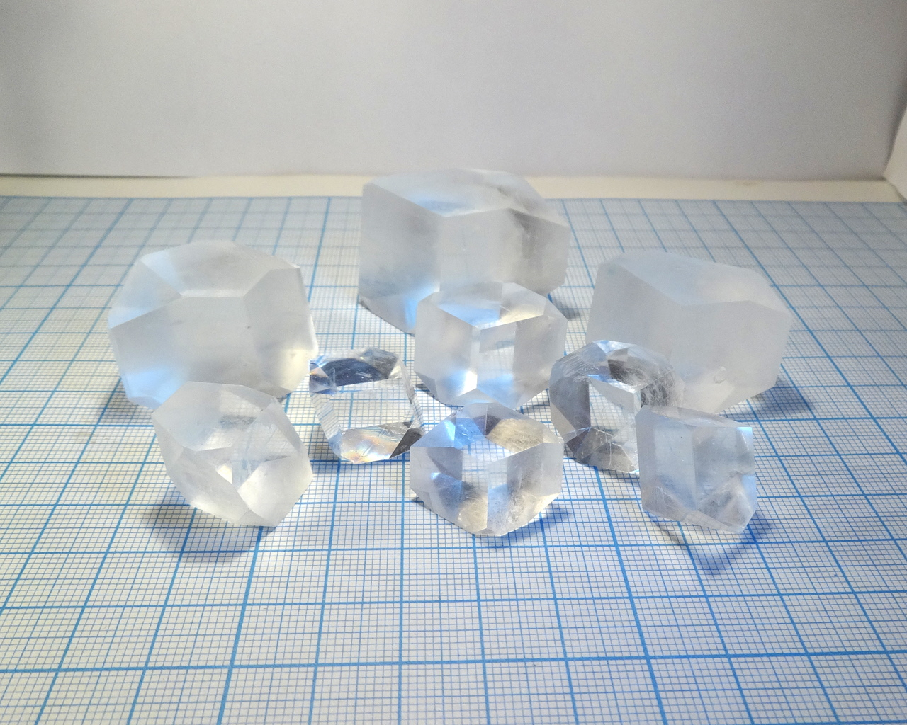](/crystals/images/potassium-zinc-sulfate/dsc02400.jpg)

Potassium twin of [ammonium zinc sulfate](ammonium-zinc-sulfate.md), visually indistinguishable from it. I suspect that precise measurement could reveal some subtle differences in angles between faces, but for the naked eye these compounds look the same. Similarly, baking soda can be used to improve crystal quality (see "Growing" section).

<!--more-->

## Properties
* **Crystal system**: monoclinic
* **Stability on air**: stable.

## Preparation
Prepare compound by dissolving equimolar amounts of zinc sulfate (\ce{ZnSO4*7H2O}) and potassium sulfate (\ce{K2SO4}) in hot water, then crystallize.

Zinc sulfate can be prepared by dissolving in sulfuric acid metallic zinc:

\ce{Zn + H2SO4 -> ZnSO4 + H2(g)}

or, preferably, zinc oxide (\ce{ZnO}), used as white pigment:

\ce{ZnO + H2SO4 -> ZnSO4 + H2O}

The second reaction is preferable because it does not produce gas.

Potassium sulfate is a common fertilizer. However, fertilizer-grade \ce{K2SO4} often contains significant amount of potash \ce{K2CO3}. This can be fixed by adding sulfuric acid in small amounts, until fizzing stops.

## Growing
As always, I used slow evapoartion method for growing. Solubility of this compound is significantly lower than of pure zinc sulfate.

Similarly to the [ammonium analog](ammonium-zinc-sulfate.md), there is a secret in making extremely transparent crystals.

After preparing solution, add small amount of baking soda \ce{NaHCO3} to it. I used 1g of soda per 100ml of saturated solution. Stir the solution; soon, reaction starts that produces gas (\ce{CO2}) and some white sediment (\ce{ZnCO3}):

\ce{ZnSO4 + 2NaHCO3 -> ZnCO3 + Na2SO4 + CO2}

Let the solution stay undisturbed for a day (it is needed for completing reaction and forming sediment), filter it and use for growing.

Crystals, grown from such solution, would be much clear.

## Safety
Despite zinc is important for health, in large amounts zinc compounds are moderately toxic. 

## More photos
[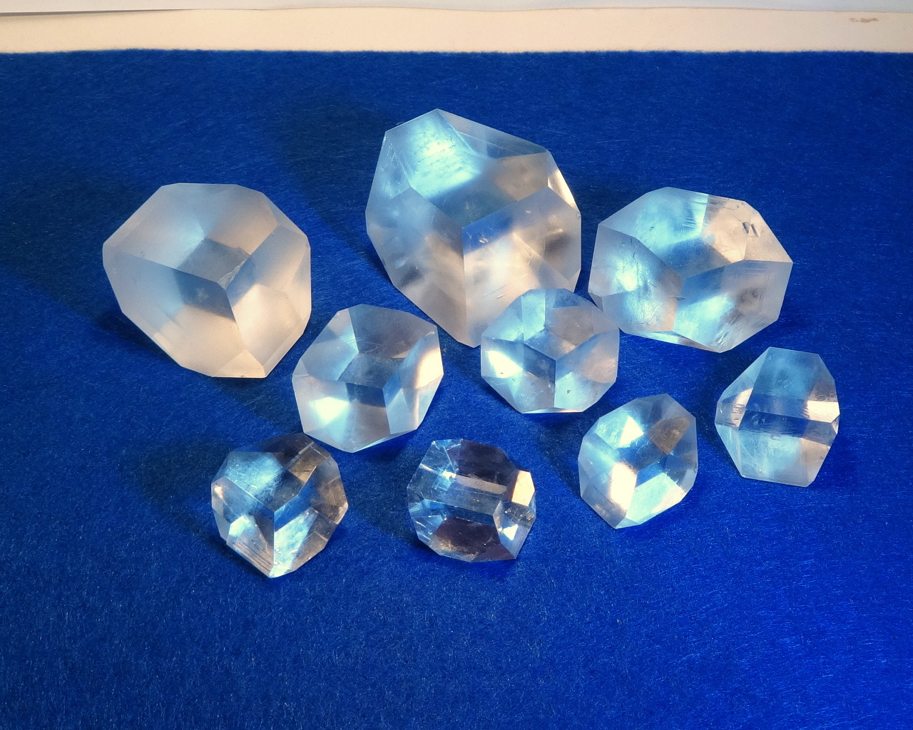](/crystals/images/potassium-zinc-sulfate/dsc02409.jpg)
[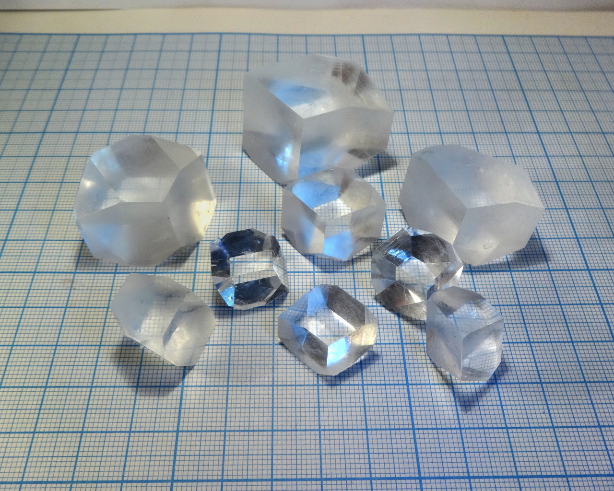](/crystals/images/potassium-zinc-sulfate/dsc02397.jpg)
[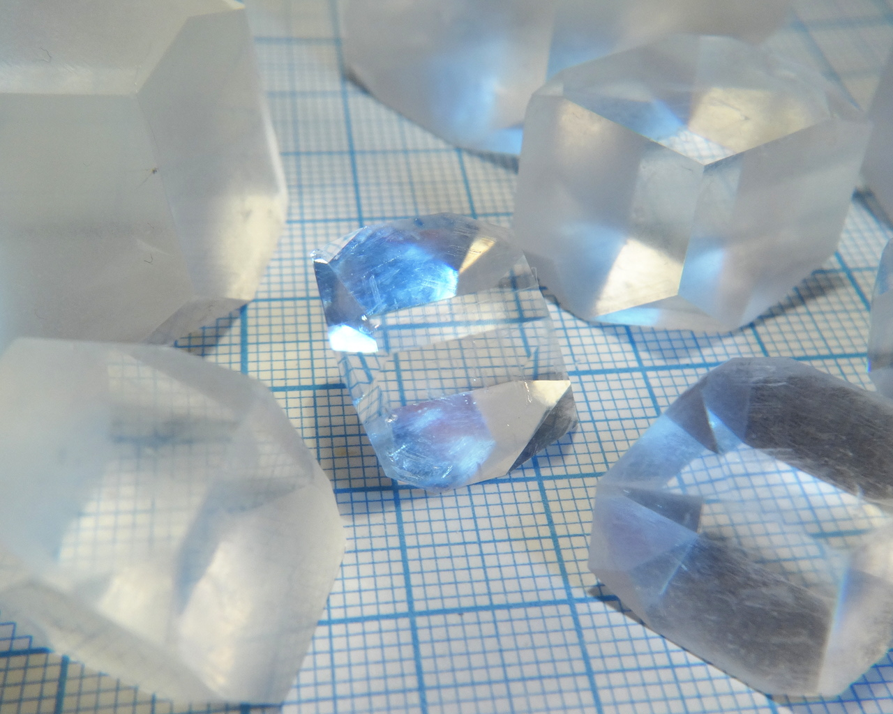](/crystals/images/potassium-zinc-sulfate/dsc02390.jpg)

[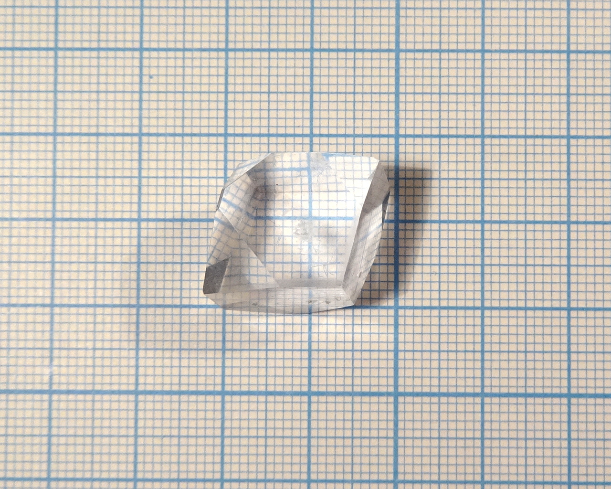](/crystals/images/potassium-zinc-sulfate/dsc02024.jpg)
[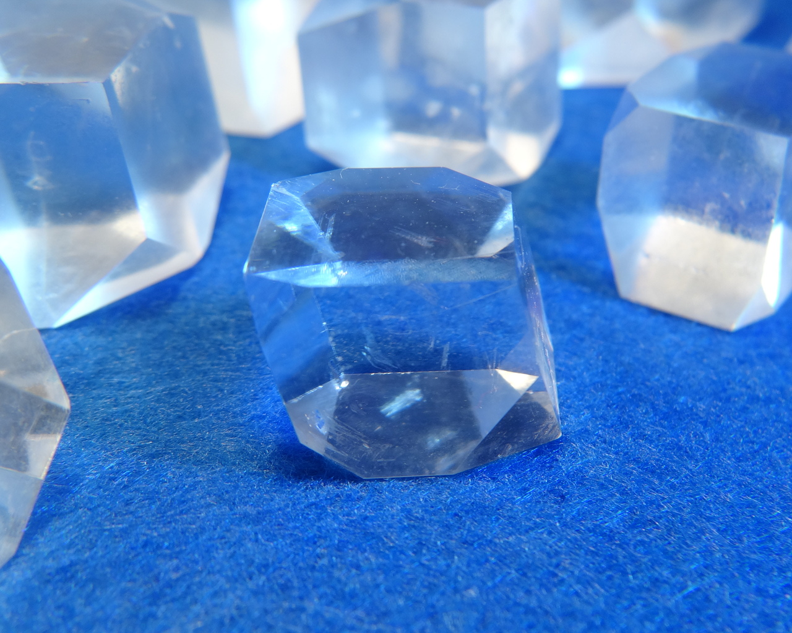](/crystals/images/potassium-zinc-sulfate/dsc02423.jpg)
[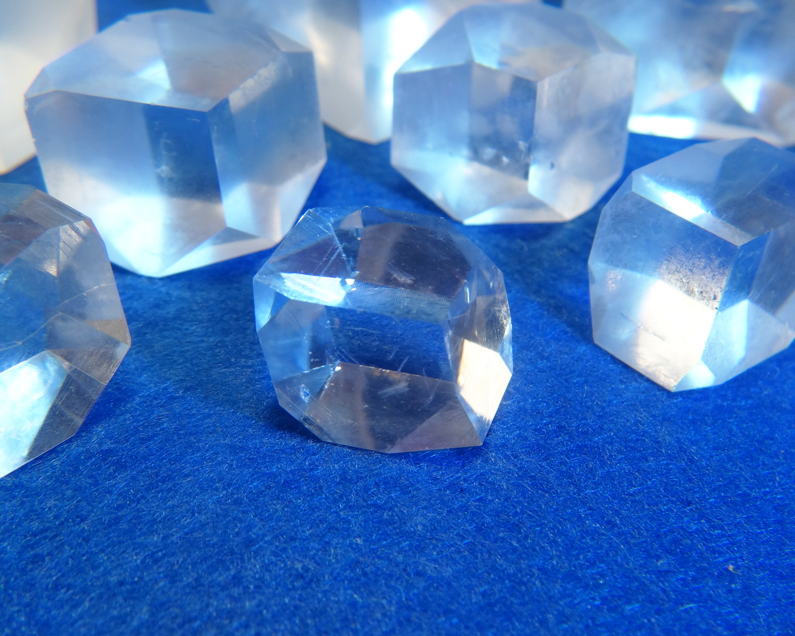](/crystals/images/potassium-zinc-sulfate/dsc02420.jpg)
[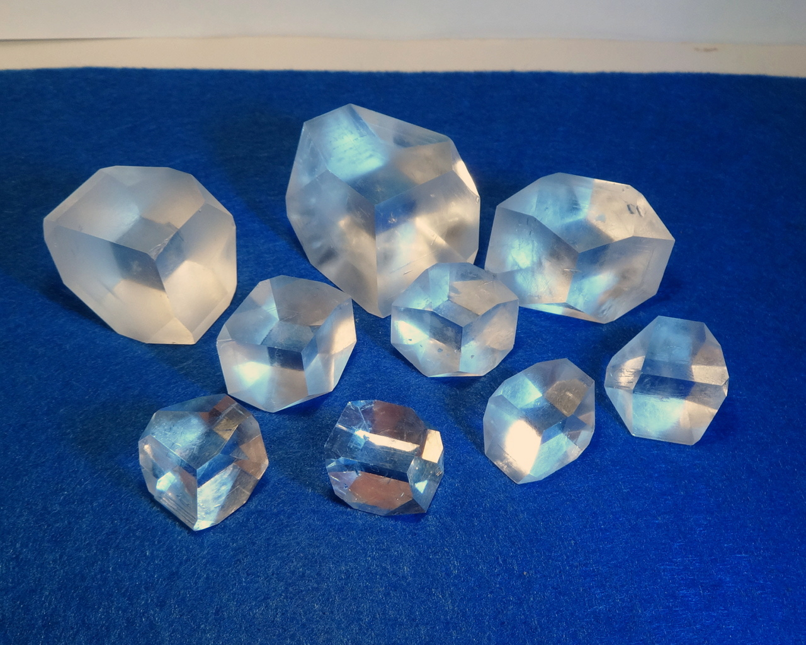](/crystals/images/potassium-zinc-sulfate/dsc02416.jpg)
[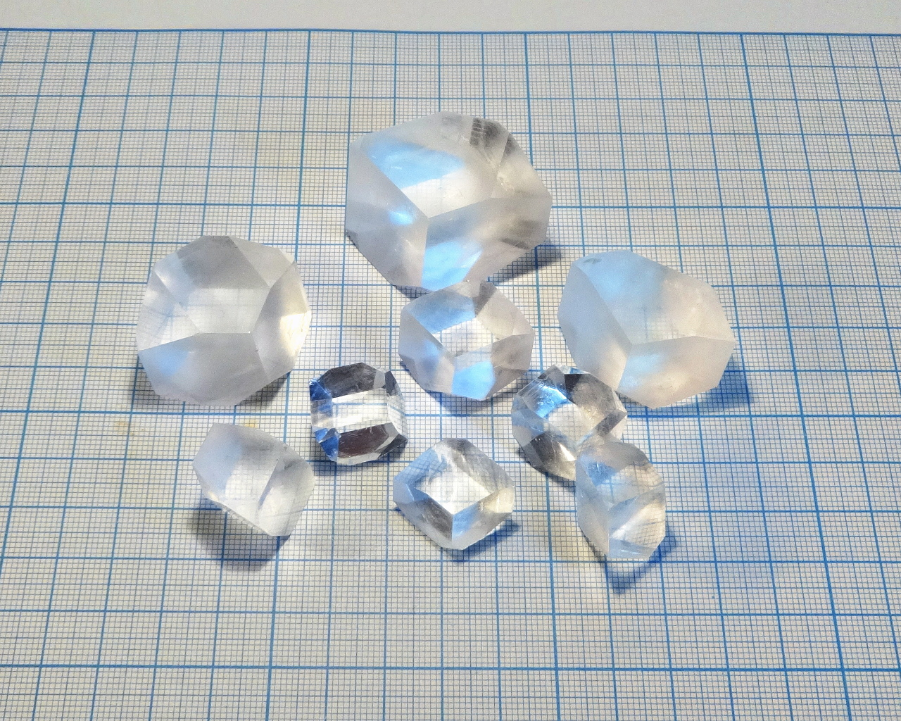](/crystals/images/potassium-zinc-sulfate/dsc02408.jpg)
[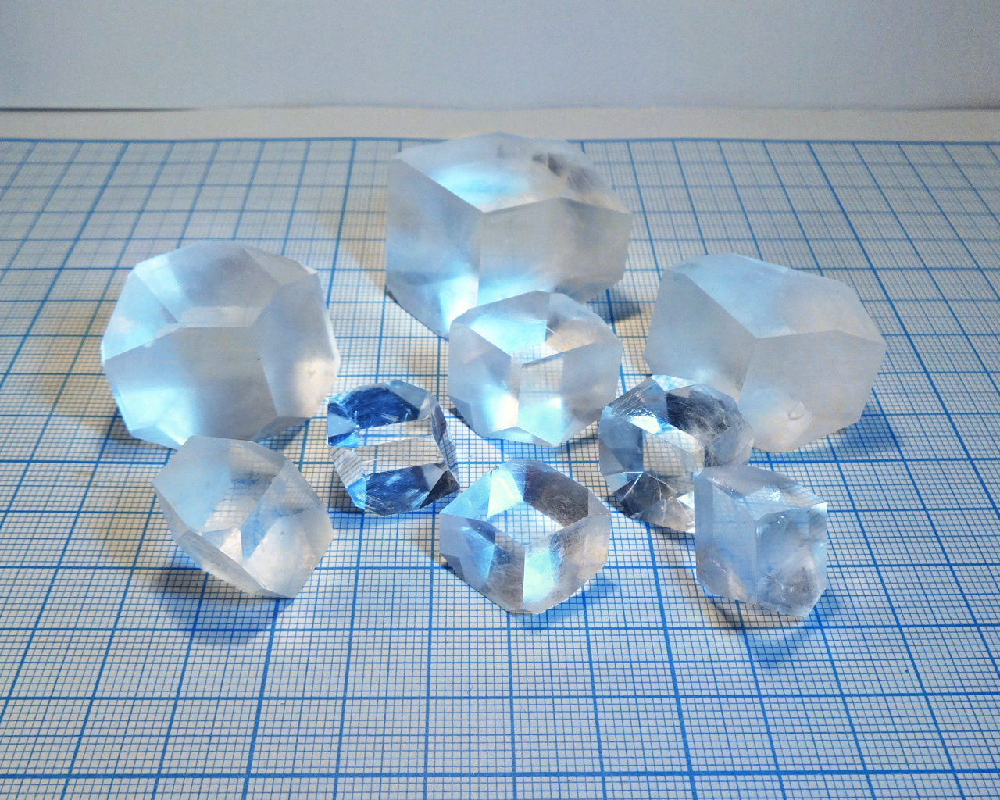](/crystals/images/potassium-zinc-sulfate/dsc02402.jpg)
[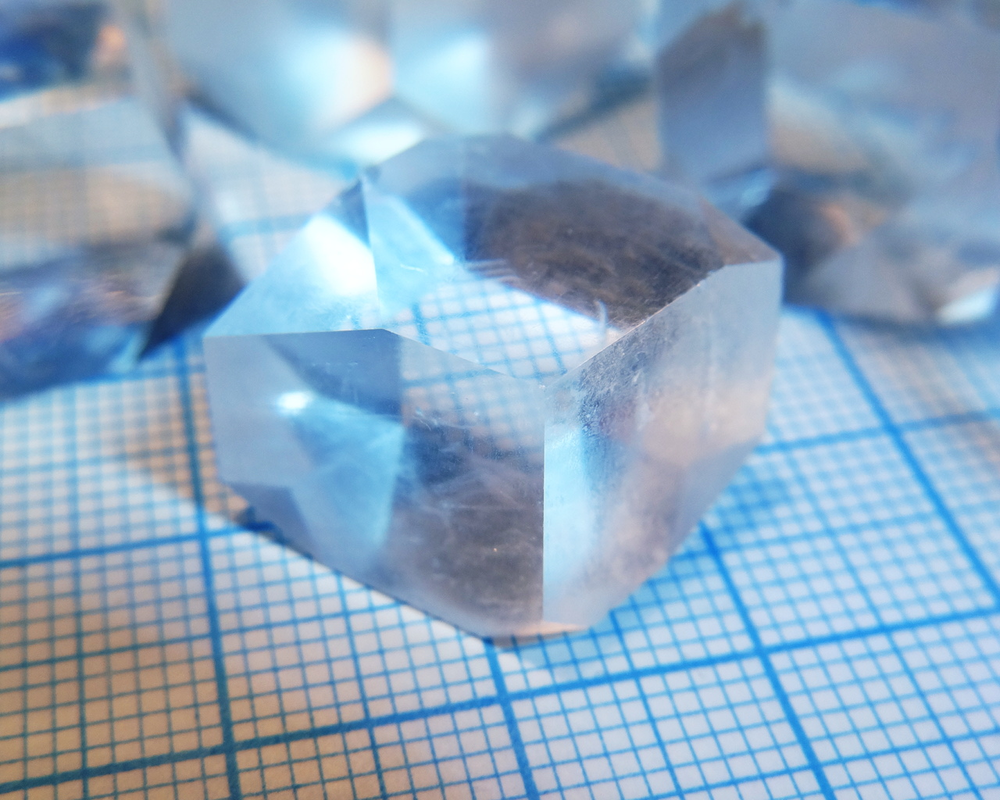](/crystals/images/potassium-zinc-sulfate/dsc02394.jpg)

