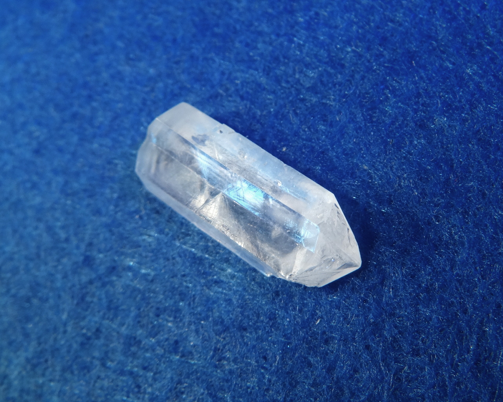
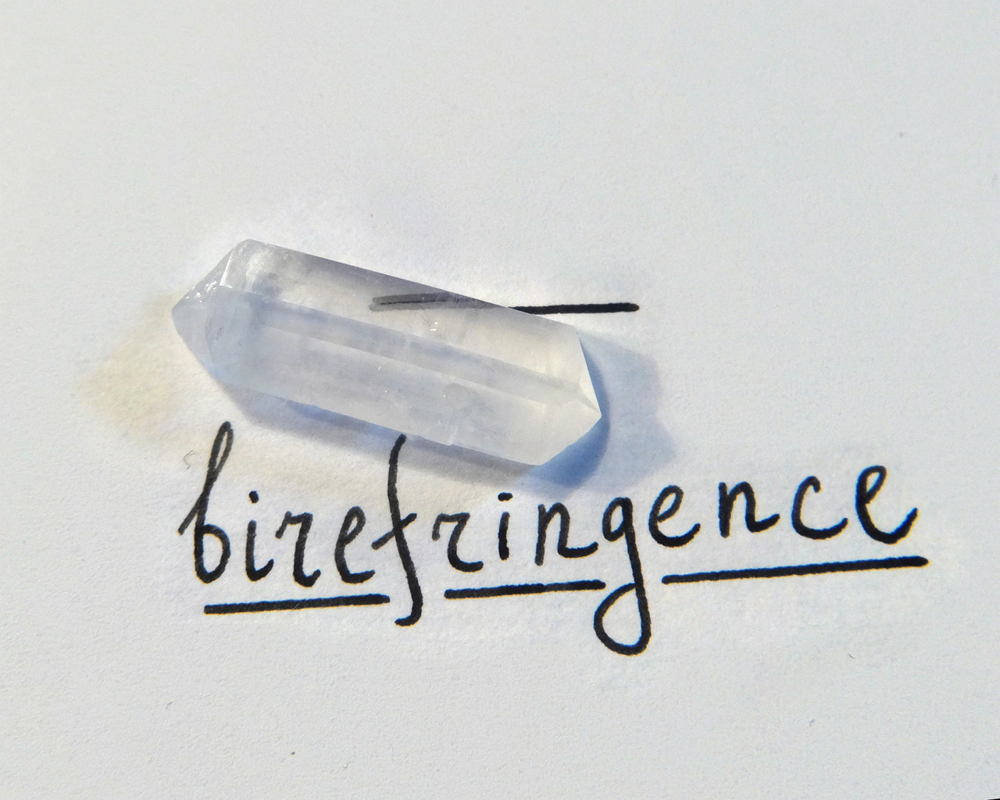
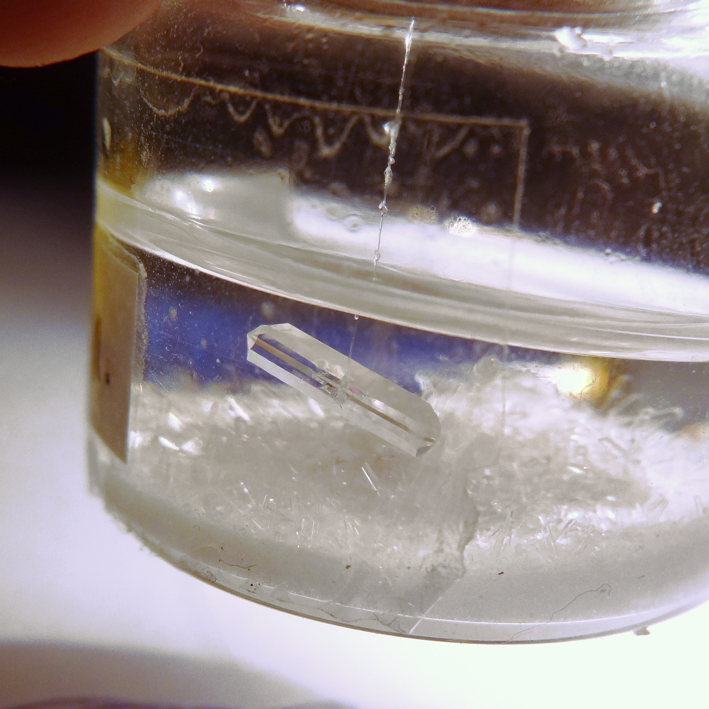
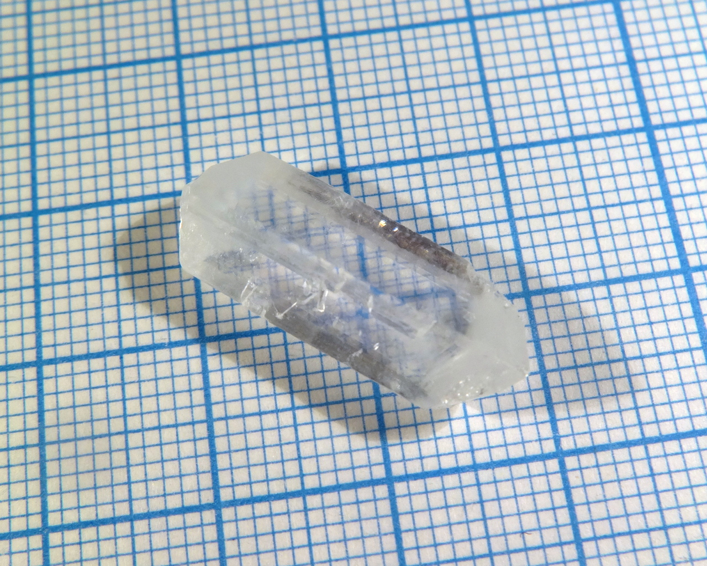

Formula: \ce{C7H5NO3S}

<!--more-->

## Properties
* **Crystal shape**: elongated sticks
* **Color**: transparent
* **Stability on air**: stable

Crystals are very fragile. Similarly to its [sodium salt](sodium-saccharin.md), free saccharin also displays strong birefringence (note how the line image doubles):

## Preparation
Can be prepared by reacting [sodium saccharin](sodium-saccharin.md), used as sweetener, with any acid. Free saccharin is almost insoluble in water and precipitates as white sediment.
## Growing
Since water solubility is very low, some other solvent must be used. I tried isopropanol and acetone; it is soluble in both, but solubility in isopropanol though better than in water, is still low. Acetone appeared to be a convenient solvent.

As always, I used slow evaporation method. Because acetone is very volatile, it is important to reduce evapotation speed.
## Safety
The compound itself is safe. Acetone solution can pose a fire hazard (acetone is very flammable), and acetone vapors are bad for health.
## More photos

## References
* [Wikipedia](https://en.wikipedia.org/wiki/Saccharin)
* [My gallery on Imgur](http://imgur.com/gallery/FocxR)
