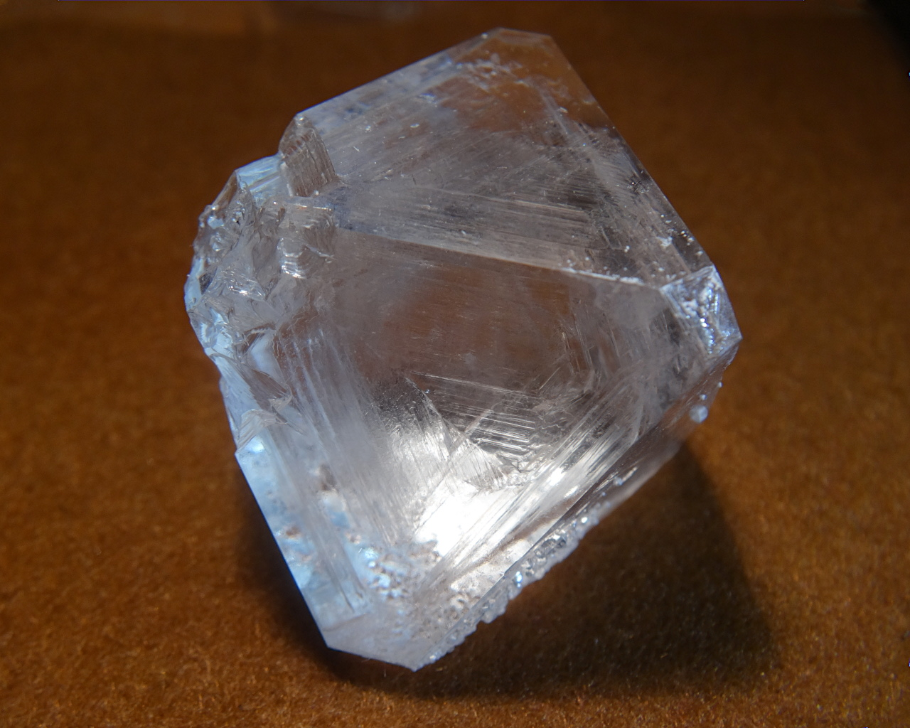
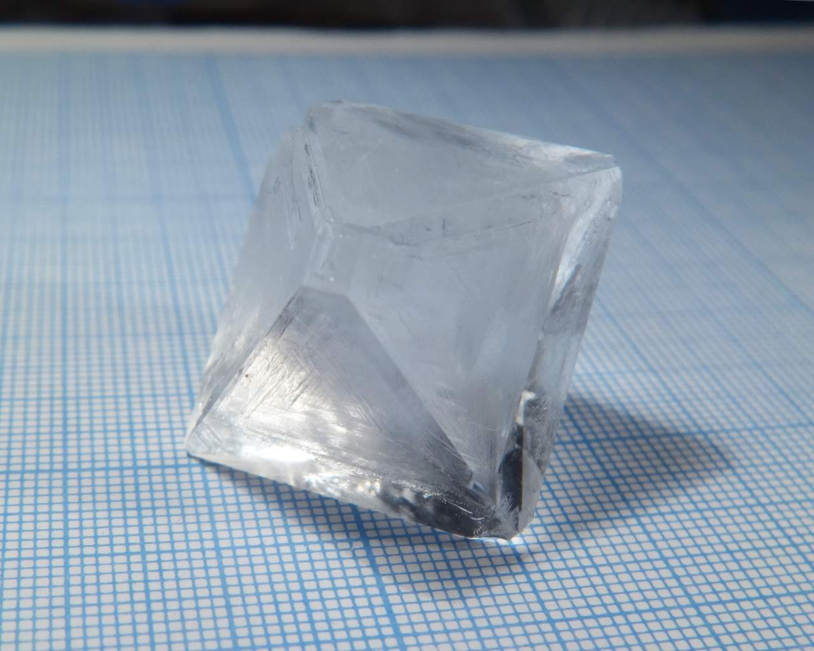
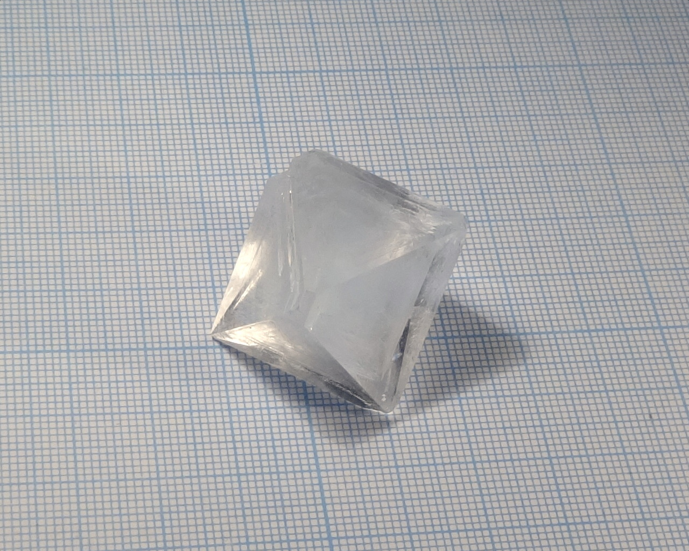
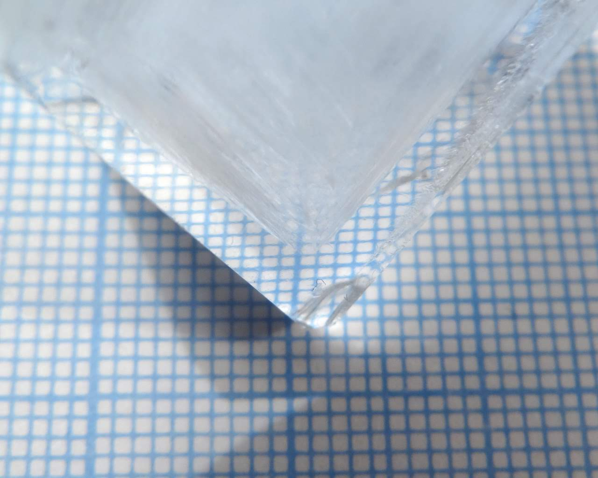
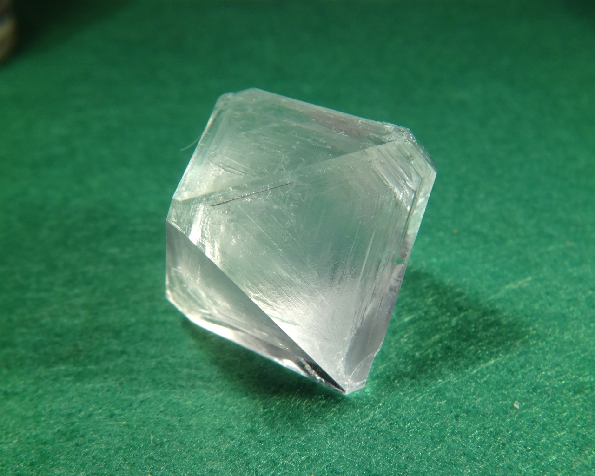
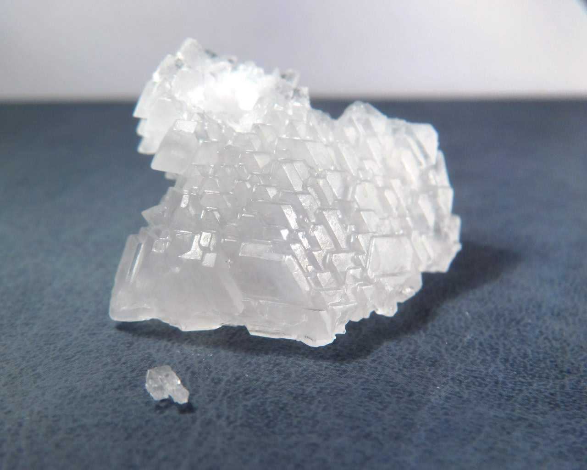
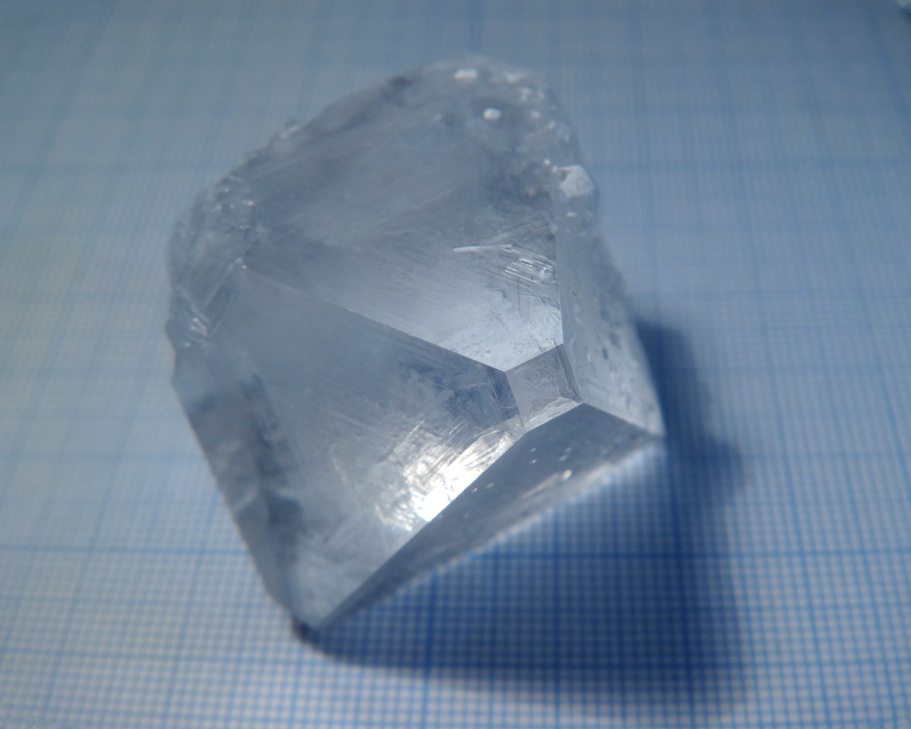
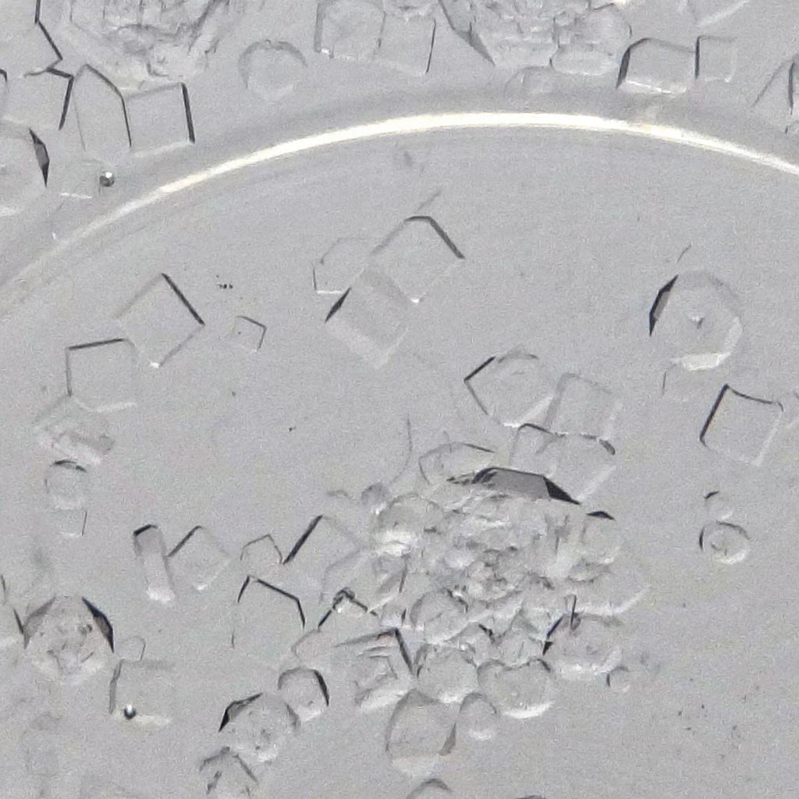

Formula: \ce{NaAl(SO4)2*12H2O}

Also known as sodium alum, this double sulfate is among the most elusive alums species. Typycally, alums have comparatively low solubility and crystallize easily, but for sodium aluminium sulfate it is not the case.

<!--more-->

## Properties

* **Crystal system**: isometric
* **Crystal shape**: octahedral
* **Color**: colorless
* **Stability on air**: very unstable

## Preparation

Make solution of sodium and aluminium sulfates in stoichiometric proportion (1:1 molar ratio) and crystallize it carefully. An easy way to prepare such solution is to dissolve metallic aluminium in \ce{NaOH} solution, and then add stoichiometric amount of sulfuric acid:

\ce{Al + NaOH + 3H2O = Na[Al(OH)4] + 1.5H2}

\ce{Na[Al(OH)4] + 2H2SO4 + 8H2O = NaAl(SO4)2*12H2O}

## Growing

Definitely, some luck is needed to obtain crystals of this material. Solubility of sodium alum is much higher then of its [potassium analog](potassium-alum.md), reaching 208g/100ml at 15 °C, according to the [Wikipedia](https://en.wikipedia.org/wiki/Sodium_alum).

Moreover, nucleation appears to be complicated. Sometimes, evaporation of a small amount of the solution does not produce any alum crystals.

## Safety

Toxicity is low, but solutions can be irritating.

## More photos

Mix of various crystalline species obtained by evaporating a solution of \ce{Na2SO4} and \ce{Al2(SO4)3}. Octahedral crystals, such as the large one at the right, are alum. I don't know what are the flat rhombic crystals.

## References

* Wikipedia on [sodium alum](https://en.wikipedia.org/wiki/Sodium_alum)
