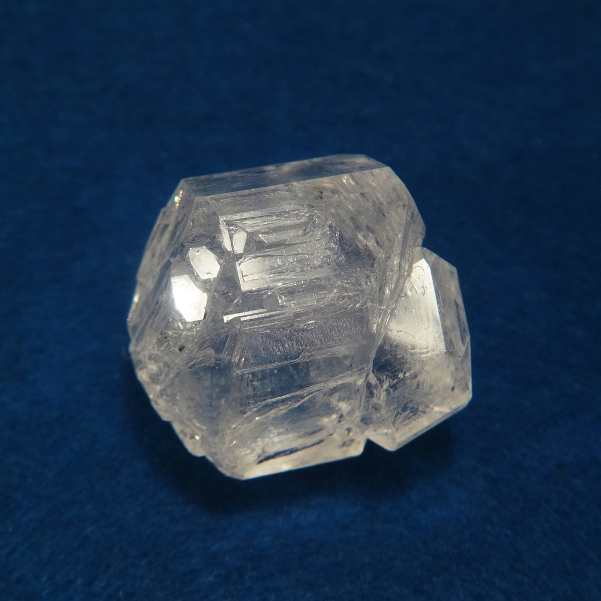
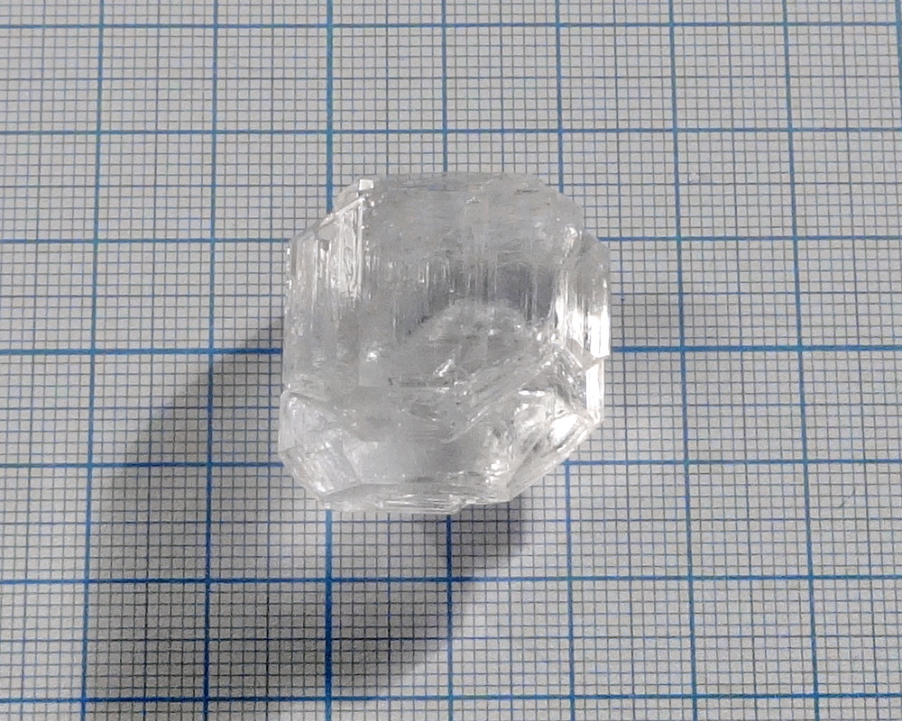
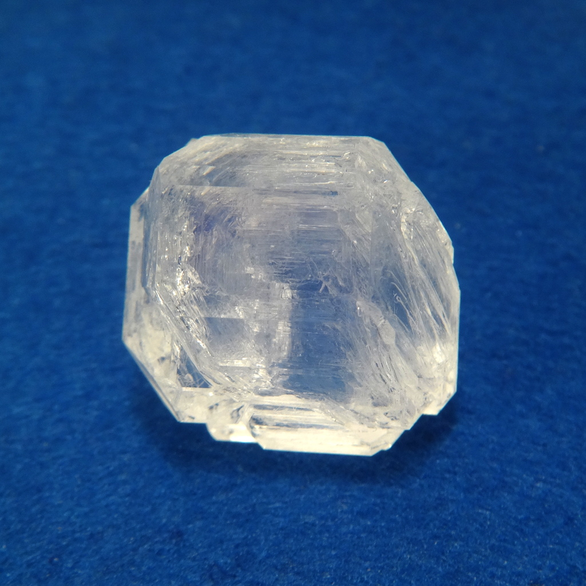
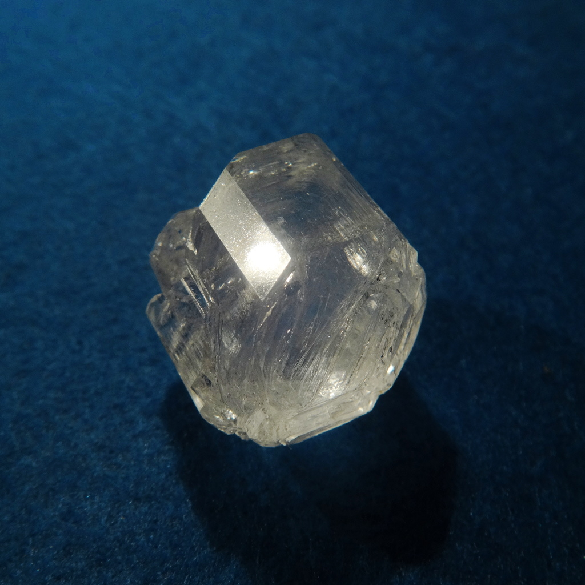

Formula: \ce{NH4NaSO4*2H2O}.

Artificial analog of the mineral [lecontite](https://www.mindat.org/min-2364.html).

<!--more-->

## Properties
* **Crystal system**: orthorhombic
* **Crystal shape**: compact 
* **Color**: colorless
* **Stability on air**: stable
## Preparation
Mix equimolar amounts of sodium sulfate \ce{Na2SO4} and ammonium sulfate \ce{(NH4)2SO4}, dissolve them in water and crystallize.
Sometimes it is used as fertilizer and can be purchased ready.
## Growing
Grows fast, but easily forms opaque inclusions. Probably, these inclusions are caused by room temerature changes.
## Safety
Safe.
## More photos

## References
* [Mindat: Lecontite](https://www.mindat.org/min-2364.html)
