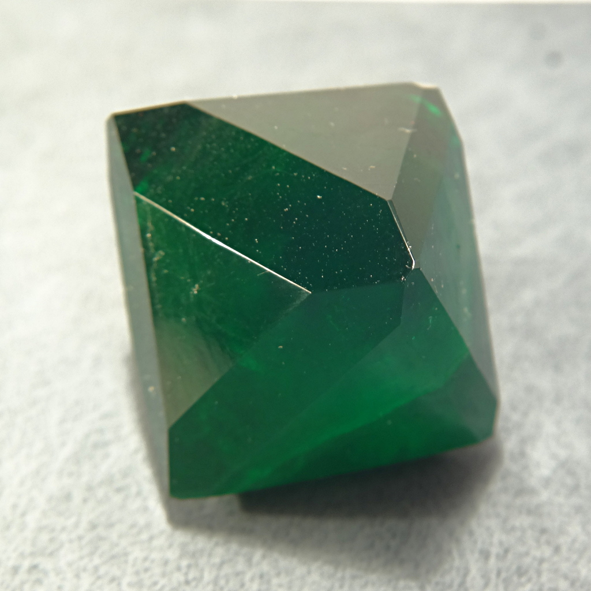
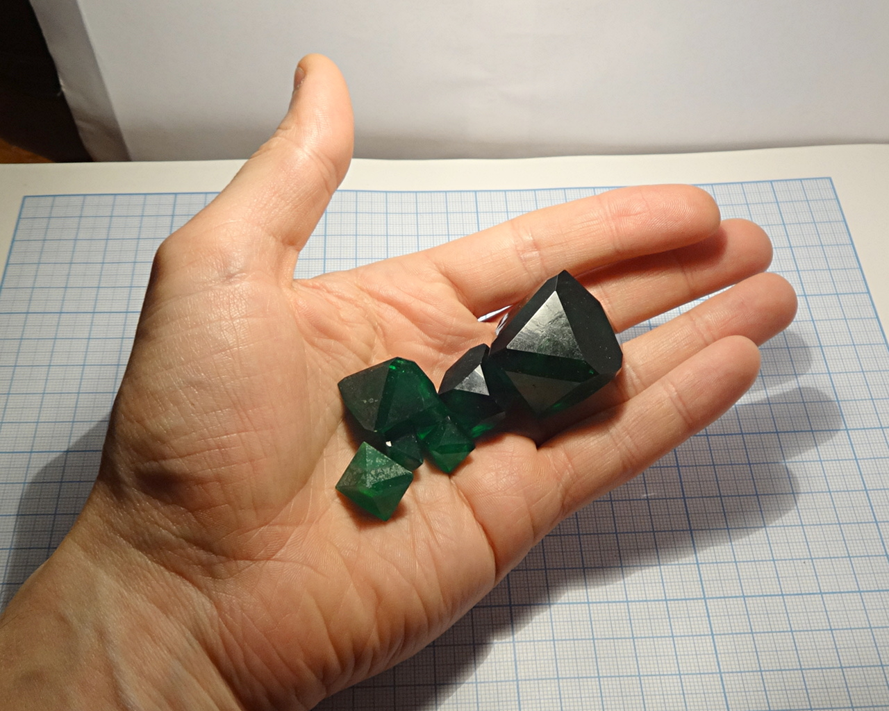
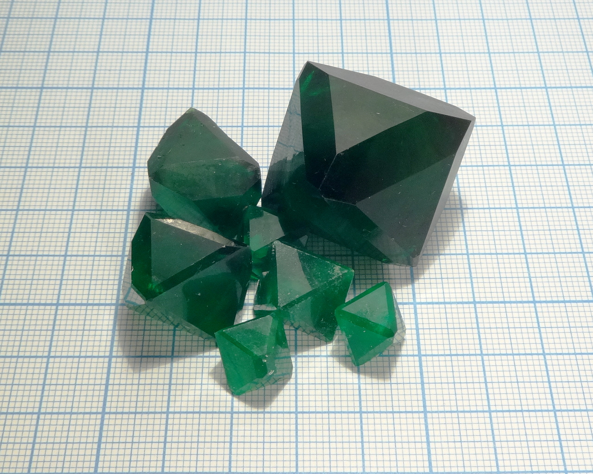
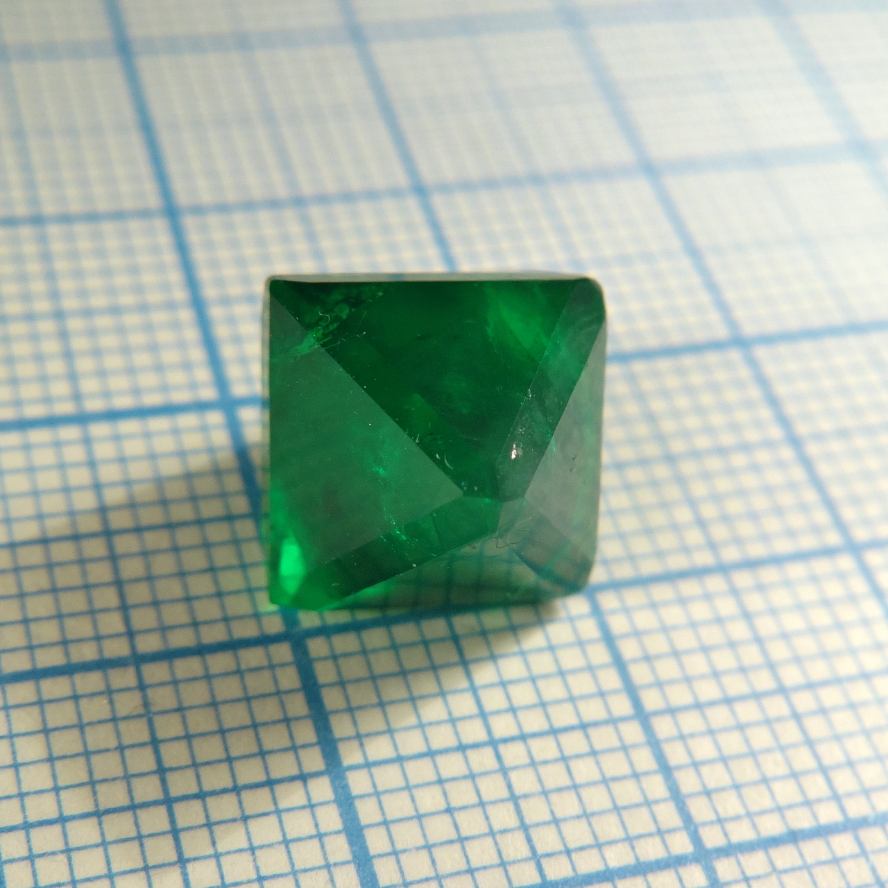
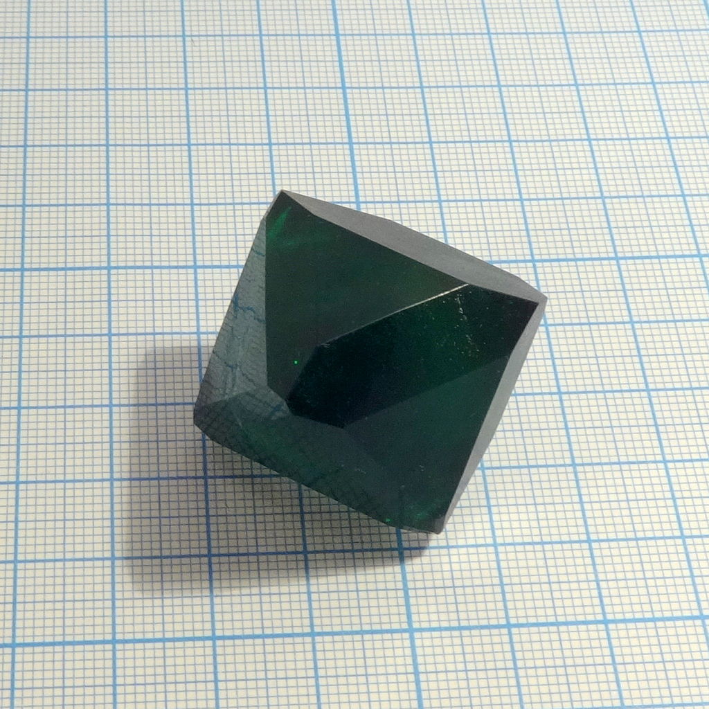
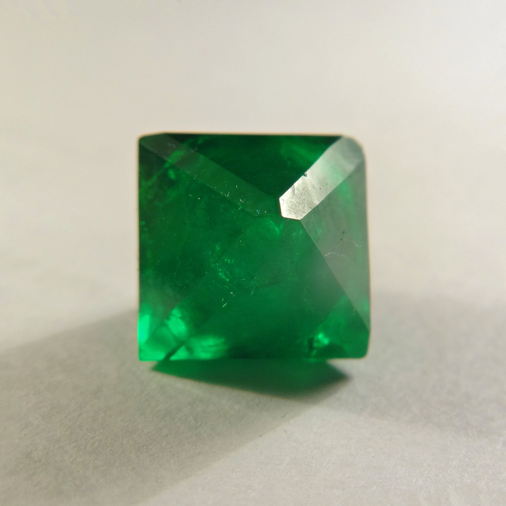
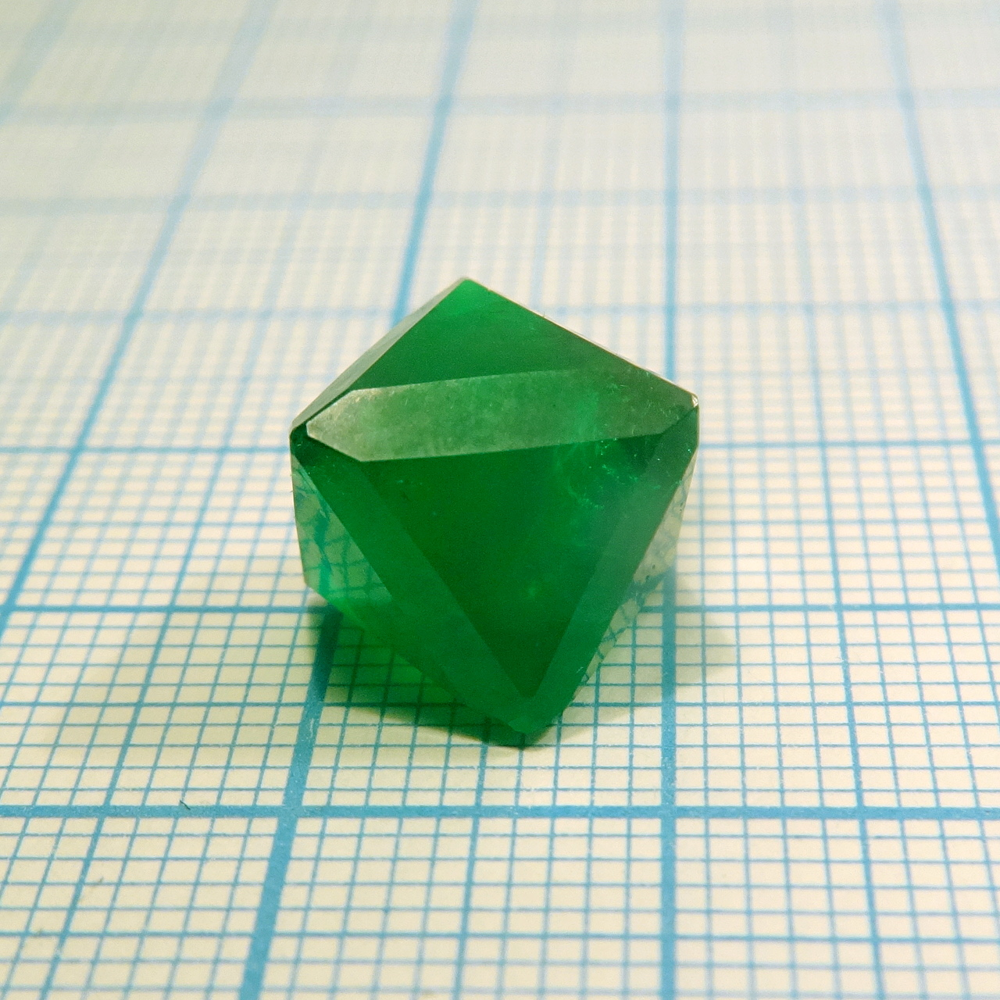
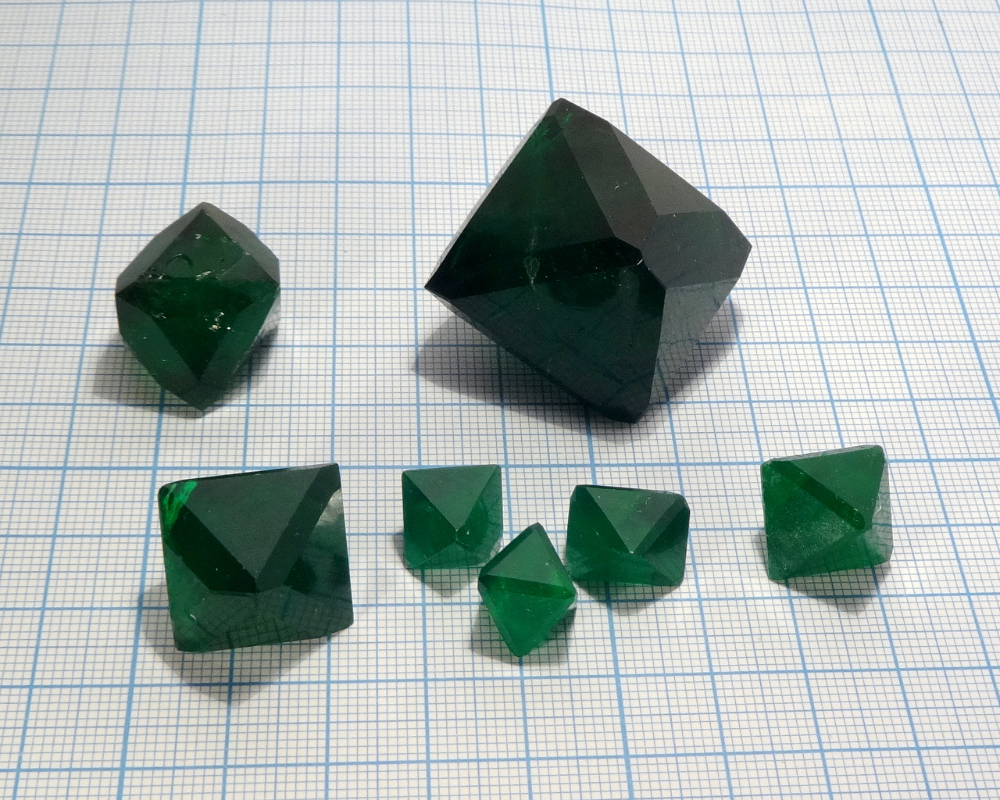

Formula: \ce{K5Na[Fe(C2O4)3]2}

One of the most interesting crystals: a double salt of sodium, potassium and ferrioxalate ion that have deep green color, highly symmetric shape and great stability upon exposure to air. Unfortunately, I was not able to prepare aluminium analog: \ce{Na} and \ce{K} alumooxalates just crystallized separtely.

See also:

* [Potassium tris(oxalato) ferrate (III)](potassium-trioxalato-ferrate.md): pure \ce{K} salt
* [Sodium tris(oxalato) ferrate (III)](sodium-trioxalatoferrate.md): pure \ce{Na} salt
* [Sodium tris(oxalato) aluminate](potassium-trioxalato-aluminate.md): \ce{Al} analog

<!--more-->

## Properties

* **Crystal system**: isometric (cubic)
* **Crystal shape**: octahedrons
* **Color**: deep green
* **Stability on air**: stable, but sensitive to light.

Green color of this compound is very deep, making large crystals appear almost black.

Crystals are apparently anhydrous and thus stable upon exposure to air. However, they are slightly light-sensitive. At first I did not notice it, but after a month on my table upper surface of some smaller crystals (that were extracted first) started showing signs of deterioration.

## Preparation

To prepare it, I prepared individual ferrioxalates of [potassium](potassium-trioxalato-ferrate.md): \ce{K3[Fe(C2O4)3]*3H2O} and [sodium](sodium-trioxalatoferrate.md): \ce{Na3[Fe(C2O4)3]*5H2O}, mixed them in 2:1 molar ratio then dissolved the mixture in a minimal amount of warm water. Upon crystallization of the solution, octahedral crystals of the double salt precipitate.

According to the literature (see References section), the formula of this compound is:

\ce{K5Na[Fe(C2O4)3]2}.

In other words, \ce{K}:\ce{Na} ratio in the crystal is 5:1. However, I found experimentally that flat crystals of \ce{K} ferrioxalate grow from the saturated solution prepared from the 5:1 mixture of \ce{K} and \ce{Na} ferrioxalates. Octahedrons of the double salt are growing when excess of \ce{Na} is provided. In my experiments, double salt crystallized if \ce{K}:\ce{Na} ratio is 2:1 or less.

This has 2 consequences:

* During crystallization, concentration of \ce{Na} in the solution is increasing.
* Double salt can not be recrystallized easily: pure \ce{K} salt crystallizes first.

## Growing

I used slow evaporation method to grow these crystals. Growing time of the biggest crystal is slightly more than one months, its weight is 35 grams.

Upon evaporation, growth gradually slows down because concentration of potassium ions decreases. To cope with this problem, I was adding small portions of saturated solution of \ce{K} salt from time to time. However, doing so requires caution, since adding too much fresh solution could dissolve growing crystals.

## Safety

All oxalates are moderately toxic.

## More photos

## References

[Crystal structure of potassium sodium Λ-tris(oxalato)ferrate(III), \ce{K2.5Na0.5Fe(C2O4)3}](https://www.researchgate.net/publication/260658650_Crystal_structure_of_potassium_sodium_D-trisoxalatoferrateIII_K25Na05FeC2O43) DOI: 10.1524/zkri.1997.212.1.56

S. Henneick, R. Wartchow, Crystal structure of potassium sodium D - tris(oxalato)ferrate(III), \ce{K2.5Na0.5Fe(C2O4)3} , Z. Kristallogr 212 (1997) 56

* R. Wartchow, Crystal structure of potassium sodium K - tris(oxalato)ferrate(III), \ce{K2.5Na0.5Fe(C2O4)3} , Z. Kristallogr 212 (1997) 57
