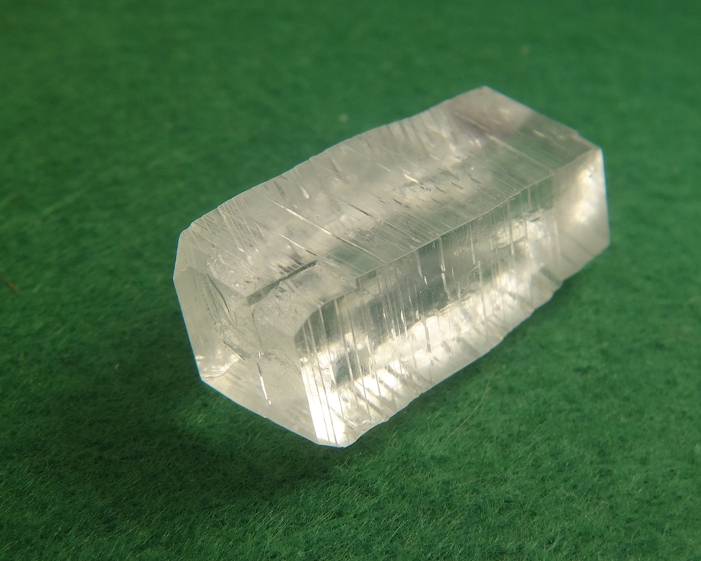
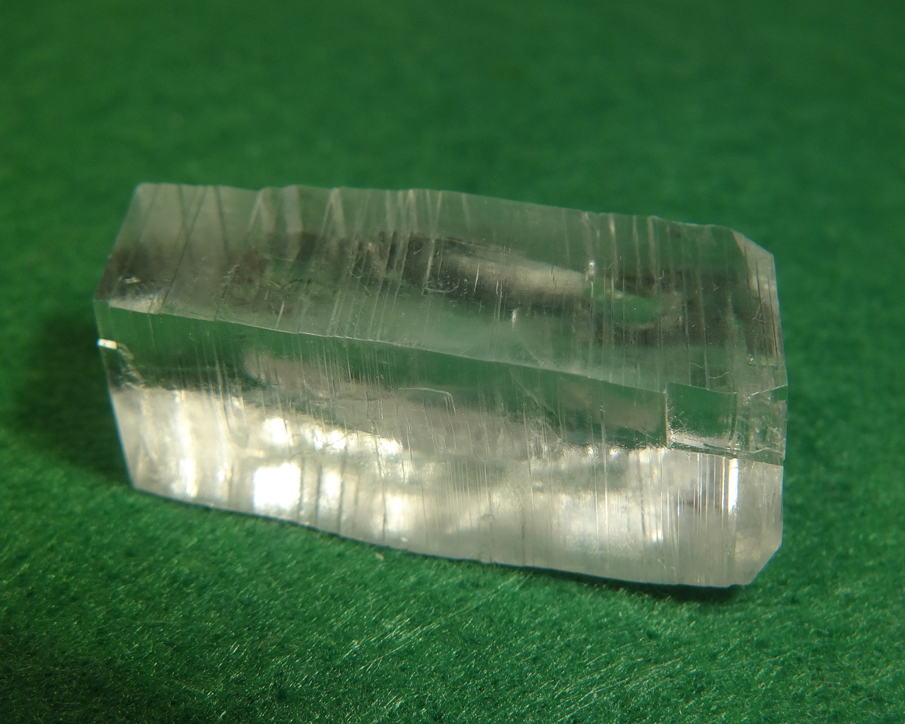
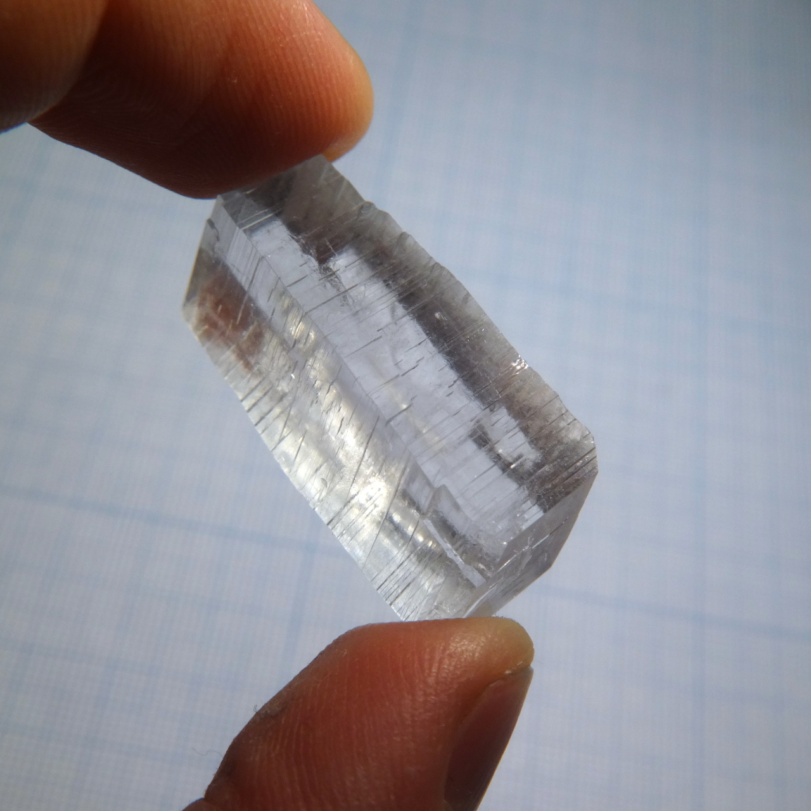

Formula: \ce{Na3[Al(C2O4)3]*5H2O}

Also known as sodium alumooxalate or sodium oxalatoaluminate. Similar compounds:

+ Potassium analog that have different structure: [potassium tris(oxalato) aluminate](potassium-trioxalato-aluminate.md).
+ Iron analog, with the same structure and nice green color: [sodium tris(oxalato) ferrate(III)](sodium-trioxalatoferrate.md).

<!--more-->

## Properties
* **Crystal system**: monoclinic
* **Crystal shape**: prismatic
* **Color**: colorless
* **Stability on air**: highly prone to dehydration
## Preparation

Preparation is similar to the [potassium salt](potassium-trioxalato-aluminate.md). The simplest procedure is: dissolve metallic aluminium in aqueous \ce{NaOH} solution, taking 3 mols of \ce{NaOH} for each mol of Al. Then add 3 mols of oxalic acid. Initially, addition of oxalic acid causes white \ce{Al(OH)3} to precipitate, but after heating an stirring, the precipitate dissolves in acid, forming alumooxalate complex. Then filter the solution and let it crystallize. Sodium alummoxalate forms relatively large rhombic crystals. Total equation of the reaction is:

\ce{2 Al + 6 NaOH + 6 H2C2O4*2H2O = 2 Na3[Al(C2O4)3] + 3 H2 + 18 H2O}

## Growing

As always, I used slow evaporation method to grow crystals of this material. Solubility of this sodium salt is much higher then of the potassium analog, apparently exceeding 50g/100ml at room temperature.

## Safety

All oxalates are moderately toxic. The biggest safety risk, however, is the preparation step. Reaction of metallic \ce{Al} with \ce{NaOH} solution is very exothermic and tend to go runaway when done on a larger scale, don't drop all the aluminium at once. Beware of the extremely irritating alkaline aerosol that is produced in this reaction.

## More photos

