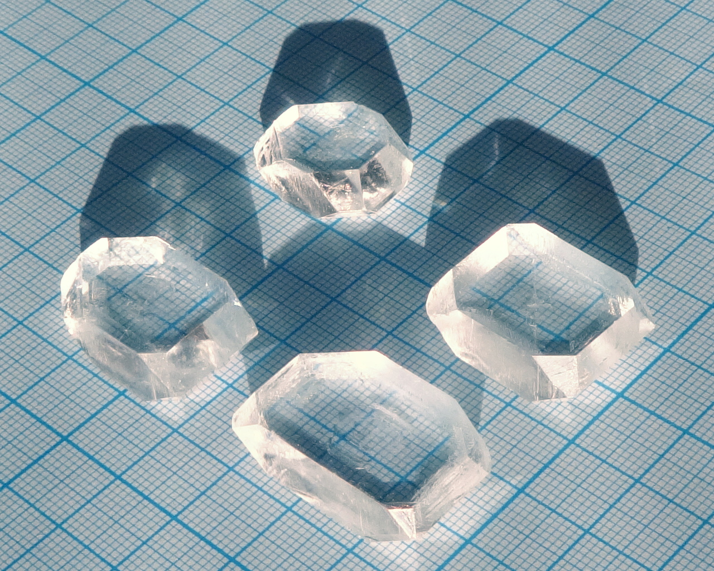
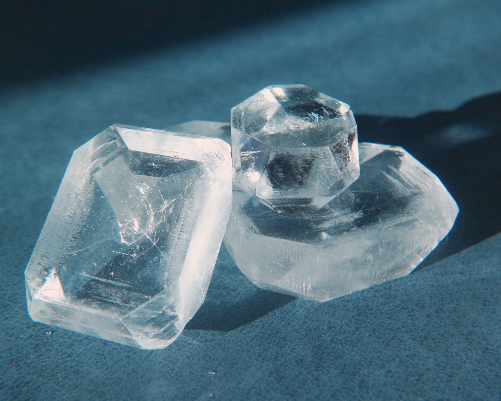
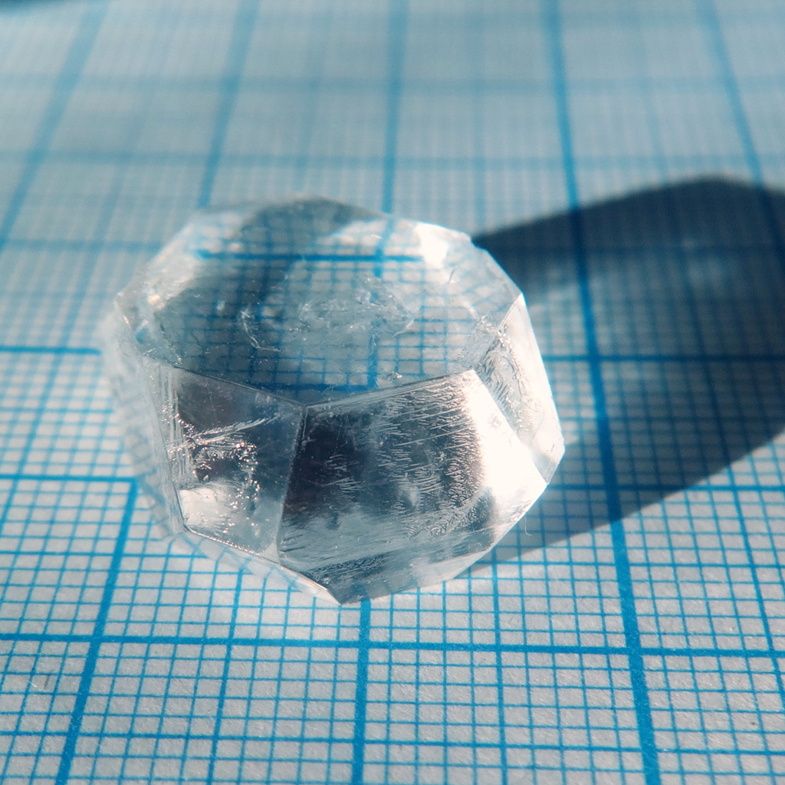
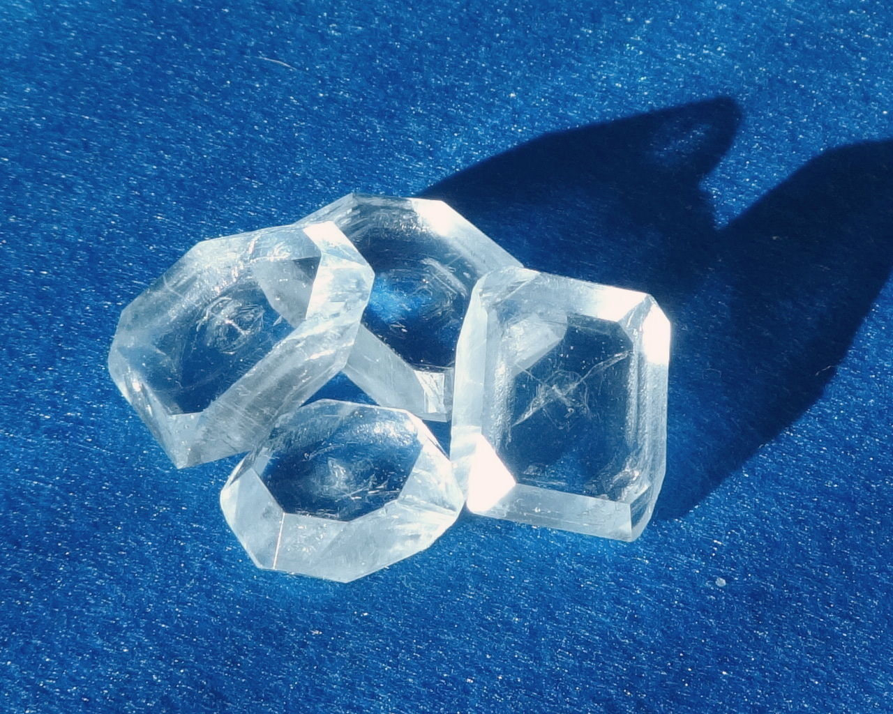

Formula: \ce{H3NSO3}

<!--more-->

## Properties
* **Crystal system**: orthorhombic
* **Crystal shape**: thick rectangular plates with additional facets
* **Color**: colorless, very transparent
* **Stability on air**: stable, however, could lose shine with time. Probably, it is caused by ammonia in air. 

## Obtaining

Sulfamic acid is often used as descaler, because of its abinity to form soluble salts with calcium. Many cheap descalers for coffee makers and dishwashers are made primarily of sulfamic acid.

## Growing
Slow evporation must be used, because at elevated temperatures aqueous solutions of sulfamic acid decompose, giving ammonium hydrogen sulfate:

\ce{H3NSO3 + H2O -> NH4HSO4}

## Safety
Sulfamic acid is not toxic, but concentrated solutions are quite acidic and could irritate skin. Solid acid is 

## More photos

## References

* [Wikipedia info](https://en.wikipedia.org/wiki/Sulfamic_acid)
