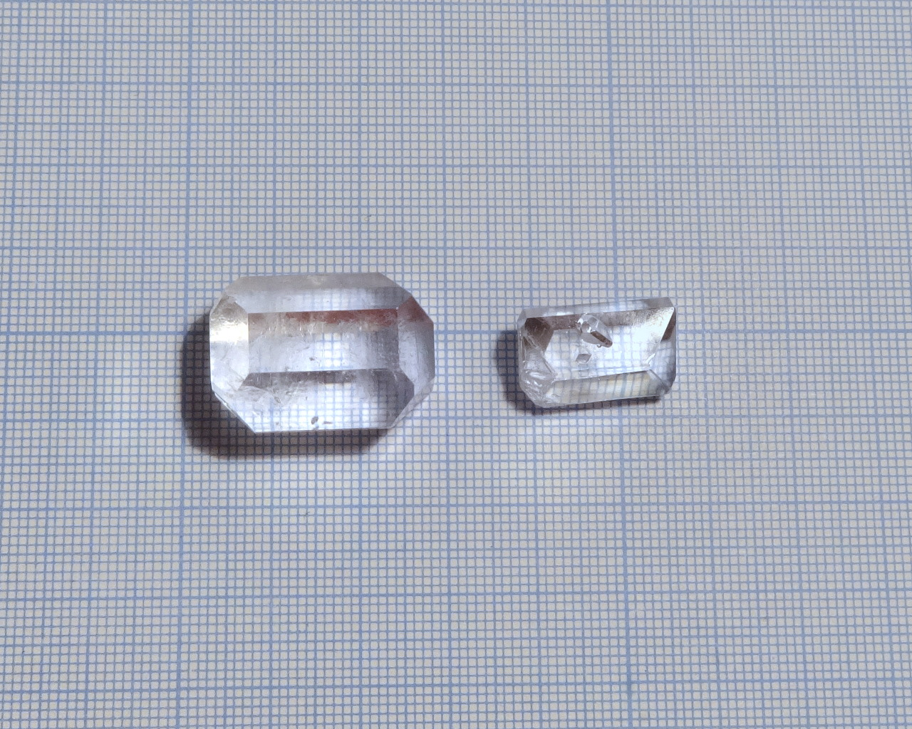
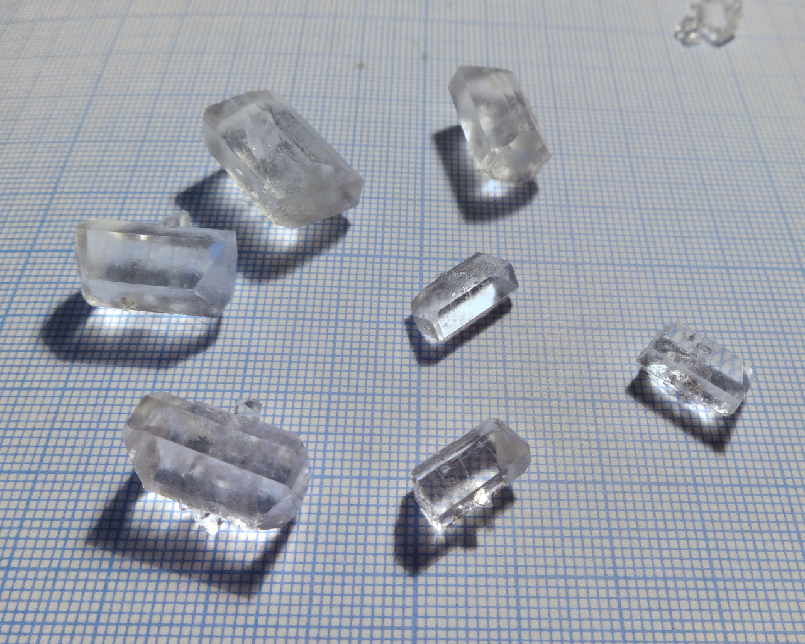
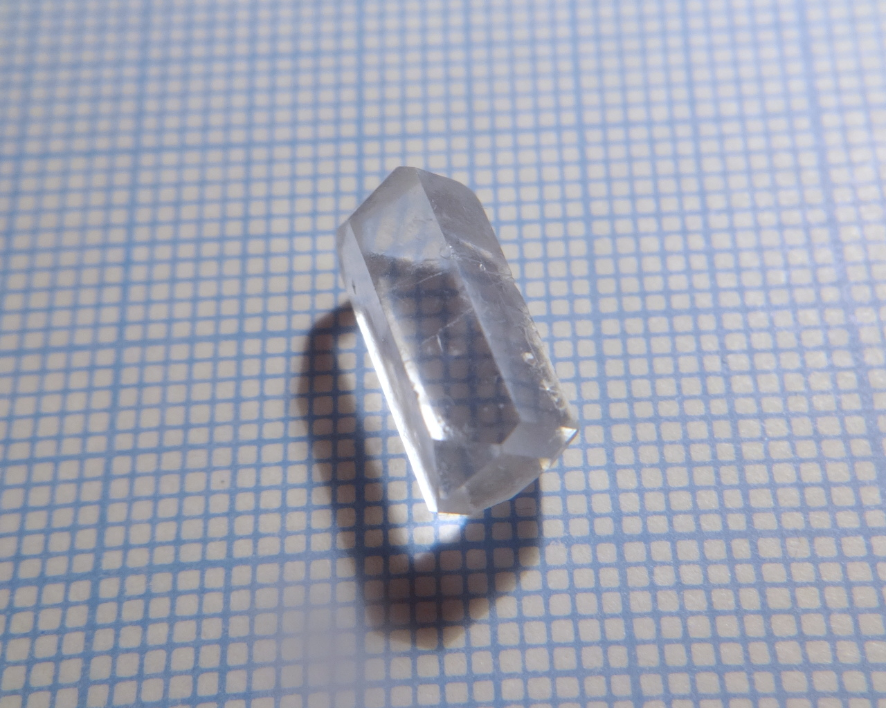
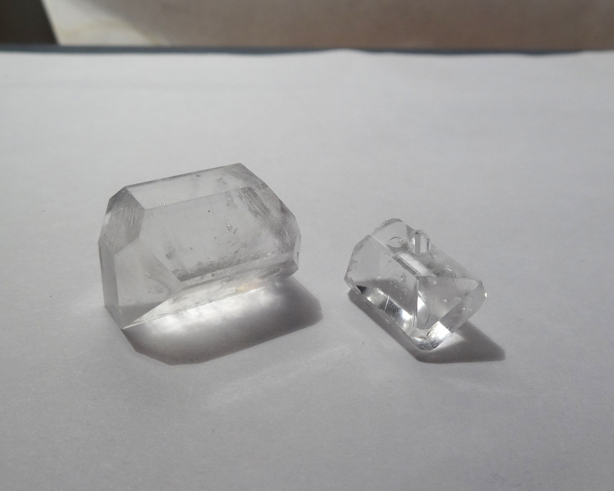
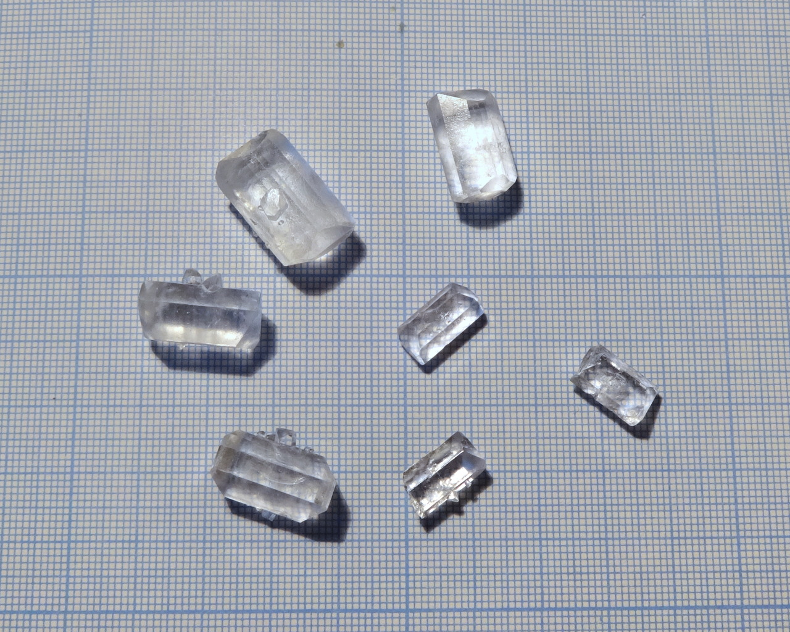

Formula: \ce{[Zn(CON2H4)6]SO4}. May contain unknown amount of water.

<!--more-->

I don't have much information on this compound, except of a few mentions about its existence.
It formed, when urea \ce{CON2H4} and Zinc sulfate \ce{ZnSO4} are dissolved in water in 6:1 molar ratio
and then crystallized.
## Properties
* **Crystal system**: my guess is orthorombic.
* **Crystal shape**: parallelepiped with facets.
* **Stability on air**: stable, but easily absorbs water.

## Preparation
Dissolve 6 molar parts or urea and 1 molar part of zinc sulfate in minimal amount of water, with only mild heating.
Avoid strong heating, because it causes formation of insoluble white sediment.

## Growing
Use regular evaporation method, but take measures to reduce evaporation, because solubility is very high and even slow evaporation can cause excessive growth. My samples were grown in almost closed contaiener.

## Safety
Should be safe. However, in large amounts zinc can be toxic.

## More photos

