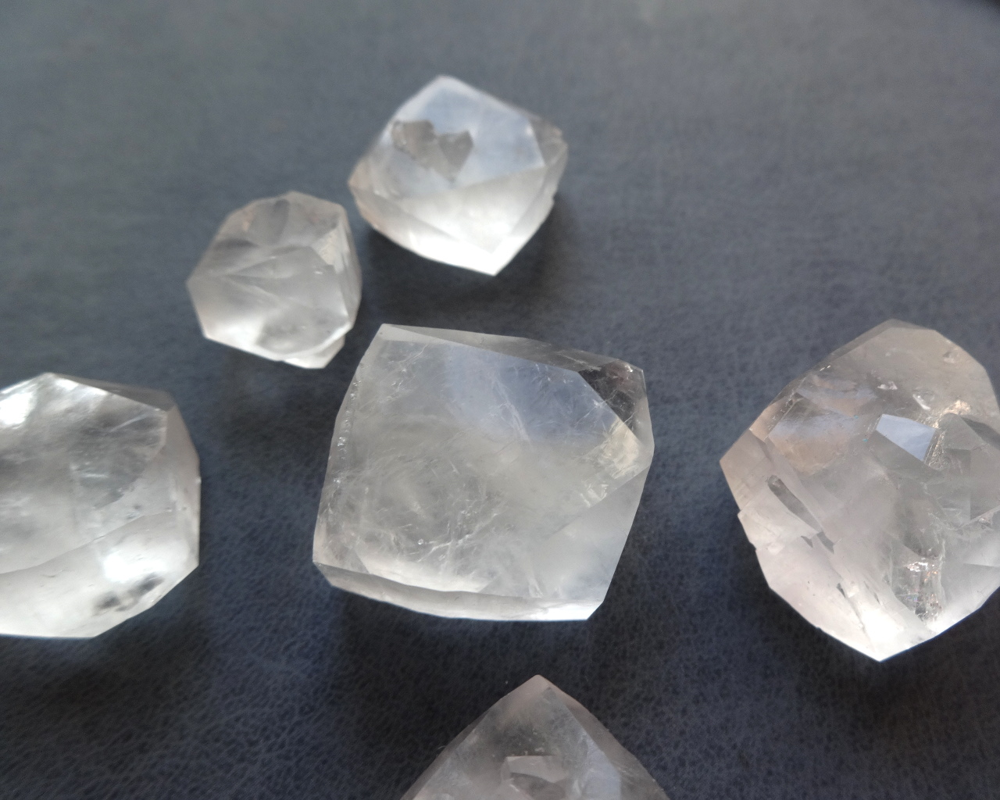
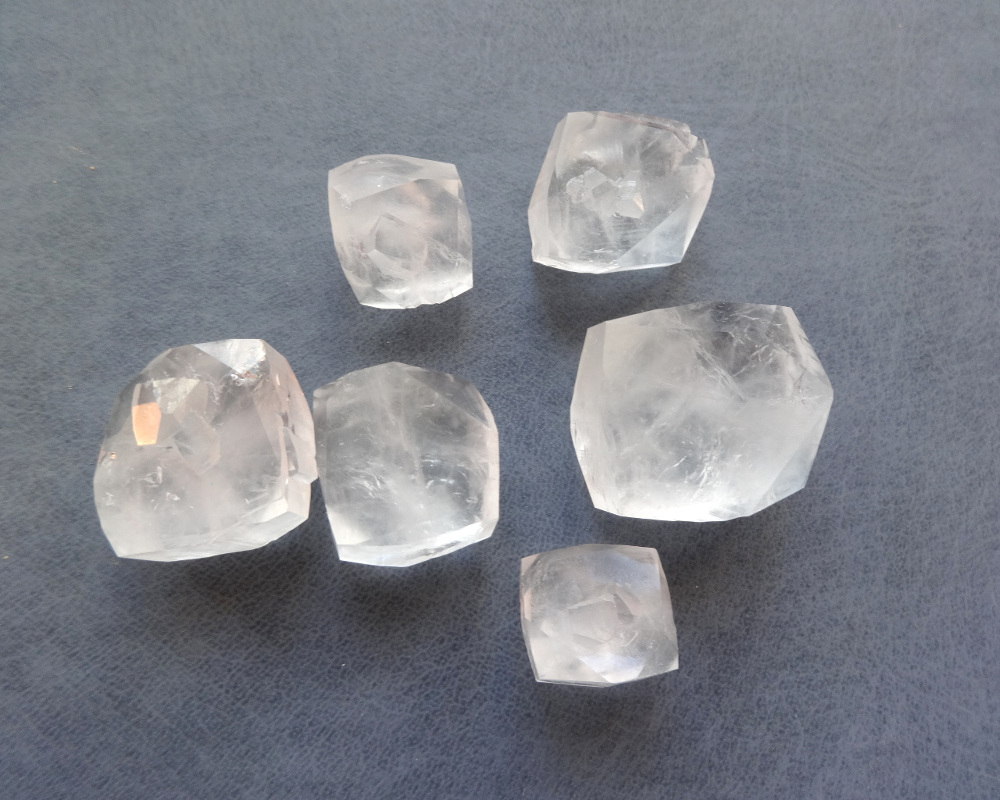
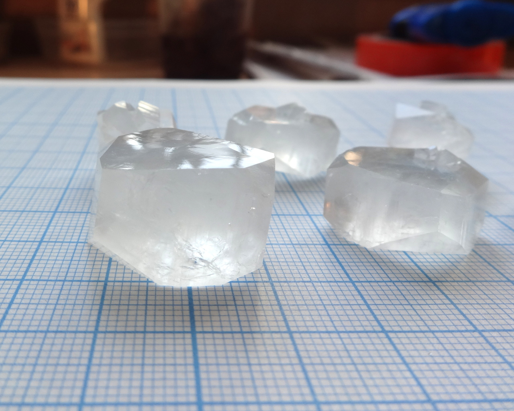
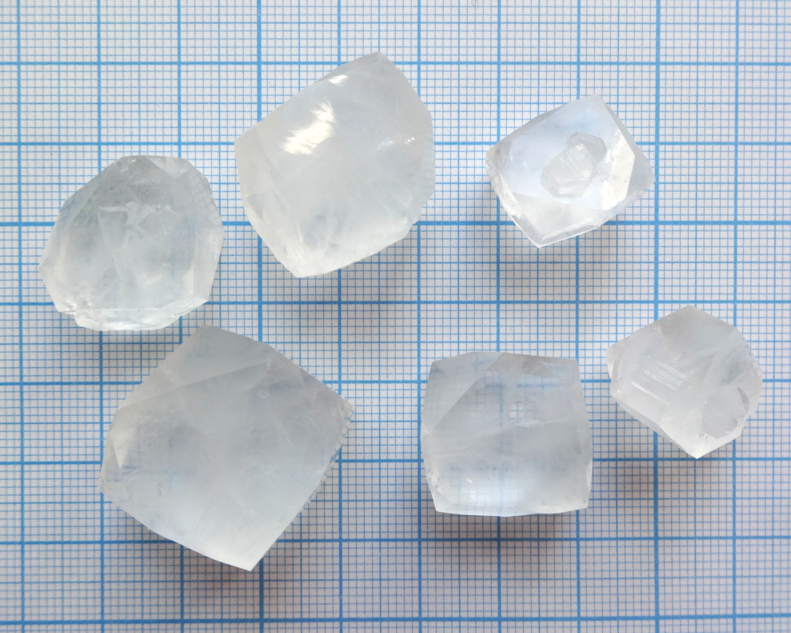
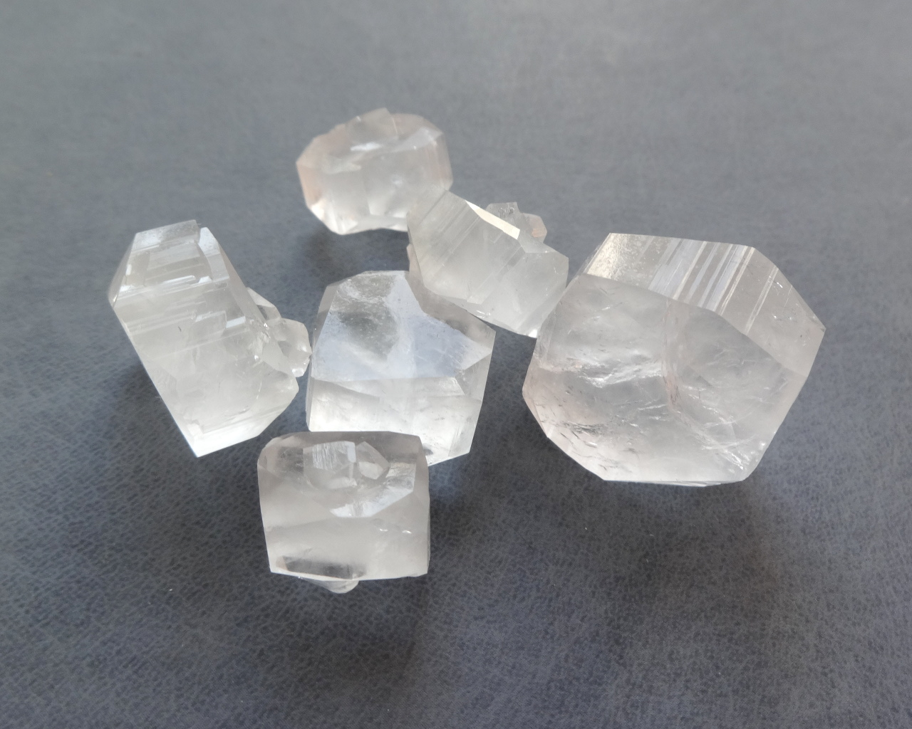
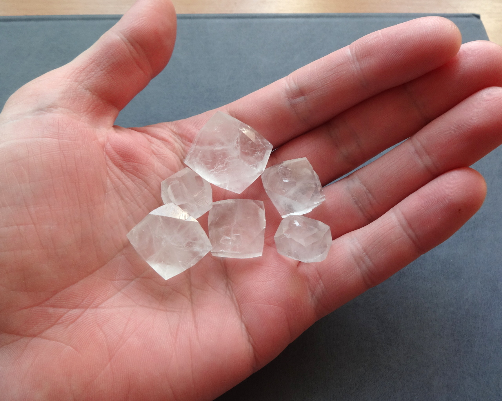
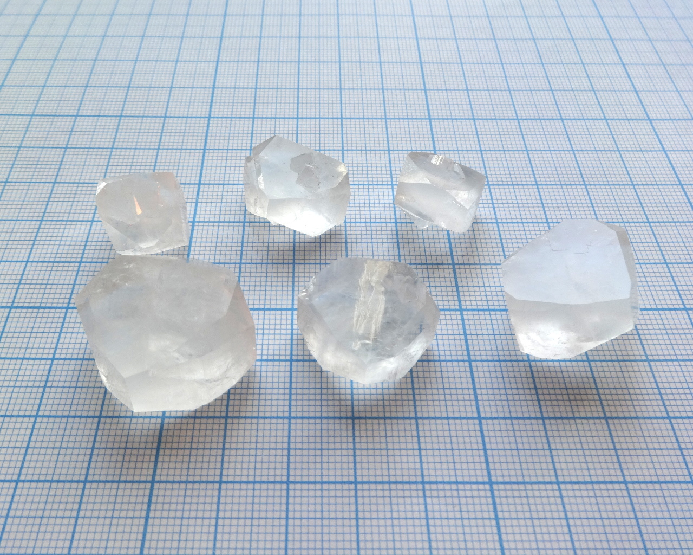

Artificial changoite, formula: \ce{Na2Zn(SO4)2*4H2O}

<!--more-->

Double sulfate of zinc and sodium. Natural variety of this compound is known as mineral [сhangoite](http://www.mindat.org/min-6861.html).

## Properties
* **Crystal system**: monoclinic.
* **Crystal shape**: tabular, with striations on sides
* **Stability on air**: stable
## Preparation
Dissolve equimolar amounts of sodium sulfate (usually \ce{Na2SO4*10H2O}) and zinc sulfate (\ce{ZnSO4*7H2O}) in water, then crystallize. The compound is very soluble, so water should barely cover solid salts.

## Growing
I used regular slow evaporation method. This copound has good solubility (my very rough guess - between 50 and 100 g per 100ml), so evaporation should not be too fast.

## Safety
Mostly safe, though in significant amounts zinc can be toxic.

## More photos

## References

* [My blog](http://dmishin.blogspot.com/2015/08/changoite-sodium-zinc-sulfate.html)
* [Mindat on Changoite](http://www.mindat.org/min-6861.html)
