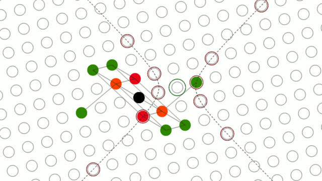
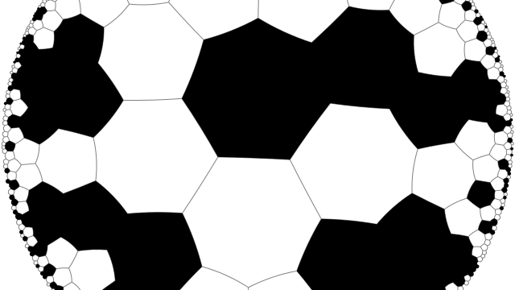
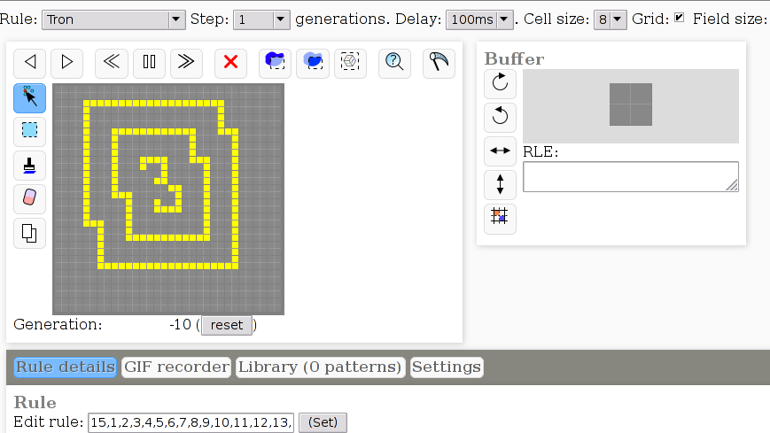
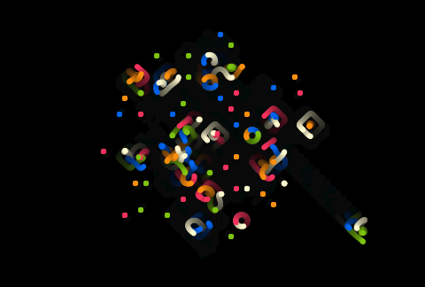
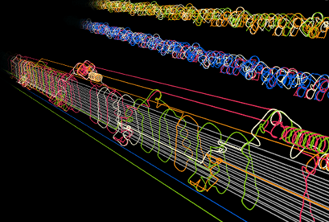
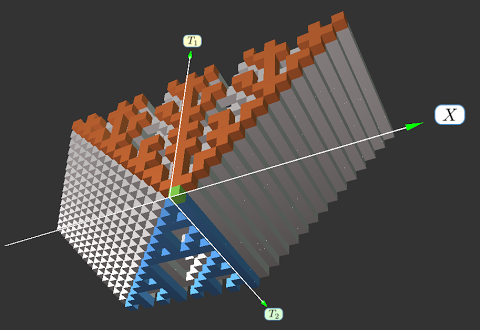

## [Minkovski plane cellular automata simulator](/minkovski-ca/index.html)

Simulator of [cellular automata](https://en.wikipedia.org/wiki/Cellular_automaton) that live on the [Minkovski plane](https://en.wikipedia.org/wiki/Minkowski_plane) - a pseudo-metric space, where the distance between two points is given by Δx²−Δy². It has hyperbolas instead of circles, and every cell has infinite number of neighbors. It is inspired by the "[Dichronauts](https://www.gregegan.net/DICHRONAUTS/DICHRONAUTS.html)" novel by Greg Egan.

## [Hyperbolic cellular automata simulator](/hyperbolic-ca-simulator/index.html)

Simulator of [cellular automata](https://en.wikipedia.org/wiki/Cellular_automaton), acting on an [regular tiling](https://en.wikipedia.org/wiki/Uniform_tilings_in_hyperbolic_plane)of the [hyperbolic plane](https://en.wikipedia.org/wiki/Hyperbolic_geometry).

It supports arbitrary large configurations of cells, limited only by available memory.

## [Reversible Cellular Automata Simulator](/js-revca/index.html)

Online (no installation needed) simulator of reversible cellular automata with Margolus neighborhood.
Blog posts:

* [Introduction to reversible cellular automata and simulator](http://dmishin.blogspot.com/2013/10/reversible-cellular-automata.html).
* [Single Rotation rule](http://dmishin.blogspot.com/2013/11/the-single-rotation-rule-remarkably.html): remarkably simple and rich rule.
* [Alternating rules and knightships](http://dmishin.blogspot.com/2014/06/alternating-rules-and-knightships.html)

## [Spaceships of the Single Rotation rule](/singlerot-spaceships/singlerot-spaceships.html)
Single Rotation is a simple reversible cellular automaton, that operates on a field with Margolus neighborhood. Random initial conditions in this rule produce lots of different spaceships, some of them are in this catalog.
See [blog post](#) for details.

## [Single Rotation cellular automaton with smooth interpolation](/singlerot-smooth/singlerot-smooth.html)

    
A simulator of the [Single Rotation](http://dmishin.blogspot.com/2013/11/the-single-rotation-rule-remarkably.html) cellular automaton, that tracks positions of the cells and uses Lancsoz interpolation to add an intermediate frames. Its primary purpose is a nice visual effect, for experimenting with reversible cellular automata see [online simulator](http://dmishin.github.io/js-revca/index.html?rule=0,2,8,3,1,5,6,7,4,9,10,11,12,13,14,15&step=8&frame_delay=100&size=64x64&cell_size=6,1&phase=0).

## [Reversible CA Collider](reversible-ca-collider.md)
A tool to automatically catalogize collisions of simple patterns in reversible cellular automata.

## [3D version of the Single Rotation simulator with smoothing](/singlerot-smooth/3d/singlerot-3d.html)

3-dimensonal version of the above application, using Web GL for visualization. It displays world lines of the moving cells, as a 3-dimensional curves.

* Sources: [github.com/dmishin/singlerot-smooth](https://github.com/dmishin/singlerot-smooth), in the "3d" folder.
* [Blog post](http://dmishin.blogspot.com/2015/01/3d-single-rotation.html)
* [Demonstration video](http://youtu.be/XX4igr8ufeA)

## [Reversible Cellular Automata applied to image](/image-revca/index.html)
What if block reversible cellular automaton rule is applied to a raster image? The effect might be curious.
This simulator lets you to watch the evolution of the image under reversible rule. The rule is:

- If a 2x2 block of pixeld contains 1 pixel of highly different color, then this block is rotated CV.

## [Simulator of cellular automata with 2 dimensions of time](/t2dca/2dca.html)

Simulate elementary cellular automata with 1 spatial and 2 temporal dimensions.
Simulation result is displayed as static 3d object, visualized with Tree.js.
See also [blog post](http://dmishin.blogspot.com/2014/06/cellular-automata-with-2-temporal.html) about it.

